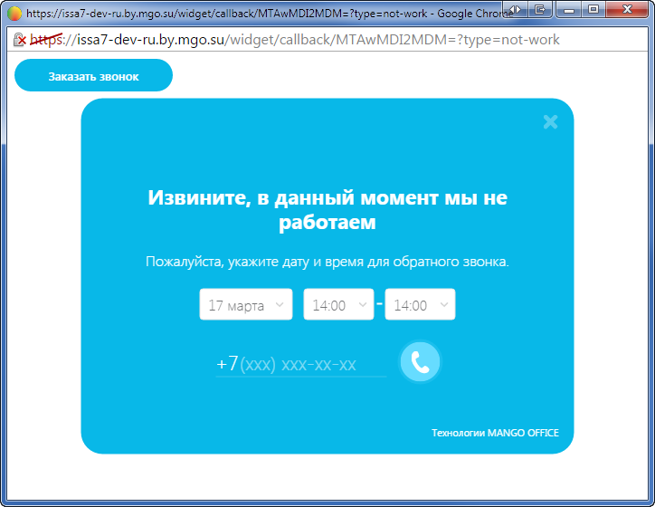

##### 4.2.3.3.6. Тест виджета

> Трассировка: PDF §4.2.3.3.6 · сквозные стр. 98 · источники: ч.1 `kb/sources/mango-lk-manual/LK_manual_v-125-1-280.pdf` с.98.

На каждой вкладке расположена ссылка «Тест виджета». Она используется для тестирования виджета согласно установленному расписанию и настройкам внешнего вида.

При нажатии ссылки виджет открывается в отдельном окне браузера. Нажмите на кнопку или ярлык для отображения виджета.

> **Описание иллюстрации LK-§4.2.3.3.6-1** (к §4.2.3.3.6 «Тест виджета», стр. 98; 724×560 px). Снимок экрана / схема Личного кабинета.
> Относится к тексту руководства: «…При нажатии ссылки виджет открывается в отдельном окне браузера. Нажмите на кнопку или ярлык для отображения виджета.».
> Текст на изображении (OCR, требует сверки): [© https://issa7-dev-ru.by.mgo.su/widget/callback/MTAwMDI2MDM=?type=not-work - Google Е [СЕ ей; 6х betps://issa7-dev-ru.by.mgo.su/widget/callback/MTAWMDI2MDM=?type=not-work; AA
