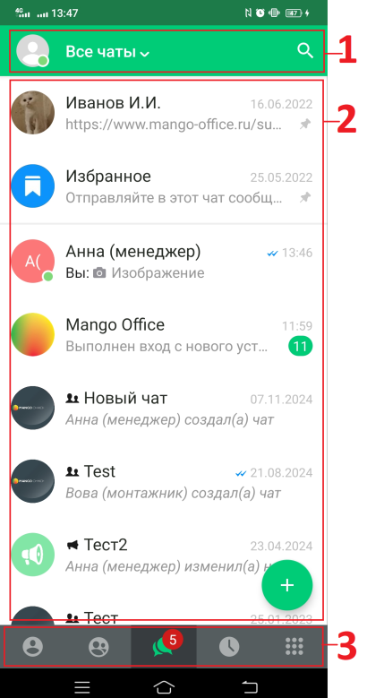

# Общее описание интерфейса

> Трассировка: PDF §— · сквозные стр. 9 · источники: ч.1 `kb/sources/mtalker/UserGuide_mTalker_4Mobile 11.06.26.pdf` с.9.

В окне программы отображаются следующие элементы интерфейса: 1) название активной закладки; 2) поле для отображения содержимого той или иной закладки. 3) основное меню с кнопками вызова закладок:

> **Описание иллюстрации MTALKER-MOB-05-1** · к разделу §0 «Общее описание интерфейса» · стр. 9 · пиктограмма (значок элемента интерфейса), 40×43 px.
> Относится к тексту руководства: «В окне программы отображаются следующие элементы интерфейса: 1) название активной закладки; 2) поле для отображения содержимого той или иной закладки. 3) основное меню с кнопками вызова закладок:»
> Следующий за иллюстрацией текст: «• - контакты;»
> Текста на изображении нет; назначение значка — см. текст, к которому он относится.

• - контакты;

> **Описание иллюстрации MTALKER-MOB-05-2** · к разделу §0 «Общее описание интерфейса» · стр. 9 · фрагмент интерфейса (кнопка, переключатель, поле или подпись), 85×63 px.
> Относится к тексту руководства: «• - контакты;»
> Следующий за иллюстрацией текст: «• - конференции;»

• - конференции;

> **Описание иллюстрации MTALKER-MOB-05-3** · к разделу §0 «Общее описание интерфейса» · стр. 9 · фрагмент интерфейса (кнопка, переключатель, поле или подпись), 90×58 px.
> Относится к тексту руководства: «• - конференции;»
> Следующий за иллюстрацией текст: «• - чаты;»

• - чаты;

> **Описание иллюстрации MTALKER-MOB-05-4** · к разделу §0 «Общее описание интерфейса» · стр. 9 · фрагмент интерфейса (кнопка, переключатель, поле или подпись), 79×53 px.
> Относится к тексту руководства: «• - чаты;»
> Следующий за иллюстрацией текст: «• - журнал вызовов;»

• - журнал вызовов;

> **Описание иллюстрации MTALKER-MOB-05-5** · к разделу §0 «Общее описание интерфейса» · стр. 9 · фрагмент интерфейса (кнопка, переключатель, поле или подпись), 84×81 px.
> Относится к тексту руководства: «• - журнал вызовов;»
> Следующий за иллюстрацией текст: «• - экранная клавиатура.»

• - экранная клавиатура.

> **Описание иллюстрации MTALKER-MOB-05-6** · к разделу §0 «Общее описание интерфейса» · стр. 9 · снимок экрана / схема, 410×779 px.
> Относится к тексту руководства: «• - экранная клавиатура.»
> Текст на изображении (OCR, требует сверки): 1 13:47; НО m+; $ Все чаты v; Иванов И.И.; nttps; ango; office.ru; Избранное; Отправляйте в это; ча; сообщ; Анна (менеджер); Вы: @ Изобра; ение; Mango Office; Bb; IONHEH вход с новог(; уст; 2: Новый чат; Анна (мене джер) создал(а; 2: Test; Вова (монтажник; оздал(а) чат; « Тест2; Анна (мен; 1жер) изменил(а] t; eee