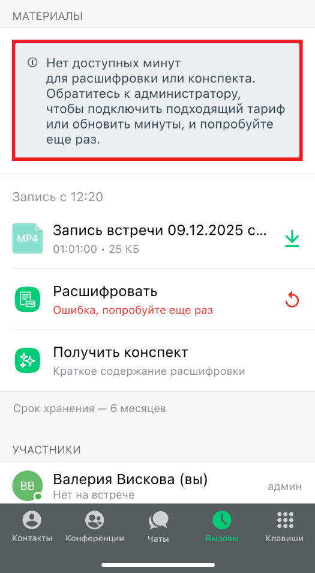
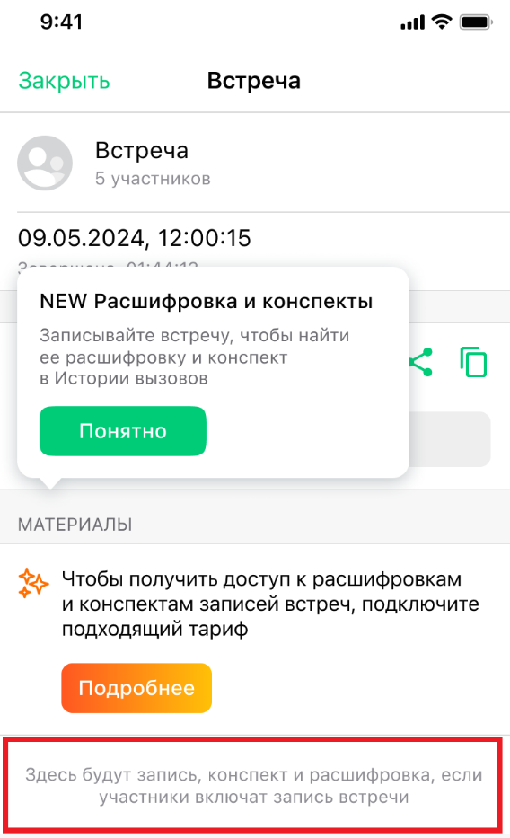
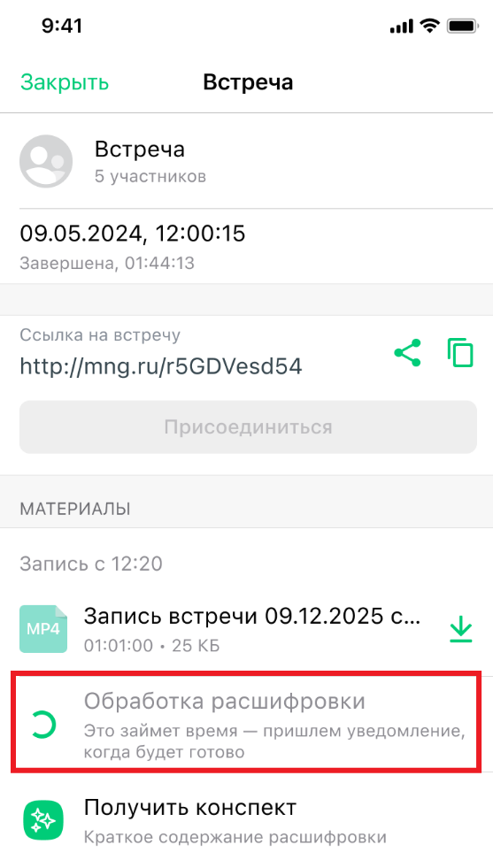
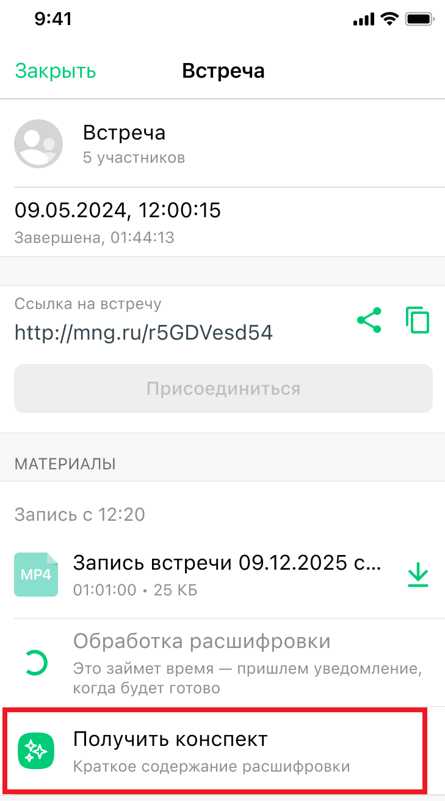
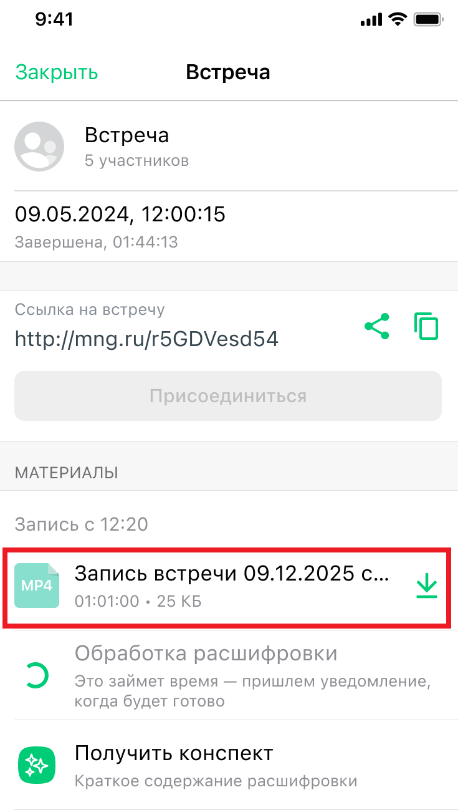
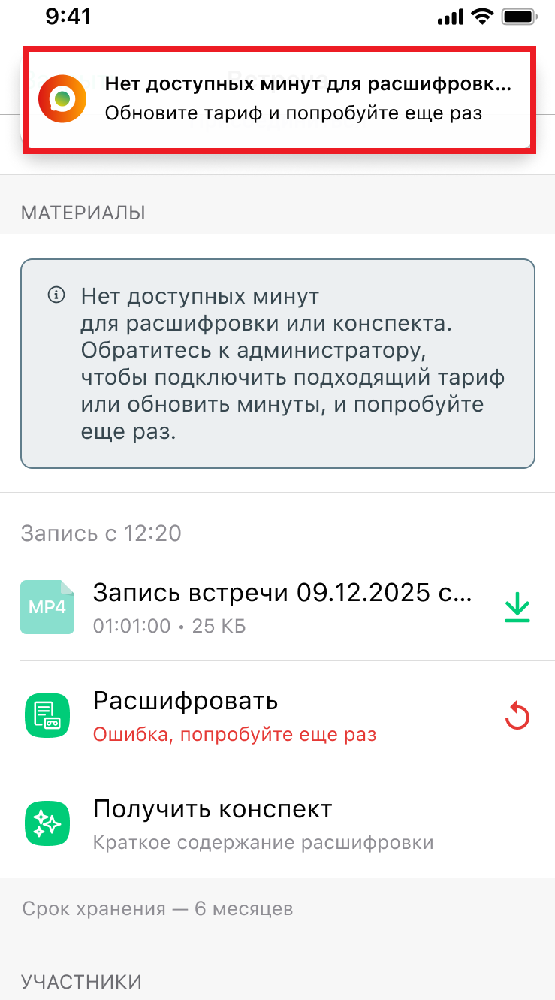

# Расшифровка и конспектирование записей встреч

> Трассировка: PDF §— · сквозные стр. 22-27 · источники: ч.1 `kb/sources/mtalker/UserGuide_mTalker_4Mobile 11.06.26.pdf` с.22-27.

Общие сведения Расшифровка позволяет преобразовать запись видеоконференции в текстовый формат. Конспектирование позволяет получить краткое содержание записи видеоконференции на основе расшифровки. Функции доступны пользователям, у которых подключена услуга “Групповая видеоконференция” и имеются доступные минуты для обработки записей. Если услуга не подключена Если услуга “Групповая видеоконференция” не подключена, в карточке видеоконференции отображается информационный блок с предложением подключить подходящий тариф. Для получения дополнительной информации нажмите кнопку Подробнее.

> **Описание иллюстрации MTALKER-MOB-30-1** · к разделу §0 «Расшифровка и конспектирование записей встреч» · стр. 22 · снимок экрана / схема, 525×954 px.
> Относится к тексту руководства: «…не подключена Если услуга “Групповая видеоконференция” не подключена, в карточке видеоконференции отображается информационный блок с предложением подключить подходящий тариф. Для получения дополнительной информации нажмите кнопку Подробнее.»
> Следующий за иллюстрацией текст: «Mango Talker для ОС Android. Руководство пользователя | Версия от 11.06.2026 Если запись отсутствует Если запись видеоконференции отсутствует, в карточке видеоконференции отображается сообщение: “Здес…»
> Текст на изображении (OCR, требует сверки): МАТЕРИАЛЫ; @ Нет доступных минут; для расшифровки или конспекта.; Обратитесь к администратору,; чтобы подключить подходящий тариф; или обновить минуты, и попробуйте; еще раз.; Запись с 12:20; Запись встречи 09.12.2025 с...; 01:01:00 . 25 КБ; Расшифровать; Ошибка, попробуйте еще раз; Получить конспект; Краткое содержание расшифровки; Срок хранения — 6 месяцев; УЧАСТНИКИ; ВВ; Валерия Вискова (вы); админ; Нет на встрече; eee; Контакты; Конференции; Чаты; Клавиши

Mango Talker для ОС Android. Руководство пользователя | Версия от 11.06.2026 Если запись отсутствует Если запись видеоконференции отсутствует, в карточке видеоконференции отображается сообщение: “Здесь будут запись, конспект и расшифровка, если участники включат запись встречи”.

> **Описание иллюстрации MTALKER-MOB-30-2** · к разделу §0 «Расшифровка и конспектирование записей встреч» · стр. 23 · снимок экрана / схема, 568×933 px.
> Относится к тексту руководства: «…о пользователя | Версия от 11.06.2026 Если запись отсутствует Если запись видеоконференции отсутствует, в карточке видеоконференции отображается сообщение: “Здесь будут запись, конспект и расшифровка, если участники включат запись встречи”.»
> Следующий за иллюстрацией текст: «Получение расшифровки Для получения расшифровки: 1. Откройте карточку видеоконференции. 2. Перейдите к блоку с материалами встречи. 3. Выберите запись видеоконференции. 4. Нажмите “Расшифровать“. Посл…»
> Текст на изображении (OCR, требует сверки): 9:41; ws oo; Закрыть; Встреча; 5 участников; 09.05.2024, 12:00:15; aoe; = NALA ALAN; NEW Расшифровка и конспекты; Записывайте встречу, чтобы найти; ее расшифровку и конспект; в Истории вызовов; МАТЕРИАЛЫ; a Чтобы получить доступ к расшифровкам; и конспектам записей встреч, подключите; подходящий тариф; Здесь будут запись, конспект и расшифровка, если; участники включат запись встречи

Получение расшифровки Для получения расшифровки: 1. Откройте карточку видеоконференции. 2. Перейдите к блоку с материалами встречи. 3. Выберите запись видеоконференции. 4. Нажмите “Расшифровать“. После отправки записи на обработку отображается статус выполнения операции. Mango Talker для ОС Android. Руководство пользователя | Версия от 11.06.2026

> **Описание иллюстрации MTALKER-MOB-30-3** · к разделу §0 «Расшифровка и конспектирование записей встреч» · стр. 24 · снимок экрана / схема, 557×972 px.
> Относится к тексту руководства: «… с материалами встречи. 3. Выберите запись видеоконференции. 4. Нажмите “Расшифровать“. После отправки записи на обработку отображается статус выполнения операции. Mango Talker для ОС Android. Руководство пользователя | Версия от 11.06.2026»
> Следующий за иллюстрацией текст: «Получение конспекта Для получения конспекта: 1. Откройте карточку видеоконференции. 2. Перейдите к блоку с материалами встречи. 3. Выберите запись видеоконференции. 4. Нажмите “Получить конспект“. Кон…»
> Текст на изображении (OCR, требует сверки): 9:41; Закрыть; Встреча; 5 участников; 09.05.2024, 12:00:15; Завершена, 01:44:13; Ссылка на встречу; http://mng.ru/r5GDVesd54; МАТЕРИАЛЫ; Запись с 12:20; Запись встречи 09.12.2025 с...; Vv; 01:01:00 . 25 KB; Обработка расшифровки; Это займет время — пришлем уведомление,; когда будет готово; Получить конспект; Краткое содержание расшифровки

Получение конспекта Для получения конспекта: 1. Откройте карточку видеоконференции. 2. Перейдите к блоку с материалами встречи. 3. Выберите запись видеоконференции. 4. Нажмите “Получить конспект“. Конспект формируется автоматически на основе расшифровки записи видеоконференции. Mango Talker для ОС Android. Руководство пользователя | Версия от 11.06.2026

> **Описание иллюстрации MTALKER-MOB-30-4** · к разделу §0 «Расшифровка и конспектирование записей встреч» · стр. 25 · снимок экрана / схема, 729×1309 px.
> Относится к тексту руководства: «…ами встречи. 3. Выберите запись видеоконференции. 4. Нажмите “Получить конспект“. Конспект формируется автоматически на основе расшифровки записи видеоконференции. Mango Talker для ОС Android. Руководство пользователя | Версия от 11.06.2026»
> Следующий за иллюстрацией текст: «Готовые материалы встречи После завершения обработки запись видеоконференции отображается в карточке видеоконференции и доступна для скачивания. Mango Talker для ОС Android. Руководство пользователя |…»
> Текст на изображении (OCR, требует сверки): 9:41; lS os; Закрыть; Встреча; 5 участников; 09.05.2024, 12:00:15; Завершена, 01:44:13; Ссылка на встречу; http://mng.ru/r5GDVesd54; МАТЕРИАЛЫ; Запись с 12:20; Запись встречи 09.12.2025 с...; Vv; Ga; 01:01:00 - 25 KB; Обработка расшифровки; Это займет время — пришлем уведомление,; когда будет готово; Получить конспект; Краткое содержание расшифровки

Готовые материалы встречи После завершения обработки запись видеоконференции отображается в карточке видеоконференции и доступна для скачивания. Mango Talker для ОС Android. Руководство пользователя | Версия от 11.06.2026

> **Описание иллюстрации MTALKER-MOB-30-5** · к разделу §0 «Расшифровка и конспектирование записей встреч» · стр. 26 · снимок экрана / схема, 735×1299 px.
> Относится к тексту руководства: «Готовые материалы встречи После завершения обработки запись видеоконференции отображается в карточке видеоконференции и доступна для скачивания. Mango Talker для ОС Android. Руководство пользователя | Версия от 11.06.2026»
> Следующий за иллюстрацией текст: «Недостаточно минут для обработки Если лимит минут для расшифровки или конспектирования исчерпан, при попытке запуска обработки отображается сообщение: “Нет доступных минут для расшифровки или конспект…»
> Текст на изображении (OCR, требует сверки): 9:41; lS os; Закрыть; Встреча; 5 участников; 09.05.2024, 12:00:15; Завершена, 01:44:13; Ссылка на встречу; http://mng.ru/r5GDVesd54; МАТЕРИАЛЫ; Запись с 12:20; Запись встречи 09.12.2025 с...; Vv; 01:01:00 - 25 KB; Обработка расшифровки; Это займет время — пришлем уведомление,; когда будет готово; Получить конспект; Краткое содержание расшифровки

Недостаточно минут для обработки Если лимит минут для расшифровки или конспектирования исчерпан, при попытке запуска обработки отображается сообщение: “Нет доступных минут для расшифровки или конспекта. Обратитесь к администратору, чтобы подключить подходящий тариф или обновить минуты, и попробуйте еще раз”. После увеличения лимита минут обработку можно запустить повторно. Mango Talker для ОС Android. Руководство пользователя | Версия от 11.06.2026

> **Описание иллюстрации MTALKER-MOB-30-6** · к разделу §0 «Расшифровка и конспектирование записей встреч» · стр. 27 · снимок экрана / схема, 739×1331 px.
> Относится к тексту руководства: «…ь к администратору, чтобы подключить подходящий тариф или обновить минуты, и попробуйте еще раз”. После увеличения лимита минут обработку можно запустить повторно. Mango Talker для ОС Android. Руководство пользователя | Версия от 11.06.2026»
> Текст на изображении (OCR, требует сверки): 9:41; ws а; Нет доступных минут для расшифровк; Обновите тариф и попробуйте еще раз; МАТЕРИАЛЫ; @ Нет доступных минут; для расшифровки или конспекта.; Обратитесь к администратору,; чтобы подключить подходящий тариф; или обновить минуты, и попробуйте; еще раз.; Запись с 12:20; Запись встречи 09.12.2025 с...; 01:01:00 . 25 KB; Расшифровать; Ошибка, попробуйте еще раз; Получить конспект; Краткое содержание расшифровки; Срок хранения — 6 месяцев; УЧАСТНИКИ