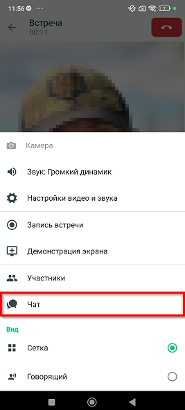
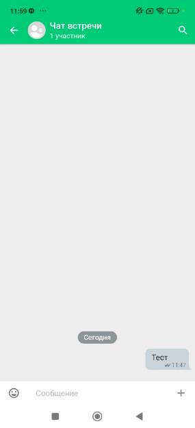
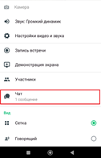

# Чат во время видеоконференции

> Трассировка: PDF §— · сквозные стр. 27-29 · источники: ч.1 `kb/sources/mtalker/UserGuide_mTalker_4Mobile 11.06.26.pdf` с.27-29.

Во время видеоконференции в MTalker доступен чат для обмена сообщениями между участниками. Чтобы открыть чат во время видеоконференции, в окне видеоконференции следует нажать

> **Описание иллюстрации MTALKER-MOB-31-1** · к разделу §0 «Чат во время видеоконференции» · стр. 27 · пиктограмма (значок элемента интерфейса), 54×40 px.
> Относится к тексту руководства: «Во время видеоконференции в MTalker доступен чат для обмена сообщениями между участниками. Чтобы открыть чат во время видеоконференции, в окне видеоконференции следует нажать»
> Следующий за иллюстрацией текст: «кнопку , затем нажать на пункт “Чат”. Будет открыто окно чата встречи. Mango Talker для ОС Android. Руководство пользователя | Версия от 11.06.2026»
> Текста на изображении нет; назначение значка — см. текст, к которому он относится.

кнопку , затем нажать на пункт “Чат”. Будет открыто окно чата встречи. Mango Talker для ОС Android. Руководство пользователя | Версия от 11.06.2026

> **Описание иллюстрации MTALKER-MOB-31-2** · к разделу §0 «Чат во время видеоконференции» · стр. 28 · снимок экрана / схема, 267×592 px.
> Относится к тексту руководства: «кнопку , затем нажать на пункт “Чат”. Будет открыто окно чата встречи. Mango Talker для ОС Android. Руководство пользователя | Версия от 11.06.2026»
> Следующий за иллюстрацией текст: «В чате вы можете: • отправлять текстовые сообщения; • отправлять изображения, ссылки и файлы; • отвечать на сообщения; • удалять отправленные сообщения.»
> Текст на изображении (OCR, требует сверки): дас»; Камера; Звук: Громкий динамик; Настройки видео и звука; Запись встречи; Демонстрация экрана; oo; Участники; Чат; Вид; as; os; Сетка; Говорящий

В чате вы можете: • отправлять текстовые сообщения; • отправлять изображения, ссылки и файлы; • отвечать на сообщения; • удалять отправленные сообщения.

> **Описание иллюстрации MTALKER-MOB-31-3** · к разделу §0 «Чат во время видеоконференции» · стр. 28 · снимок экрана / схема, 285×625 px.
> Относится к тексту руководства: «В чате вы можете: • отправлять текстовые сообщения; • отправлять изображения, ссылки и файлы; • отвечать на сообщения; • удалять отправленные сообщения.»
> Следующий за иллюстрацией текст: «При поступлении нового сообщения на кнопке чата отображается индикатор новых сообщений . Mango Talker для ОС Android. Руководство пользователя | Версия от 11.06.2026»
> Текст на изображении (OCR, требует сверки): Чат встречи; 1 участник; ль; Сообщение

При поступлении нового сообщения на кнопке чата отображается индикатор новых сообщений . Mango Talker для ОС Android. Руководство пользователя | Версия от 11.06.2026

> **Описание иллюстрации MTALKER-MOB-31-4** · к разделу §0 «Чат во время видеоконференции» · стр. 29 · снимок экрана / схема, 126×196 px.
> Относится к тексту руководства: «При поступлении нового сообщения на кнопке чата отображается индикатор новых сообщений . Mango Talker для ОС Android. Руководство пользователя | Версия от 11.06.2026»
> Следующий за иллюстрацией текст: «Примечание. Чат видеоконференции является временным и не отображается в списке чатов MTalker.»

Примечание. Чат видеоконференции является временным и не отображается в списке чатов MTalker.
