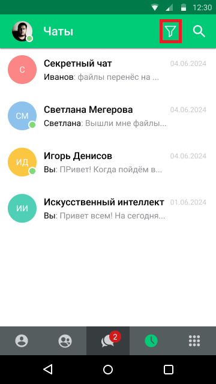
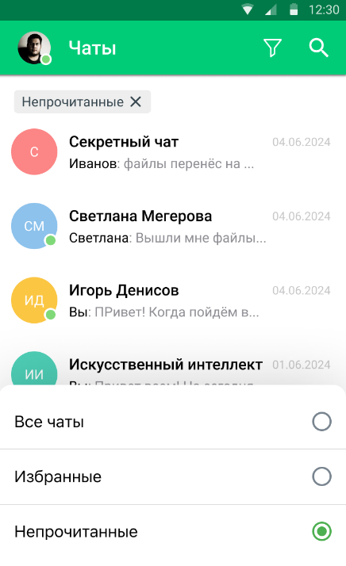

# Фильтр чатов по непрочитанным сообщениям

> Трассировка: PDF §— · сквозные стр. 32-34 · источники: ч.1 `kb/sources/mtalker/UserGuide_mTalker_4Mobile 11.06.26.pdf` с.32-34.

В MTalker вы можете отфильтровать список чатов по наличию непрочитанных сообщений. Доступны следующие варианты отображения: • Все чаты — отображаются все чаты пользователя; • Непрочитанные — отображаются только чаты, в которых есть непрочитанные сообщения. Чтобы включить фильтр по непрочитанным сообщениям, на закладке “Чаты” следует: Mango Talker для ОС Android. Руководство пользователя | Версия от 11.06.2026

> **Описание иллюстрации MTALKER-MOB-41-1** · к разделу §0 «Фильтр чатов по непрочитанным сообщениям» · стр. 33 · пиктограмма (значок элемента интерфейса), 24×25 px.
> Относится к тексту руководства: «… • Непрочитанные — отображаются только чаты, в которых есть непрочитанные сообщения. Чтобы включить фильтр по непрочитанным сообщениям, на закладке “Чаты” следует: Mango Talker для ОС Android. Руководство пользователя | Версия от 11.06.2026»
> Следующий за иллюстрацией текст: «1. нажать на кнопку фильтра в верхней части экрана;»
> Текста на изображении нет; назначение значка — см. текст, к которому он относится.

1. нажать на кнопку фильтра в верхней части экрана;

> **Описание иллюстрации MTALKER-MOB-41-2** · к разделу §0 «Фильтр чатов по непрочитанным сообщениям» · стр. 33 · снимок экрана / схема, 360×640 px.
> Относится к тексту руководства: «1. нажать на кнопку фильтра в верхней части экрана;»
> Следующий за иллюстрацией текст: «2. в открывшемся списке выбрать пункт “Непрочитанные”.»
> Текст на изображении (OCR, требует сверки): Секретный чат; Иванов: фа; et; Светлана Мегерова; Светлана: Вышли мн; pavnt; Игорь Денисов; Вы: П; Искусственный интеллект; Вы: Прив; ем; дня; eee; eco

2. в открывшемся списке выбрать пункт “Непрочитанные”.

> **Описание иллюстрации MTALKER-MOB-41-3** · к разделу §0 «Фильтр чатов по непрочитанным сообщениям» · стр. 33 · снимок экрана / схема, 436×714 px.
> Относится к тексту руководства: «2. в открывшемся списке выбрать пункт “Непрочитанные”.»
> Следующий за иллюстрацией текст: «Будут показаны только чаты, в которых есть непрочитанные сообщения. Чтобы снова отобразить все чаты, на закладке “Чаты” следует:»
> Текст на изображении (OCR, требует сверки): 12:30; Чаты; Непрочитанные X; Секретный чат; Иванов: файлы перенёс на...; Светлана Мегерова; Светлана: Вышли мне файлы; Игорь Денисов; Вы: ПРивет! Когда пойдём B..; Искусственный интеллект; ЕН:; ее; Все чаты; Избранные; Непрочитанные

Будут показаны только чаты, в которых есть непрочитанные сообщения. Чтобы снова отобразить все чаты, на закладке “Чаты” следует:

<!-- изображение на стр. 33: байты не извлечены (PyMuPDF недоступен) -->

1. нажать на кнопку фильтра ; 2. в открывшемся списке выбрать пункт “Все чаты”. Будут показаны все чаты пользователя. Mango Talker для ОС Android. Руководство пользователя | Версия от 11.06.2026 Примечание. Список чатов сортируется по дате последнего сообщения в соответствии с текущей логикой приложения. При прочтении сообщений в чате, такой чат автоматически исчезает из списка “Непрочитанные”.
