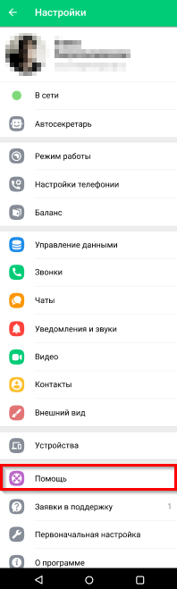
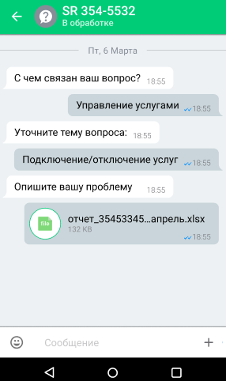
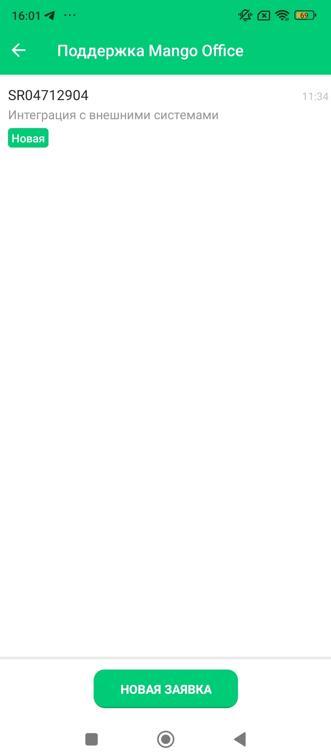
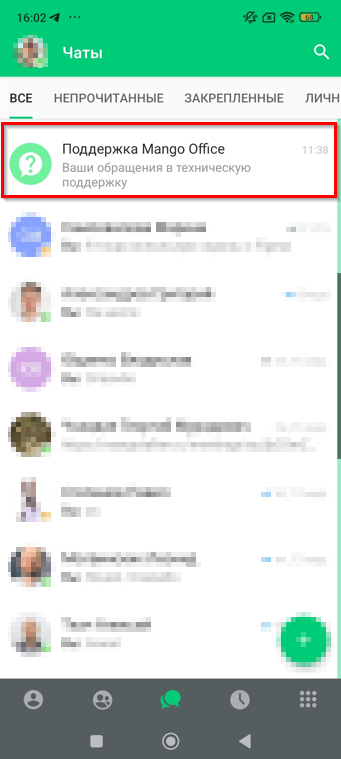

# Работа с техподдержкой

> Трассировка: PDF §— · сквозные стр. 35-40 · источники: ч.1 `kb/sources/mtalker/UserGuide_mTalker_4Mobile 11.06.26.pdf` с.35-40.

Вы можете создавать заявки в техническую поддержку и получать ответы на них в чате. Mango Talker для ОС Android. Руководство пользователя | Версия от 11.06.2026 Открытие раздела техподдержки Для того чтобы открыть раздел с заявками в техподдержку, в MTalker следует: 1. перейти в раздел “Профиль”; 2. выбрать пункт “Помощь”.

> **Описание иллюстрации MTALKER-MOB-45-1** · к разделу §0 «Работа с техподдержкой» · стр. 36 · снимок экрана / схема, 198×659 px.
> Относится к тексту руководства: «…Mango Talker для ОС Android. Руководство пользователя | Версия от 11.06.2026 Открытие раздела техподдержки Для того чтобы открыть раздел с заявками в техподдержку, в MTalker следует: 1. перейти в раздел “Профиль”; 2. выбрать пункт “Помощь”.»
> Следующий за иллюстрацией текст: «Список заявок В списке заявок отображаются:  номер заявки;  категория обращения;  статус заявки;  дата последнего обновления;  наличие новых сообщений. Mango Talker для ОС Android. Руководство по…»
> Текст на изображении (OCR, требует сверки): a сш шота; В сети; ‘Автосекретарь; Режим работы; Настройки телефонии; Баланс; Управление данными; Звонки; Чаты; Уведомления и звуки; Видео; Контакты; Внешний вид; Устройства; Заявки в поддержку; Первоначальная настройка; О программе

Список заявок В списке заявок отображаются:  номер заявки;  категория обращения;  статус заявки;  дата последнего обновления;  наличие новых сообщений. Mango Talker для ОС Android. Руководство пользователя | Версия от 11.06.2026 Если заявки отсутствуют, будет показано сообщение “Здесь появятся ваши заявки в техническую поддержку”. Для создания новой заявки нажмите кнопку “Новая заявка”.

> **Описание иллюстрации MTALKER-MOB-45-2** · к разделу §0 «Работа с техподдержкой» · стр. 37 · снимок экрана / схема, 197×451 px.
> Относится к тексту руководства: «…й. Mango Talker для ОС Android. Руководство пользователя | Версия от 11.06.2026 Если заявки отсутствуют, будет показано сообщение “Здесь появятся ваши заявки в техническую поддержку”. Для создания новой заявки нажмите кнопку “Новая заявка”.»
> Следующий за иллюстрацией текст: «Создание заявки Для того чтобы создать заявку, в разделе “Поддержка Mango Talker” следует: 1. нажать кнопку “Новая заявка”; 2. выбрать категорию обращения; 3. выбрать тему вопроса; 4. ввести текст соо…»
> Текст на изображении (OCR, требует сверки): SR 354-5532; Вы:; ce; [2 обриботье]; [3экрыте]; 58 354-5532; [Hosen; [Зэкрыте]; [oes]; 40 0

Создание заявки Для того чтобы создать заявку, в разделе “Поддержка Mango Talker” следует: 1. нажать кнопку “Новая заявка”; 2. выбрать категорию обращения; 3. выбрать тему вопроса; 4. ввести текст сообщения с описанием проблемы; 5. при необходимости прикрепить файл или изображение; 6. нажать кнопку отправки сообщения. Mango Talker для ОС Android. Руководство пользователя | Версия от 11.06.2026

> **Описание иллюстрации MTALKER-MOB-45-3** · к разделу §0 «Работа с техподдержкой» · стр. 38 · снимок экрана / схема, 286×482 px.
> Относится к тексту руководства: «…3. выбрать тему вопроса; 4. ввести текст сообщения с описанием проблемы; 5. при необходимости прикрепить файл или изображение; 6. нажать кнопку отправки сообщения. Mango Talker для ОС Android. Руководство пользователя | Версия от 11.06.2026»
> Следующий за иллюстрацией текст: «7. После отправки сообщения будет создана заявка в техническую поддержку с уникальным номером.»
> Текст на изображении (OCR, требует сверки): SR 354-5532; В обработке; С чем связан ваш вопрос?; Управление услугами __; Уточните тему вопроса:; Подключение/отключение услуг; Опишите вашу проблему; ь.х!5х; (в) отчет_35453345...апрел

7. После отправки сообщения будет создана заявка в техническую поддержку с уникальным номером.

> **Описание иллюстрации MTALKER-MOB-45-4** · к разделу §0 «Работа с техподдержкой» · стр. 38 · снимок экрана / схема, 543×66 px.
> Относится к тексту руководства: «7. После отправки сообщения будет создана заявка в техническую поддержку с уникальным номером.»
> Следующий за иллюстрацией текст: «Mango Talker для ОС Android. Руководство пользователя | Версия от 11.06.2026 Уведомления При изменении статуса заявки или получении ответа от технической поддержки отображается уведомление. Если уведо…»
> Текст на изображении (OCR, требует сверки): Спасибо за ваше обращение. Ваша заявка 504712904 создана. Наша; служба поддержки проверит заявку и постарается ответить; максимально быстро.

Mango Talker для ОС Android. Руководство пользователя | Версия от 11.06.2026 Уведомления При изменении статуса заявки или получении ответа от технической поддержки отображается уведомление. Если уведомления отключены, наличие новых сообщений отображается в списке заявок.

> **Описание иллюстрации MTALKER-MOB-45-5** · к разделу §0 «Работа с техподдержкой» · стр. 39 · снимок экрана / схема, 331×756 px.
> Относится к тексту руководства: «…ководство пользователя | Версия от 11.06.2026 Уведомления При изменении статуса заявки или получении ответа от технической поддержки отображается уведомление. Если уведомления отключены, наличие новых сообщений отображается в списке заявок.»
> Следующий за иллюстрацией текст: «Mango Talker для ОС Android. Руководство пользователя | Версия от 11.06.2026 Чат “Поддержка Mango Talker” В разделе “Чаты” отображается чат “Поддержка Mango Talker”. Для того чтобы открыть список заяв…»
> Текст на изображении (OCR, требует сверки): Поддержка Mango Office; $R04712904; 11:34; Интеграция с внешними системами

Mango Talker для ОС Android. Руководство пользователя | Версия от 11.06.2026 Чат “Поддержка Mango Talker” В разделе “Чаты” отображается чат “Поддержка Mango Talker”. Для того чтобы открыть список заявок, в разделе “Чаты” следует: 1. найти чат “Поддержка Mango Talker”; 2. нажать на строку с названием чата; 3. будет открыт список созданных вами заявок.

> **Описание иллюстрации MTALKER-MOB-45-6** · к разделу §0 «Работа с техподдержкой» · стр. 40 · снимок экрана / схема, 341×759 px.
> Относится к тексту руководства: «…еле “Чаты” отображается чат “Поддержка Mango Talker”. Для того чтобы открыть список заявок, в разделе “Чаты” следует: 1. найти чат “Поддержка Mango Talker”; 2. нажать на строку с названием чата; 3. будет открыт список созданных вами заявок.»
> Текст на изображении (OCR, требует сверки): Е / Чаты; ВСЕ; НЕПРОЧИТАННЫЕ; ЗАКРЕПЛЕННЫЕ; личн; Поддержка Mango Office; Xt; еску!; щения E; де; eco oe Boo; ри ши ee]; ao som on a; mos ша; ии; eee; oO