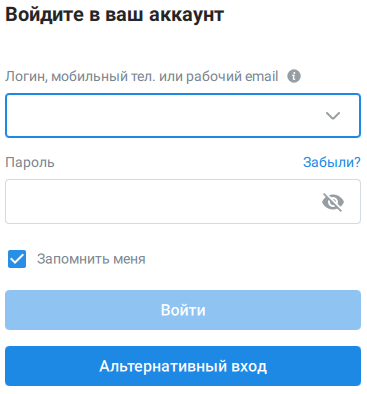

# 3.5. Вход через браузер

> Трассировка: PDF §3.5 · сквозные стр. 27-29 · источники: ч.1 `kb/sources/mtalker/UserGuide_Windows_mTalker_ch1_Working.11.06.26.pdf` с.27-29.

Вы можете войти в MTalker через браузер с использованием альтернативного способа авторизации. В этом случае вход выполняется на странице авторизации, которая открывается в системном браузере вашего компьютера. Чтобы войти через браузер, в окне входа в MTalker необходимо нажать кнопку «Альтернативный вход».

> **Описание иллюстрации MTALKER-WORK-§3.5-1** · к разделу §3.5 «Вход через браузер» · стр. 27 · снимок экрана / схема, 367×394 px.
> Относится к тексту руководства: «…вного способа авторизации. В этом случае вход выполняется на странице авторизации, которая открывается в системном браузере вашего компьютера. Чтобы войти через браузер, в окне входа в MTalker необходимо нажать кнопку «Альтернативный вход».»
> Следующий за иллюстрацией текст: «В открывшемся окне «Добро пожаловать в Mango Talker» выбрать способ входа: «С паролем» или «С кодом». После успешной авторизации данные учетной записи могут быть сохранены в браузере. В этом случае пр…»
> Текст на изображении (OCR, требует сверки): Войдите в ваш аккаунт; Логин, мобильный тел. или рабочий email @; Пароль; Забыли?; Запомнить меня

В открывшемся окне «Добро пожаловать в Mango Talker» выбрать способ входа: «С паролем» или «С кодом». После успешной авторизации данные учетной записи могут быть сохранены в браузере. В этом случае при последующих входах пользователю не потребуется повторно вводить логин и пароль — достаточно выбрать сохраненную учетную запись. Mango Talker для сред ОС Windows и Mac. Руководство пользователя | Версия от 11.06.2026

> **Описание иллюстрации MTALKER-WORK-§3.5-2** · к разделу §3.5 «Вход через браузер» · стр. 28 · снимок экрана / схема, 392×289 px.
> Относится к тексту руководства: «…узере. В этом случае при последующих входах пользователю не потребуется повторно вводить логин и пароль — достаточно выбрать сохраненную учетную запись. Mango Talker для сред ОС Windows и Mac. Руководство пользователя | Версия от 11.06.2026»
> Следующий за иллюстрацией текст: «Если сохраненные учетные записи отсутствуют, в поле «Логин, почта или телефон» введите номер мобильного телефона либо адрес электронной почты.»
> Текст на изображении (OCR, требует сверки): © MANGO OFFICE; Выберите учетную запись; Boi Sea eels Linnie в; Добавить учетную запись

Если сохраненные учетные записи отсутствуют, в поле «Логин, почта или телефон» введите номер мобильного телефона либо адрес электронной почты.

> **Описание иллюстрации MTALKER-WORK-§3.5-3** · к разделу §3.5 «Вход через браузер» · стр. 28 · снимок экрана / схема, 386×446 px.
> Относится к тексту руководства: «Если сохраненные учетные записи отсутствуют, в поле «Логин, почта или телефон» введите номер мобильного телефона либо адрес электронной почты.»
> Следующий за иллюстрацией текст: «Mango Talker для сред ОС Windows и Mac. Руководство пользователя | Версия от 11.06.2026 Выполнить один из следующих действий:  Если выбран способ «С паролем», ввести пароль в поле «Пароль» и нажать к…»
> Текст на изображении (OCR, требует сверки): « MANGO OFFICE; Добро пожаловать в Mango Talker; С паролем; С кодом; Логин, почта или телефон (2); Пароль; Забыли пароль?

Mango Talker для сред ОС Windows и Mac. Руководство пользователя | Версия от 11.06.2026 Выполнить один из следующих действий:  Если выбран способ «С паролем», ввести пароль в поле «Пароль» и нажать кнопку «Войти»;  Если выбран способ «С кодом», получить короткий код и ввести его в соответствующее поле. После успешной проверки данных будет выполнен вход в MTalker.
