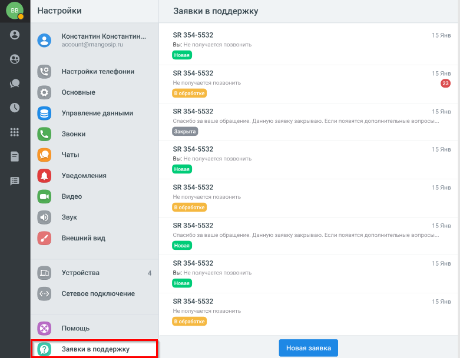
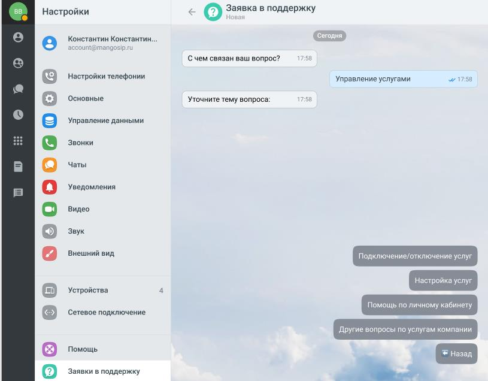
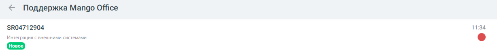
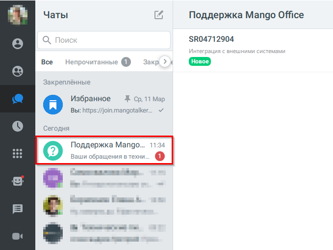

# 4.17. Работа с техподдержкой

> Трассировка: PDF §4.17 · сквозные стр. 43-48 · источники: ч.1 `kb/sources/mtalker/UserGuide_Windows_mTalker_ch1_Working.11.06.26.pdf` с.43-48.

Вы можете создавать заявки в техническую поддержку и получать ответы на них в чате. Переход в раздел техподдержки Для того чтобы открыть раздел с заявками в техподдержку, в MTalker следует: 1. перейти в раздел “Профиль”; 2. выбрать пункт “Заявки в поддержку”; 3. будет открыт список ваших заявок в техническую поддержку. Mango Talker для сред ОС Windows и Mac. Руководство пользователя | Версия от 11.06.2026

> **Описание иллюстрации MTALKER-WORK-§4.17-1** · к разделу §4.17 «Работа с техподдержкой» · стр. 44 · снимок экрана / схема, 781×609 px.
> Относится к тексту руководства: «…у, в MTalker следует: 1. перейти в раздел “Профиль”; 2. выбрать пункт “Заявки в поддержку”; 3. будет открыт список ваших заявок в техническую поддержку. Mango Talker для сред ОС Windows и Mac. Руководство пользователя | Версия от 11.06.2026»
> Следующий за иллюстрацией текст: «Список заявок В списке заявок отображаются:  номер заявки;  категория обращения;  статус заявки;  дата последнего обновления;  наличие новых сообщений. Если заявки отсутствуют, будет показано соо…»
> Текст на изображении (OCR, требует сверки): BB; Настройки; Заявки в поддержку; Константин Константин...; SR 354-5532; account; mangosip.ru; Вы:; Настройки телефонии; sk 354-5532; Основные; [= Управление данными; se; Звонки; Закрыта; JHB; Чаты; [ Уведомления; [= Видео; Звук; Внешний вид; Устройства; Сетевое подключение; Помощь

Список заявок В списке заявок отображаются:  номер заявки;  категория обращения;  статус заявки;  дата последнего обновления;  наличие новых сообщений. Если заявки отсутствуют, будет показано сообщение “Здесь появятся ваши заявки в техническую поддержку”. Mango Talker для сред ОС Windows и Mac. Руководство пользователя | Версия от 11.06.2026

> **Описание иллюстрации MTALKER-WORK-§4.17-2** · к разделу §4.17 «Работа с техподдержкой» · стр. 45 · снимок экрана / схема, 505×608 px.
> Относится к тексту руководства: «…оследнего обновления;  наличие новых сообщений. Если заявки отсутствуют, будет показано сообщение “Здесь появятся ваши заявки в техническую поддержку”. Mango Talker для сред ОС Windows и Mac. Руководство пользователя | Версия от 11.06.2026»
> Следующий за иллюстрацией текст: «Как создать заявку Для того чтобы создать заявку, в разделе “Поддержка Mango Talker” следует: 1. нажать кнопку “Новая заявка”; 2. выбрать категорию обращения; 3. выбрать тему вопроса; 4. ввести текст …»
> Текст на изображении (OCR, требует сверки): Заявки в поддержку; SR 354-5532; 15 Янв; Вы: Не получается позвонить; Не получается позвонить; Спасибо за ваше обращение. Данную заявку закрываю. Если появятся дополнительные вопросы...; тке; аботке

Как создать заявку Для того чтобы создать заявку, в разделе “Поддержка Mango Talker” следует: 1. нажать кнопку “Новая заявка”; 2. выбрать категорию обращения; 3. выбрать тему вопроса; 4. ввести текст сообщения с описанием проблемы; 5. при необходимости прикрепить файл или изображение; 6. нажать Enter для отправки сообщения; Mango Talker для сред ОС Windows и Mac. Руководство пользователя | Версия от 11.06.2026

> **Описание иллюстрации MTALKER-WORK-§4.17-3** · к разделу §4.17 «Работа с техподдержкой» · стр. 46 · снимок экрана / схема, 815×636 px.
> Относится к тексту руководства: «…у вопроса; 4. ввести текст сообщения с описанием проблемы; 5. при необходимости прикрепить файл или изображение; 6. нажать Enter для отправки сообщения; Mango Talker для сред ОС Windows и Mac. Руководство пользователя | Версия от 11.06.2026»
> Следующий за иллюстрацией текст: «7. после отправки сообщения будет создана заявка в техническую поддержку с уникальным номером.»
> Текст на изображении (OCR, требует сверки): 88; Настройки; р © Заявка в поддержку; Е MORE TAH TMH:; un; nar; С чем связан ваш вопрос?; Настройки телефонии; Управление услугами; w 17:58; Основные; Уточните тему вопроса:; 58; Управление данными; Звонки; Чаты; Уведомления; Видео; Звук; Внешний вид; Устройства; Сетевое подключение; Помощь; Заявки в поддержку

7. после отправки сообщения будет создана заявка в техническую поддержку с уникальным номером.

> **Описание иллюстрации MTALKER-WORK-§4.17-4** · к разделу §4.17 «Работа с техподдержкой» · стр. 46 · снимок экрана / схема, 543×66 px.
> Относится к тексту руководства: «7. после отправки сообщения будет создана заявка в техническую поддержку с уникальным номером.»
> Следующий за иллюстрацией текст: «Уведомления При изменении статуса заявки или получении ответа от технической поддержки отображается уведомление. Если уведомления отключены, наличие новых сообщений отображается в списке заявок.»
> Текст на изображении (OCR, требует сверки): Спасибо за ваше обращение. Ваша заявка 504712904 создана. Наша; служба поддержки проверит заявку и постарается ответить; максимально быстро.

Уведомления При изменении статуса заявки или получении ответа от технической поддержки отображается уведомление. Если уведомления отключены, наличие новых сообщений отображается в списке заявок.

> **Описание иллюстрации MTALKER-WORK-§4.17-5** · к разделу §4.17 «Работа с техподдержкой» · стр. 46 · снимок экрана / схема, 1228×134 px.
> Относится к тексту руководства: «Уведомления При изменении статуса заявки или получении ответа от технической поддержки отображается уведомление. Если уведомления отключены, наличие новых сообщений отображается в списке заявок.»
> Следующий за иллюстрацией текст: «Чат “Поддержка Mango Talker” В разделе “Чаты” отображается чат “Поддержка Mango Talker”. Mango Talker для сред ОС Windows и Mac. Руководство пользователя | Версия от 11.06.2026 Для того чтобы открыть …»
> Текст на изображении (OCR, требует сверки): < Поддержка Mango Office; $R04712904; 1134; Интеграция с внешними системами

Чат “Поддержка Mango Talker” В разделе “Чаты” отображается чат “Поддержка Mango Talker”. Mango Talker для сред ОС Windows и Mac. Руководство пользователя | Версия от 11.06.2026 Для того чтобы открыть список заявок, в разделе “Чаты” следует: 1. найти чат “Поддержка Mango Talker”; 2. нажать на строку с названием чата. Будет открыт список созданных вами заявок.

> **Описание иллюстрации MTALKER-WORK-§4.17-6** · к разделу §4.17 «Работа с техподдержкой» · стр. 47 · снимок экрана / схема, 679×509 px.
> Относится к тексту руководства: «…s и Mac. Руководство пользователя | Версия от 11.06.2026 Для того чтобы открыть список заявок, в разделе “Чаты” следует: 1. найти чат “Поддержка Mango Talker”; 2. нажать на строку с названием чата. Будет открыт список созданных вами заявок.»
> Следующий за иллюстрацией текст: «Mango Talker для сред ОС Windows и Mac. Руководство пользователя | Версия от 11.06.2026»
> Текст на изображении (OCR, требует сверки): aL!; Чаты; EA; Поддержка Mango Office; $80471 2904; Все; Закреплённые; Избранное; Ж Ср, 11 Мар; Вы: https://join.mangotalker...; Сегодня; Поддержка Mango... 11:34; Ваши обращения в техни; os; oe oe и в; om

Mango Talker для сред ОС Windows и Mac. Руководство пользователя | Версия от 11.06.2026
