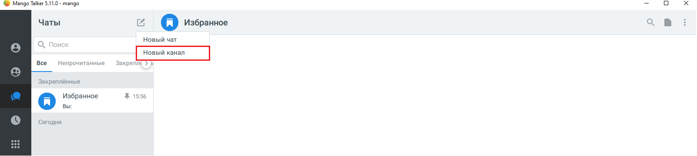
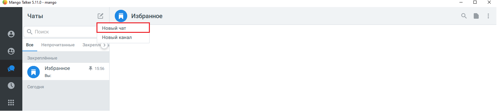
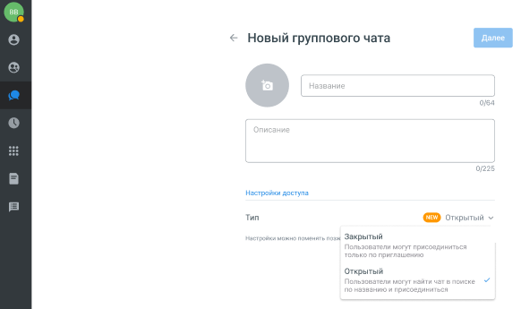
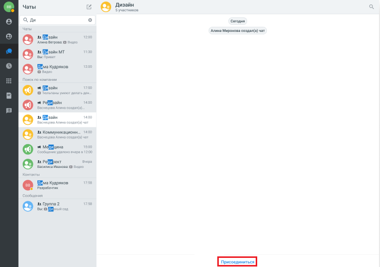

# 5.3. Публичные чаты и каналы

> Трассировка: PDF §5.3 · сквозные стр. 50-55 · источники: ч.1 `kb/sources/mtalker/UserGuide_Windows_mTalker_ch1_Working.11.06.26.pdf` с.50-55.

В MTalker можно создавать публичные чаты и каналы, которые доступны для поиска сотрудникам компании. Пользователь может найти такой чат или канал через поиск и присоединиться к нему без приглашения. По умолчанию чаты и каналы создаются как закрытые. При создании администратор может изменить тип доступа и сделать чат или канал открытым (публичным). Mango Talker для сред ОС Windows и Mac. Руководство пользователя | Версия от 11.06.2026 Как создать публичный канал

> **Описание иллюстрации MTALKER-WORK-§5.3-1** · к разделу §5.3 «Публичные чаты и каналы» · стр. 51 · пиктограмма (значок элемента интерфейса), 42×41 px.
> Относится к тексту руководства: «… создаются как закрытые. При создании администратор может изменить тип доступа и сделать чат или канал открытым (публичным). Mango Talker для сред ОС Windows и Mac. Руководство пользователя | Версия от 11.06.2026 Как создать публичный канал»
> Следующий за иллюстрацией текст: «1. Откройте раздел “Чаты”. Нажмите кнопку “Новый канал”.»
> Текста на изображении нет; назначение значка — см. текст, к которому он относится.

1. Откройте раздел “Чаты”. Нажмите кнопку “Новый канал”.

> **Описание иллюстрации MTALKER-WORK-§5.3-2** · к разделу §5.3 «Публичные чаты и каналы» · стр. 51 · снимок экрана / схема, 1602×362 px.
> Относится к тексту руководства: «1. Откройте раздел “Чаты”. Нажмите кнопку “Новый канал”.»
> Следующий за иллюстрацией текст: «2. Введите название канала и описание.»
> Текст на изображении (OCR, требует сверки): (© Mango Talker 5.11.0 - mango; Чаты; a a) Избранное; Новый чат; Все; Чепрочитанные; Закреплс > Е; Закреплённые; Избранное; Ж 1556; вы:; Сегодня; Pn; 333; 33

2. Введите название канала и описание.

> **Описание иллюстрации MTALKER-WORK-§5.3-3** · к разделу §5.3 «Публичные чаты и каналы» · стр. 51 · снимок экрана / схема, 708×504 px.
> Относится к тексту руководства: «2. Введите название канала и описание.»
> Следующий за иллюстрацией текст: «Mango Talker для сред ОС Windows и Mac. Руководство пользователя | Версия от 11.06.2026 3. В разделе “Тип” выберите параметр “Открытый”.»
> Текст на изображении (OCR, требует сверки): вв; Новый канал; ки доступа; Twn; Кто может приглашать подлик; © владелец и вдминистратер; Все участники

Mango Talker для сред ОС Windows и Mac. Руководство пользователя | Версия от 11.06.2026 3. В разделе “Тип” выберите параметр “Открытый”.

> **Описание иллюстрации MTALKER-WORK-§5.3-4** · к разделу §5.3 «Публичные чаты и каналы» · стр. 52 · снимок экрана / схема, 710×501 px.
> Относится к тексту руководства: «Mango Talker для сред ОС Windows и Mac. Руководство пользователя | Версия от 11.06.2026 3. В разделе “Тип” выберите параметр “Открытый”.»
> Следующий за иллюстрацией текст: «4. Добавьте подписчиков из списка и нажмите кнопку “Создать”.»
> Текст на изображении (OCR, требует сверки): Новый канал; on; чо:; Жан ден; тупа; Тип; зэк; Открытый

4. Добавьте подписчиков из списка и нажмите кнопку “Создать”.

> **Описание иллюстрации MTALKER-WORK-§5.3-5** · к разделу §5.3 «Публичные чаты и каналы» · стр. 52 · снимок экрана / схема, 706×501 px.
> Относится к тексту руководства: «4. Добавьте подписчиков из списка и нажмите кнопку “Создать”.»
> Следующий за иллюстрацией текст: «Mango Talker для сред ОС Windows и Mac. Руководство пользователя | Версия от 11.06.2026 Как создать публичный групповой чат»
> Текст на изображении (OCR, требует сверки): вв; Добавить подписчиков; Захар Сергеев; preee; Захар; 4 Бембеева; Босдан Бембоева; хар Сергеев; Ксения Дементьева; Ольга Бембеева; Босдан Бембеева; Захар Ceprees

Mango Talker для сред ОС Windows и Mac. Руководство пользователя | Версия от 11.06.2026 Как создать публичный групповой чат

> **Описание иллюстрации MTALKER-WORK-§5.3-6** · к разделу §5.3 «Публичные чаты и каналы» · стр. 53 · пиктограмма (значок элемента интерфейса), 42×41 px.
> Относится к тексту руководства: «Mango Talker для сред ОС Windows и Mac. Руководство пользователя | Версия от 11.06.2026 Как создать публичный групповой чат»
> Следующий за иллюстрацией текст: «1. Откройте раздел “Чаты”. Нажмите кнопку “Новый чат”.»
> Текста на изображении нет; назначение значка — см. текст, к которому он относится.

1. Откройте раздел “Чаты”. Нажмите кнопку “Новый чат”.

> **Описание иллюстрации MTALKER-WORK-§5.3-7** · к разделу §5.3 «Публичные чаты и каналы» · стр. 53 · снимок экрана / схема, 1602×362 px.
> Относится к тексту руководства: «1. Откройте раздел “Чаты”. Нажмите кнопку “Новый чат”.»
> Следующий за иллюстрацией текст: «2. Укажите название чата и при необходимости добавьте описание.»
> Текст на изображении (OCR, требует сверки): (© Mango Talker 5.11.0 - mango; Чаты; a о Избранное; Новый канал; Все; Чепрочитанные; Закрепле > E; Закреплённые; Избранное; Ж 1556; вы:; Сегодня; Pn; 333; 33

2. Укажите название чата и при необходимости добавьте описание.

> **Описание иллюстрации MTALKER-WORK-§5.3-8** · к разделу §5.3 «Публичные чаты и каналы» · стр. 53 · снимок экрана / схема, 579×345 px.
> Относится к тексту руководства: «2. Укажите название чата и при необходимости добавьте описание.»
> Следующий за иллюстрацией текст: «Mango Talker для сред ОС Windows и Mac. Руководство пользователя | Версия от 11.06.2026 3. В разделе «Тип» выберите параметр “Открытый”.»
> Текст на изображении (OCR, требует сверки): BB; Новый группового чата; Настройки доступа; wn; тый; Кто может приглашать участников:; О владелец и администратор; Все участники

Mango Talker для сред ОС Windows и Mac. Руководство пользователя | Версия от 11.06.2026 3. В разделе «Тип» выберите параметр “Открытый”.

> **Описание иллюстрации MTALKER-WORK-§5.3-9** · к разделу §5.3 «Публичные чаты и каналы» · стр. 54 · снимок экрана / схема, 582×345 px.
> Относится к тексту руководства: «Mango Talker для сред ОС Windows и Mac. Руководство пользователя | Версия от 11.06.2026 3. В разделе «Тип» выберите параметр “Открытый”.»
> Следующий за иллюстрацией текст: «4. Добавьте подписчиков из списка и нажмите кнопку “Создать”.»
> Текст на изображении (OCR, требует сверки): 8B; Новый группового чата; Настройки доступа; Тип; ~ Закрытый; Открытый

4. Добавьте подписчиков из списка и нажмите кнопку “Создать”.

> **Описание иллюстрации MTALKER-WORK-§5.3-10** · к разделу §5.3 «Публичные чаты и каналы» · стр. 54 · снимок экрана / схема, 706×501 px.
> Относится к тексту руководства: «4. Добавьте подписчиков из списка и нажмите кнопку “Создать”.»
> Следующий за иллюстрацией текст: «Mango Talker для сред ОС Windows и Mac. Руководство пользователя | Версия от 11.06.2026 Как найти публичный чат или канал Публичные чаты и каналы отображаются в результатах поиска MTalker. Чтобы найти…»
> Текст на изображении (OCR, требует сверки): вв; Добавить подписчиков; Захар Сергеев; preee; Захар; 4 Бембеева; Босдан Бембоева; хар Сергеев; Ксения Дементьева; Ольга Бембеева; Босдан Бембеева; Захар Ceprees

Mango Talker для сред ОС Windows и Mac. Руководство пользователя | Версия от 11.06.2026 Как найти публичный чат или канал Публичные чаты и каналы отображаются в результатах поиска MTalker. Чтобы найти публичный чат или канал:

> **Описание иллюстрации MTALKER-WORK-§5.3-11** · к разделу §5.3 «Публичные чаты и каналы» · стр. 55 · пиктограмма (значок элемента интерфейса), 42×41 px.
> Относится к тексту руководства: «Mango Talker для сред ОС Windows и Mac. Руководство пользователя | Версия от 11.06.2026 Как найти публичный чат или канал Публичные чаты и каналы отображаются в результатах поиска MTalker. Чтобы найти публичный чат или канал:»
> Следующий за иллюстрацией текст: «1. Откройте раздел “Чат”. 2. В поле «Поиск» введите название чата или канала. 3. В результатах поиска выберите нужный чат или канал. 4. После открытия карточки чата или канала нажмите кнопку «Подписат…»
> Текста на изображении нет; назначение значка — см. текст, к которому он относится.

1. Откройте раздел “Чат”. 2. В поле «Поиск» введите название чата или канала. 3. В результатах поиска выберите нужный чат или канал. 4. После открытия карточки чата или канала нажмите кнопку «Подписаться».

> **Описание иллюстрации MTALKER-WORK-§5.3-12** · к разделу §5.3 «Публичные чаты и каналы» · стр. 55 · снимок экрана / схема, 752×528 px.
> Относится к тексту руководства: «1. Откройте раздел “Чат”. 2. В поле «Поиск» введите название чата или канала. 3. В результатах поиска выберите нужный чат или канал. 4. После открытия карточки чата или канала нажмите кнопку «Подписаться».»
> Текст на изображении (OCR, требует сверки): 8B; Чаты; esas ,; А, Ди; Сегодня; Алина Миронова создал(з) чат; в: зойн; Annus Ветровз: ©; за ИИзайн МТ; Bu; Wma Kyapaxos; . Pesan; te Maan; 41 Коммуникационн; vt Mona; в: Pelpext; Василиса Ивано:; В ма Кудряков; абочтик; 3 Группа2