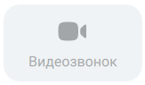
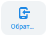

# 6.1. Как позвонить?

> Трассировка: PDF §6.1 · сквозные стр. 61-62 · источники: ч.1 `kb/sources/mtalker/UserGuide_Windows_mTalker_ch1_Working.11.06.26.pdf` с.61-62.

Номер, сохраненный в контактах Чтобы позвонить на номер, сохраненный в контактах, в основном окне MTalker следует:

> **Описание иллюстрации MTALKER-WORK-§6.1-1** · к разделу §6.1 «Как позвонить?» · стр. 61 · пиктограмма (значок элемента интерфейса), 41×40 px.
> Относится к тексту руководства: «Номер, сохраненный в контактах Чтобы позвонить на номер, сохраненный в контактах, в основном окне MTalker следует:»
> Следующий за иллюстрацией текст: «1) нажать на кнопку . Будет открыт раздел “Контакты”; 2) найти строку с данными контакта (собеседника), которому нужно позвонить; 3) кликните на строку с данными контакта. Будет открыта карточка конта…»
> Текста на изображении нет; назначение значка — см. текст, к которому он относится.

1) нажать на кнопку . Будет открыт раздел “Контакты”; 2) найти строку с данными контакта (собеседника), которому нужно позвонить; 3) кликните на строку с данными контакта. Будет открыта карточка контакта; 4) нажмите на одну из следующих кнопок:

> **Описание иллюстрации MTALKER-WORK-§6.1-2** · к разделу §6.1 «Как позвонить?» · стр. 61 · фрагмент интерфейса (кнопка, переключатель, поле или подпись), 168×102 px.
> Относится к тексту руководства: «…ажать на кнопку . Будет открыт раздел “Контакты”; 2) найти строку с данными контакта (собеседника), которому нужно позвонить; 3) кликните на строку с данными контакта. Будет открыта карточка контакта; 4) нажмите на одну из следующих кнопок:»
> Следующий за иллюстрацией текст: «– : будет выполнен аудио вызов абонента на внутренний номер абонента;»
> Текст на изображении (OCR, требует сверки): Позвонить

– : будет выполнен аудио вызов абонента на внутренний номер абонента;

> **Описание иллюстрации MTALKER-WORK-§6.1-3** · к разделу §6.1 «Как позвонить?» · стр. 61 · фрагмент интерфейса (кнопка, переключатель, поле или подпись), 163×95 px.
> Относится к тексту руководства: «– : будет выполнен аудио вызов абонента на внутренний номер абонента;»
> Следующий за иллюстрацией текст: «– : будет выполнен видео вызов абонента на внутренний номер абонента;»
> Текст на изображении (OCR, требует сверки): ax; Видеозвонок

– : будет выполнен видео вызов абонента на внутренний номер абонента;

> **Описание иллюстрации MTALKER-WORK-§6.1-4** · к разделу §6.1 «Как позвонить?» · стр. 61 · фрагмент интерфейса (кнопка, переключатель, поле или подпись), 80×62 px.
> Относится к тексту руководства: «– : будет выполнен видео вызов абонента на внутренний номер абонента;»
> Следующий за иллюстрацией текст: «– : будет выполнен заказ обратного звонка на внутренний номер абонента. ВАТС позвонит нужному вам абоненту и вам, и когда абоненты примут звонок, ВАТС соединит звонок. Если нужный вам сотрудник зареги…»
> Текст на изображении (OCR, требует сверки): O6pat..

– : будет выполнен заказ обратного звонка на внутренний номер абонента. ВАТС позвонит нужному вам абоненту и вам, и когда абоненты примут звонок, ВАТС соединит звонок. Если нужный вам сотрудник зарегистрировал в ВАТС свой мобильный номер телефона (один или несколько), то в карточке контакта будет отображаться поле “Мобильный”, в котором отображаются эти номера. Чтобы позвонить на мобильный нужного вам абонента, наведите

> **Описание иллюстрации MTALKER-WORK-§6.1-5** · к разделу §6.1 «Как позвонить?» · стр. 61 · фрагмент интерфейса (кнопка, переключатель, поле или подпись), 87×48 px.
> Относится к тексту руководства: «… сотрудник зарегистрировал в ВАТС свой мобильный номер телефона (один или несколько), то в карточке контакта будет отображаться поле “Мобильный”, в котором отображаются эти номера. Чтобы позвонить на мобильный нужного вам абонента, наведите»
> Следующий за иллюстрацией текст: «курсор нужный вам номер мобильного, будет показана кнопка . Нажмите на эту кнопку. Будет выполнен звонок на выбранный вами номер мобильного телефона. Номер, не cохраненный в контакты (любой номер) Что…»

курсор нужный вам номер мобильного, будет показана кнопка . Нажмите на эту кнопку. Будет выполнен звонок на выбранный вами номер мобильного телефона. Номер, не cохраненный в контакты (любой номер) Чтобы позвонить на любой номер, не записанный в контакты, в основном окне MTalker следует:

> **Описание иллюстрации MTALKER-WORK-§6.1-6** · к разделу §6.1 «Как позвонить?» · стр. 61 · пиктограмма (значок элемента интерфейса), 34×42 px.
> Относится к тексту руководства: «…ана кнопка . Нажмите на эту кнопку. Будет выполнен звонок на выбранный вами номер мобильного телефона. Номер, не cохраненный в контакты (любой номер) Чтобы позвонить на любой номер, не записанный в контакты, в основном окне MTalker следует:»
> Следующий за иллюстрацией текст: «1) нажать на кнопку . Будет открыт раздел “Клавиши”; 2) удалить все значения из поля “Номер”, если они там есть; 3) набрать номер телефона на цифровой клавиатуре;»
> Текста на изображении нет; назначение значка — см. текст, к которому он относится.

1) нажать на кнопку . Будет открыт раздел “Клавиши”; 2) удалить все значения из поля “Номер”, если они там есть; 3) набрать номер телефона на цифровой клавиатуре;

> **Описание иллюстрации MTALKER-WORK-§6.1-7** · к разделу §6.1 «Как позвонить?» · стр. 61 · пиктограмма (значок элемента интерфейса), 55×43 px.
> Относится к тексту руководства: «1) нажать на кнопку . Будет открыт раздел “Клавиши”; 2) удалить все значения из поля “Номер”, если они там есть; 3) набрать номер телефона на цифровой клавиатуре;»
> Следующий за иллюстрацией текст: «4) нажать на кнопку . Будет выполнен звонок на введенный вами номер телефона и открыто окно проведения сеанса аудио связи. Звонок на добавочный номер Звонок на добавочный номер выполняется через “,” (…»
> Текста на изображении нет; назначение значка — см. текст, к которому он относится.

4) нажать на кнопку . Будет выполнен звонок на введенный вами номер телефона и открыто окно проведения сеанса аудио связи. Звонок на добавочный номер Звонок на добавочный номер выполняется через “,” (запятая). Для этого, в основном окне MTalker следует:

> **Описание иллюстрации MTALKER-WORK-§6.1-8** · к разделу §6.1 «Как позвонить?» · стр. 61 · пиктограмма (значок элемента интерфейса), 38×39 px.
> Относится к тексту руководства: «…кнопку . Будет выполнен звонок на введенный вами номер телефона и открыто окно проведения сеанса аудио связи. Звонок на добавочный номер Звонок на добавочный номер выполняется через “,” (запятая). Для этого, в основном окне MTalker следует:»
> Следующий за иллюстрацией текст: «1) нажать на кнопку . Будет открыт раздел “Клавиши”; 2) в поле “Номер” удали все символы, если они там есть; 3) при помощи экранной клавиатуры ведите номер телефона, затем поставьте “,” (запятая) и вв…»
> Текста на изображении нет; назначение значка — см. текст, к которому он относится.

1) нажать на кнопку . Будет открыт раздел “Клавиши”; 2) в поле “Номер” удали все символы, если они там есть; 3) при помощи экранной клавиатуры ведите номер телефона, затем поставьте “,” (запятая) и введите добавочный номер;

> **Описание иллюстрации MTALKER-WORK-§6.1-9** · к разделу §6.1 «Как позвонить?» · стр. 61 · пиктограмма (значок элемента интерфейса), 48×41 px.
> Относится к тексту руководства: «1) нажать на кнопку . Будет открыт раздел “Клавиши”; 2) в поле “Номер” удали все символы, если они там есть; 3) при помощи экранной клавиатуры ведите номер телефона, затем поставьте “,” (запятая) и введите добавочный номер;»
> Следующий за иллюстрацией текст: «4) нажмите кнопку . Будет выполнен звонок на добавочный номер телефона. Mango Talker для сред ОС Windows и Mac. Руководство пользователя | Версия от 11.06.2026 Номер в истории вызовов Для того чтобы п…»
> Текста на изображении нет; назначение значка — см. текст, к которому он относится.

4) нажмите кнопку . Будет выполнен звонок на добавочный номер телефона. Mango Talker для сред ОС Windows и Mac. Руководство пользователя | Версия от 11.06.2026 Номер в истории вызовов Для того чтобы позвонить на номер, ранее зафиксированный в истории вызовов, в основном окне MTalker следует:

> **Описание иллюстрации MTALKER-WORK-§6.1-10** · к разделу §6.1 «Как позвонить?» · стр. 62 · пиктограмма (значок элемента интерфейса), 38×42 px.
> Относится к тексту руководства: «…ный номер телефона. Mango Talker для сред ОС Windows и Mac. Руководство пользователя | Версия от 11.06.2026 Номер в истории вызовов Для того чтобы позвонить на номер, ранее зафиксированный в истории вызовов, в основном окне MTalker следует:»
> Следующий за иллюстрацией текст: «1) нажать на кнопку . Будет открыт раздел “История вызовов”; 2) кликните на строку с данными нужного вам вызова. Будет открыта карточка вызова;»
> Текста на изображении нет; назначение значка — см. текст, к которому он относится.

1) нажать на кнопку . Будет открыт раздел “История вызовов”; 2) кликните на строку с данными нужного вам вызова. Будет открыта карточка вызова;

> **Описание иллюстрации MTALKER-WORK-§6.1-11** · к разделу §6.1 «Как позвонить?» · стр. 62 · пиктограмма (значок элемента интерфейса), 36×38 px.
> Относится к тексту руководства: «1) нажать на кнопку . Будет открыт раздел “История вызовов”; 2) кликните на строку с данными нужного вам вызова. Будет открыта карточка вызова;»
> Следующий за иллюстрацией текст: «3) нажмите кнопку . Будет выполнен аудио звонок абоненту. В комнату аудио конференцсвязи В вашей ВАТС могут быть настроены комнаты для проведения аудио конференций. Их перечень»
> Текста на изображении нет; назначение значка — см. текст, к которому он относится.

3) нажмите кнопку . Будет выполнен аудио звонок абоненту. В комнату аудио конференцсвязи В вашей ВАТС могут быть настроены комнаты для проведения аудио конференций. Их перечень

> **Описание иллюстрации MTALKER-WORK-§6.1-12** · к разделу §6.1 «Как позвонить?» · стр. 62 · пиктограмма (значок элемента интерфейса), 37×40 px.
> Относится к тексту руководства: «3) нажмите кнопку . Будет выполнен аудио звонок абоненту. В комнату аудио конференцсвязи В вашей ВАТС могут быть настроены комнаты для проведения аудио конференций. Их перечень»
> Следующий за иллюстрацией текст: «отображается в разделе “Конференции” . Вы можете позвонить в ту или иную комнату (войти в комнату), при этом MTalker будет использоваться как терминал аудио конференцсвязи. При входе в комнату может п…»
> Текста на изображении нет; назначение значка — см. текст, к которому он относится.

отображается в разделе “Конференции” . Вы можете позвонить в ту или иную комнату (войти в комнату), при этом MTalker будет использоваться как терминал аудио конференцсвязи. При входе в комнату может потребовать ПИН-код. Для того чтобы позвонить в комнату аудио конференцсвязи, в основном окне MTalker следует:

<!-- изображение на стр. 62: байты не извлечены (PyMuPDF недоступен) -->

1) нажать на кнопку “Конференции” . Будет открыт раздел “Конференции”; 2) кликните на строку с данными комнаты в списке “Комнаты конференций”. Будет открыта карточка комнаты;

<!-- изображение на стр. 62: байты не извлечены (PyMuPDF недоступен) -->

3) нажмите на кнопку . Будет выполнен аудио звонок, после установления соединения будет выполнен вход в комнату.
