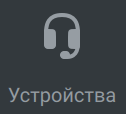
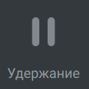

# 6.14. Во время звонка. Общее описание окна проведения сеанса связи

> Трассировка: PDF §6.14 · сквозные стр. 67-69 · источники: ч.1 `kb/sources/mtalker/UserGuide_Windows_mTalker_ch1_Working.11.06.26.pdf` с.67-69.

Во время аудио звонка, в окне проведения сеанса связи отображаются следующие инструменты, которые вы можете использовать для управления звонком:

> **Описание иллюстрации MTALKER-WORK-§6.14-1** · к разделу §6.14 «Во время звонка. Общее описание окна проведения сеанса связи» · стр. 67 · фрагмент интерфейса (кнопка, переключатель, поле или подпись), 128×83 px.
> Относится к тексту руководства: «Во время аудио звонка, в окне проведения сеанса связи отображаются следующие инструменты, которые вы можете использовать для управления звонком:»
> Следующий за иллюстрацией текст: «Выключить звук. Нажав кнопку “Выключить микрофон”, звуковой сигнал с вашего микрофона больше не будет передаваться в текущий сеанс связи и ваши собеседники вас не услышат.»
> Текст на изображении (OCR, требует сверки): Выключить

Выключить звук. Нажав кнопку “Выключить микрофон”, звуковой сигнал с вашего микрофона больше не будет передаваться в текущий сеанс связи и ваши собеседники вас не услышат.

> **Описание иллюстрации MTALKER-WORK-§6.14-2** · к разделу §6.14 «Во время звонка. Общее описание окна проведения сеанса связи» · стр. 67 · фрагмент интерфейса (кнопка, переключатель, поле или подпись), 116×117 px.
> Относится к тексту руководства: «Выключить звук. Нажав кнопку “Выключить микрофон”, звуковой сигнал с вашего микрофона больше не будет передаваться в текущий сеанс связи и ваши собеседники вас не услышат.»
> Следующий за иллюстрацией текст: «Клавиши. Отображение экранной клавиатуры в окне проведения сеанса связи.»
> Текст на изображении (OCR, требует сверки): eee; Клавиши

Клавиши. Отображение экранной клавиатуры в окне проведения сеанса связи.

> **Описание иллюстрации MTALKER-WORK-§6.14-3** · к разделу §6.14 «Во время звонка. Общее описание окна проведения сеанса связи» · стр. 67 · фрагмент интерфейса (кнопка, переключатель, поле или подпись), 62×75 px.
> Относится к тексту руководства: «Клавиши. Отображение экранной клавиатуры в окне проведения сеанса связи.»
> Следующий за иллюстрацией текст: «Запись. Включение/выключение записи разговора. Данная функция может быть не доступна, в зависимости от настроек вашей ВАТС.»

Запись. Включение/выключение записи разговора. Данная функция может быть не доступна, в зависимости от настроек вашей ВАТС.

> **Описание иллюстрации MTALKER-WORK-§6.14-4** · к разделу §6.14 «Во время звонка. Общее описание окна проведения сеанса связи» · стр. 67 · фрагмент интерфейса (кнопка, переключатель, поле или подпись), 126×114 px.
> Относится к тексту руководства: «Запись. Включение/выключение записи разговора. Данная функция может быть не доступна, в зависимости от настроек вашей ВАТС.»
> Следующий за иллюстрацией текст: «Устройства. Выбор динамиков и микрофона, которые вы будете использовать во время звонка.»
> Текст на изображении (OCR, требует сверки): 63; Устройства

Устройства. Выбор динамиков и микрофона, которые вы будете использовать во время звонка.

> **Описание иллюстрации MTALKER-WORK-§6.14-5** · к разделу §6.14 «Во время звонка. Общее описание окна проведения сеанса связи» · стр. 67 · фрагмент интерфейса (кнопка, переключатель, поле или подпись), 110×84 px.
> Относится к тексту руководства: «Устройства. Выбор динамиков и микрофона, которые вы будете использовать во время звонка.»
> Следующий за иллюстрацией текст: «Перевод. Перевод вызова на того или иного абонента, записанного в телефонной книге.»
> Текст на изображении (OCR, требует сверки): Перевод

Перевод. Перевод вызова на того или иного абонента, записанного в телефонной книге.

> **Описание иллюстрации MTALKER-WORK-§6.14-6** · к разделу §6.14 «Во время звонка. Общее описание окна проведения сеанса связи» · стр. 67 · фрагмент интерфейса (кнопка, переключатель, поле или подпись), 151×84 px.
> Относится к тексту руководства: «Перевод. Перевод вызова на того или иного абонента, записанного в телефонной книге.»
> Следующий за иллюстрацией текст: «Переключить. Переключение звонка между вашими устройствами, на которых выполнен вход в ваш аккаунт MTalker.»
> Текст на изображении (OCR, требует сверки): fo; Переключить

Переключить. Переключение звонка между вашими устройствами, на которых выполнен вход в ваш аккаунт MTalker.

> **Описание иллюстрации MTALKER-WORK-§6.14-7** · к разделу §6.14 «Во время звонка. Общее описание окна проведения сеанса связи» · стр. 67 · снимок экрана / схема, 129×129 px.
> Относится к тексту руководства: «Переключить. Переключение звонка между вашими устройствами, на которых выполнен вход в ваш аккаунт MTalker.»
> Следующий за иллюстрацией текст: «Удержание. Удержание вызова»
> Текст на изображении (OCR, требует сверки): Удержание

Удержание. Удержание вызова

> **Описание иллюстрации MTALKER-WORK-§6.14-8** · к разделу §6.14 «Во время звонка. Общее описание окна проведения сеанса связи» · стр. 67 · фрагмент интерфейса (кнопка, переключатель, поле или подпись), 96×105 px.
> Относится к тексту руководства: «Удержание. Удержание вызова»
> Следующий за иллюстрацией текст: «Еще. Кнопка для перехода к дополнительным действиям по звонкам: • Новый вызов. Совершение исходящего вызова по второй линии. При этом, текущий сеанс будет поставлен на удержание. • Отправить сообщение…»
> Текст на изображении (OCR, требует сверки): eee; Ещё

Еще. Кнопка для перехода к дополнительным действиям по звонкам: • Новый вызов. Совершение исходящего вызова по второй линии. При этом, текущий сеанс будет поставлен на удержание. • Отправить сообщение. Создать чат “Один-на-один”. Данная функция доступна только, если абонент записан в телефонную книгу. С помощью него вы можете отправить смс- сообщение или факс собеседнику. • Добавить участников в разговор. Добавление собеседников для проведения группового звонка. При этом все участник получают возможность слышать и разговаривать друг с другом.

> **Описание иллюстрации MTALKER-WORK-§6.14-9** · к разделу §6.14 «Во время звонка. Общее описание окна проведения сеанса связи» · стр. 67 · пиктограмма (значок элемента интерфейса), 37×39 px.
> Относится к тексту руководства: «…ощью него вы можете отправить смс- сообщение или факс собеседнику. • Добавить участников в разговор. Добавление собеседников для проведения группового звонка. При этом все участник получают возможность слышать и разговаривать друг с другом.»
> Следующий за иллюстрацией текст: «Завершение вызова. Нажав кнопку “Положить трубку”, вы завершите свое участие в данном сеансе связи. При этом, если вы принимали участие в групповом вызове, то сеанс связи будет завершен только для вас…»
> Текста на изображении нет; назначение значка — см. текст, к которому он относится.

Завершение вызова. Нажав кнопку “Положить трубку”, вы завершите свое участие в данном сеансе связи. При этом, если вы принимали участие в групповом вызове, то сеанс связи будет завершен только для вас. Остальные участники продолжат сеанс связи. Оценка качества связи и баннер видеоконференций После завершения аудиозвонка отображается окно оценки качества связи. Mango Talker для сред ОС Windows и Mac. Руководство пользователя | Версия от 11.06.2026 Дополнительно отображается баннер с предложением использовать видеоконференции. При нажатии на кнопку «Подробнее» осуществляется переход на страницу с описанием функционала ВКС. Mango Talker для сред ОС Windows и Mac. Руководство пользователя | Версия от 11.06.2026
