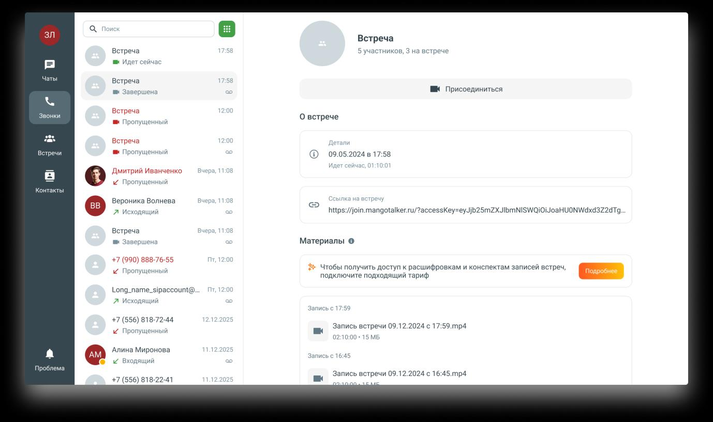
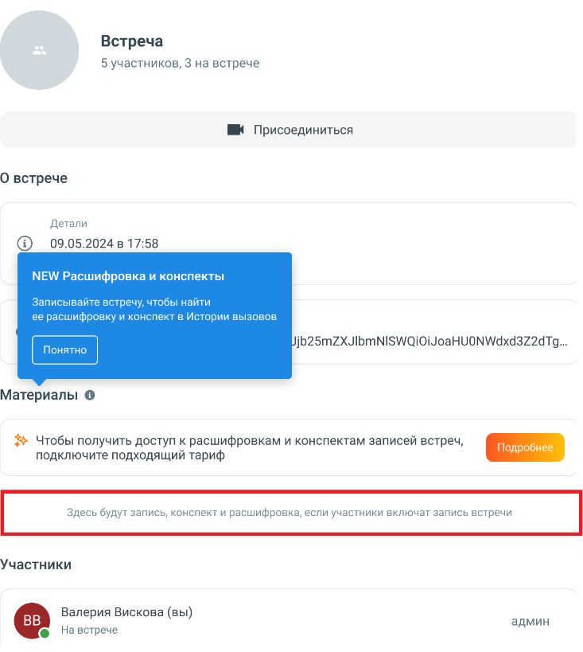
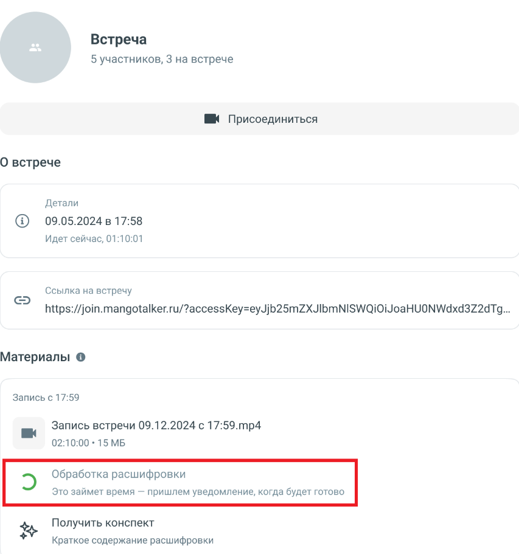
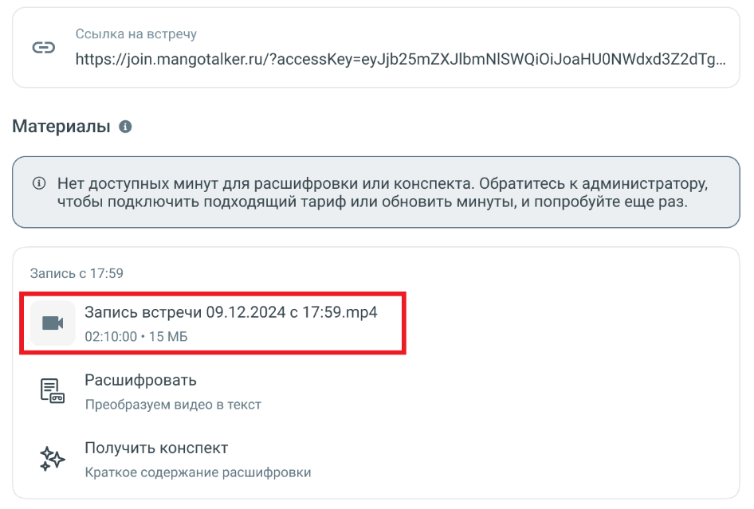
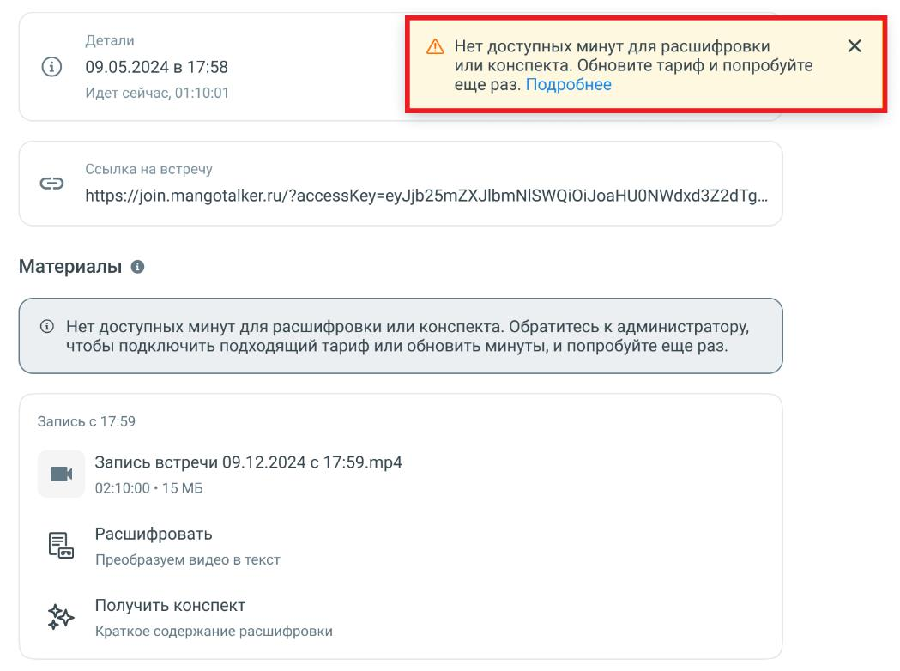

# 7.3. Расшифровка и конспектирование записей встреч

> Трассировка: PDF §7.3 · сквозные стр. 71-74 · источники: ч.1 `kb/sources/mtalker/UserGuide_Windows_mTalker_ch1_Working.11.06.26.pdf` с.71-74.

Общие сведения Расшифровка позволяет преобразовать запись видеоконференции в текстовый формат. Конспектирование позволяет получить краткое содержание записи видеоконференции на основе расшифровки. Функции расшифровки и конспектирования доступны пользователям, у которых подключена услуга Групповая “видеоконференция” и имеются доступные минуты для обработки записей. При первом открытии карточки встречи пользователю отображается информационная подсказка с описанием возможностей расшифровки и конспектирования. Запись видеоконференции становится доступна после завершения встречи. Расшифровка и конспектирование становятся доступны только после завершения обработки записи. Во время обработки в разделе “Материалы” отображается соответствующий статус выполнения операции. Если услуга не подключена Если услуга «Групповая видеоконференция» не подключена, в разделе «Материалы» отображается информационный блок с предложением подключить подходящий тариф. Для получения дополнительной информации нажмите кнопку “Подробнее”.

> **Описание иллюстрации MTALKER-WORK-§7.3-1** · к разделу §7.3 «Расшифровка и конспектирование записей встреч» · стр. 71 · снимок экрана / схема, 1378×817 px.
> Относится к тексту руководства: «…уга не подключена Если услуга «Групповая видеоконференция» не подключена, в разделе «Материалы» отображается информационный блок с предложением подключить подходящий тариф. Для получения дополнительной информации нажмите кнопку “Подробнее”.»
> Следующий за иллюстрацией текст: «Mango Talker для сред ОС Windows и Mac. Руководство пользователя | Версия от 11.06.2026 Если запись видеоконференции отсутствует, в разделе “Материалы” отображается сообщение: “Здесь будут запись, кон…»
> Текст на изображении (OCR, требует сверки): Встреча; 5 участников, 3 на встрече; вк Идет сейчас; Чаты; ИК Присоединиться; вк Завершена; Звонки; Пропущенный; О встрече; ia; Встречи; ропущенный; 09.05.2024 в 17:58; ко; / Пропущенный; Контакты; Вероника Волнева; https://join.mangotalker.ru/?accesskey=eyJjb25MZXJIbmNISWQiOiJoaHUONWdxd3Z2dTg,; Л Исходящий; Материалы ©; 38.; po; пущенный; Чтобы получить доступ к расшифровкам и конспектам записей встреч,; подключите подходящий тариф; Long_name_sipaccount@; +7 (556) 818-72-44; Запись встречи 09.12.2024 с 17:59.тр4; 02; 10:; 00; Алина Миронова; За; cote; 45; Входящий; Проблема; +7 (556) 818-22-4…

Mango Talker для сред ОС Windows и Mac. Руководство пользователя | Версия от 11.06.2026 Если запись видеоконференции отсутствует, в разделе “Материалы” отображается сообщение: “Здесь будут запись, конспект и расшифровка, если участники включат запись встречи”.

> **Описание иллюстрации MTALKER-WORK-§7.3-2** · к разделу §7.3 «Расшифровка и конспектирование записей встреч» · стр. 72 · снимок экрана / схема, 733×819 px.
> Относится к тексту руководства: «…д ОС Windows и Mac. Руководство пользователя | Версия от 11.06.2026 Если запись видеоконференции отсутствует, в разделе “Материалы” отображается сообщение: “Здесь будут запись, конспект и расшифровка, если участники включат запись встречи”.»
> Следующий за иллюстрацией текст: «Получение расшифровки Для получения расшифровки: 1. Откройте карточку встречи. 2. Перейдите в раздел “Материалы”. 3. Выберите запись видеоконференции. 4. Нажмите “Расшифровать”. После отправки записи …»
> Текст на изображении (OCR, требует сверки): Встреча; 5 участников, 3 на встрече; ШК Присоединиться; О встрече; Детали; @ 09.05.2024 в 17:58; МЕМ/ Расшифровка и конспекты; Записывайте встречу, чтобы найти; ее расшифровку и конспект в Истории вызовов; jb25MZXJIbDMNISWQiIOiJoaHUONWdxd3Z2dTg...; Материалы @; % Чтобы получить доступ к расшифровкам и конспектам записей встреч,; подключите подходящий тариф; Участники; Валерия Вискова (вы); админ; На встрече

Получение расшифровки Для получения расшифровки: 1. Откройте карточку встречи. 2. Перейдите в раздел “Материалы”. 3. Выберите запись видеоконференции. 4. Нажмите “Расшифровать”. После отправки записи на обработку отображается статус выполнения операции. Mango Talker для сред ОС Windows и Mac. Руководство пользователя | Версия от 11.06.2026

> **Описание иллюстрации MTALKER-WORK-§7.3-3** · к разделу §7.3 «Расшифровка и конспектирование записей встреч» · стр. 73 · снимок экрана / схема, 853×911 px.
> Относится к тексту руководства: «…“Материалы”. 3. Выберите запись видеоконференции. 4. Нажмите “Расшифровать”. После отправки записи на обработку отображается статус выполнения операции. Mango Talker для сред ОС Windows и Mac. Руководство пользователя | Версия от 11.06.2026»
> Следующий за иллюстрацией текст: «После завершения обработки пользователь получает уведомление о готовности результата. Получение конспекта Для получения конспекта: 1. Откройте карточку встречи. 2. Перейдите в раздел “Материалы”. 3. В…»
> Текст на изображении (OCR, требует сверки): Встреча; 5 участников, 3 на встрече; ШК Присоединиться; О встрече; Детали; @ 09.05.2024 в 17:58; Идет сейчас, 01:10:01; Ссылка на встречу; https://join.mangotalker.ru/?accessKey=eyJjb25mZXJIbMNISWQiO0iJoaHUONWdxd3Z2dTg...; Материалы @; Запись с 17:59; Запись встречи 09.12.2024 с 17:59.тр4; 02:10:00 + 15 МБ; 5 Обработка расшифровки; Это займет время — пришлем уведомление, когда будет готово; Получить конспект; Краткое содержание расшифровки

После завершения обработки пользователь получает уведомление о готовности результата. Получение конспекта Для получения конспекта: 1. Откройте карточку встречи. 2. Перейдите в раздел “Материалы”. 3. Выберите запись видеоконференции. 4. Нажмите “Получить конспект”. Конспект формируется автоматически на основе расшифровки записи видеоконференции. Готовые материалы встречи После завершения обработки запись видеоконференции отображается в разделе “Материалы” и доступна для скачивания. Mango Talker для сред ОС Windows и Mac. Руководство пользователя | Версия от 11.06.2026

> **Описание иллюстрации MTALKER-WORK-§7.3-4** · к разделу §7.3 «Расшифровка и конспектирование записей встреч» · стр. 74 · снимок экрана / схема, 946×639 px.
> Относится к тексту руководства: «…оконференции. Готовые материалы встречи После завершения обработки запись видеоконференции отображается в разделе “Материалы” и доступна для скачивания. Mango Talker для сред ОС Windows и Mac. Руководство пользователя | Версия от 11.06.2026»
> Следующий за иллюстрацией текст: «Недостаточно минут для обработки Если лимит минут для расшифровки или конспектирования исчерпан, при попытке запуска обработки отображается сообщение: «Нет доступных минут для расшифровки или конспект…»
> Текст на изображении (OCR, требует сверки): Ссылка на встречу; https://join.mangotalker.ru/?accessKey=eyJjb25MZXJIbMNISWQiOi JoaHUONWdxd3Z2dTg...; Материалы @; @® Нет доступных минут для расшифровки или конспекта. Обратитесь к администратору,; чтобы подключить подходящий тариф или обновить минуты, и попробуйте еще раз.; Запись с 17:59; Запись встречи 09.12.2024 с 1; 59.тр4; 02:10:00 + 15 МБ; Расшифровать; Преобразуем видео в текст; Получить конспект; Краткое содержание расшифровки

Недостаточно минут для обработки Если лимит минут для расшифровки или конспектирования исчерпан, при попытке запуска обработки отображается сообщение: «Нет доступных минут для расшифровки или конспекта. Обратитесь к администратору, чтобы подключить подходящий тариф или обновить минуты, и попробуйте еще раз». После увеличения лимита минут обработку можно запустить повторно.

> **Описание иллюстрации MTALKER-WORK-§7.3-5** · к разделу §7.3 «Расшифровка и конспектирование записей встреч» · стр. 74 · снимок экрана / схема, 1049×782 px.
> Относится к тексту руководства: «…ется сообщение: «Нет доступных минут для расшифровки или конспекта. Обратитесь к администратору, чтобы подключить подходящий тариф или обновить минуты, и попробуйте еще раз». После увеличения лимита минут обработку можно запустить повторно.»
> Текст на изображении (OCR, требует сверки): Детали; Л Нет доступных минут для расшифровки; 09.05.2024 в 17:58; или конспекта. Обновите тариф и попробуйте; Идет сейчас, 01:10:01; еще раз. Подробнее; Ссылка на встречу; https://join.mangotalker.ru/?accessKey=eyJjb25mMZXJIbMNISWQiOiJoaHUONWdxd3Z2dTg...; Материалы @; @ Нет доступных минут для расшифровки или конспекта. Обратитесь к администратору,; чтобы подключить подходящий тариф или обновить минуты, и попробуйте еще раз.; Запись с 17:59; Запись встречи 09.12.2024 с 17:59.mp4; 02:10:00 + 15 МБ; Расшифровать; Преобразуем видео в текст; Получить конспект; Краткое содержание расшифровки