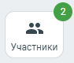

# 7.5. Как посмотреть состав участников видеоконференции

> Трассировка: PDF §7.5 · сквозные стр. 75 · источники: ч.1 `kb/sources/mtalker/UserGuide_Windows_mTalker_ch1_Working.11.06.26.pdf` с.75.

Чтобы посмотреть состав участников видеоконференции, а также , кто является

> **Описание иллюстрации MTALKER-WORK-§7.5-1** · к разделу §7.5 «Как посмотреть состав участников видеоконференции» · стр. 75 · фрагмент интерфейса (кнопка, переключатель, поле или подпись), 94×80 px.
> Относится к тексту руководства: «Чтобы посмотреть состав участников видеоконференции, а также , кто является»
> Следующий за иллюстрацией текст: «администратором, в окне проведения видеоконференции нажмите кнопку “Участники” . В окне “Список участников” рядом с именем администратора видеоконференции будет написано “(администратор)”. Изменить ро…»
> Текст на изображении (OCR, требует сверки): ee; Участники

администратором, в окне проведения видеоконференции нажмите кнопку “Участники” . В окне “Список участников” рядом с именем администратора видеоконференции будет написано “(администратор)”. Изменить роль с администратора видеоконференции на участника невозможно, если вы создали видеоконференцию. И наоборот, изменить роль участника на администратора невозможно, если НЕ вы создали видеоконференцию.
