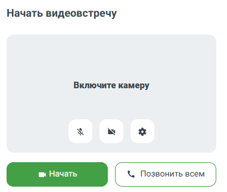

# 7.6. Как позвонить с видео абоненту или в групповой чат

> Трассировка: PDF §7.6 · сквозные стр. 75-76 · источники: ч.1 `kb/sources/mtalker/UserGuide_Windows_mTalker_ch1_Working.11.06.26.pdf` с.75-76.

Вы можете позвонить с видео сотруднику или в групповой чат из MTalker. Чтобы выполнить видеозвонок:

> **Описание иллюстрации MTALKER-WORK-§7.6-1** · к разделу §7.6 «Как позвонить с видео абоненту или в групповой чат» · стр. 75 · пиктограмма (значок элемента интерфейса), 42×41 px.
> Относится к тексту руководства: «Вы можете позвонить с видео сотруднику или в групповой чат из MTalker. Чтобы выполнить видеозвонок:»
> Следующий за иллюстрацией текст: «1. перейдите в раздел “Чаты” и нажмите на строку с данными чата с нужным вам абонентом нужным вам групповым чатом;»
> Текста на изображении нет; назначение значка — см. текст, к которому он относится.

1. перейдите в раздел “Чаты” и нажмите на строку с данными чата с нужным вам абонентом нужным вам групповым чатом;

> **Описание иллюстрации MTALKER-WORK-§7.6-2** · к разделу §7.6 «Как позвонить с видео абоненту или в групповой чат» · стр. 75 · пиктограмма (значок элемента интерфейса), 29×26 px.
> Относится к тексту руководства: «1. перейдите в раздел “Чаты” и нажмите на строку с данными чата с нужным вам абонентом нужным вам групповым чатом;»
> Следующий за иллюстрацией текст: «2. в заголовке чата нажмите на кнопку . Будет открыто окно “Присоединиться”, в котором, перед тем как присоединиться к видеоконференции, вы можете:»
> Текста на изображении нет; назначение значка — см. текст, к которому он относится.

2. в заголовке чата нажмите на кнопку . Будет открыто окно “Присоединиться”, в котором, перед тем как присоединиться к видеоконференции, вы можете:

> **Описание иллюстрации MTALKER-WORK-§7.6-3** · к разделу §7.6 «Как позвонить с видео абоненту или в групповой чат» · стр. 75 · пиктограмма (значок элемента интерфейса), 51×48 px.
> Относится к тексту руководства: «2. в заголовке чата нажмите на кнопку . Будет открыто окно “Присоединиться”, в котором, перед тем как присоединиться к видеоконференции, вы можете:»
> Следующий за иллюстрацией текст: «• включить микрофон ;»
> Текста на изображении нет; назначение значка — см. текст, к которому он относится.

• включить микрофон ;

> **Описание иллюстрации MTALKER-WORK-§7.6-4** · к разделу §7.6 «Как позвонить с видео абоненту или в групповой чат» · стр. 75 · пиктограмма (значок элемента интерфейса), 48×48 px.
> Относится к тексту руководства: «• включить микрофон ;»
> Следующий за иллюстрацией текст: «• включить камеру ; • установить настройки вашего участия в видеоконференции (например, размытие фона)»
> Текста на изображении нет; назначение значка — см. текст, к которому он относится.

• включить камеру ; • установить настройки вашего участия в видеоконференции (например, размытие фона)

> **Описание иллюстрации MTALKER-WORK-§7.6-5** · к разделу §7.6 «Как позвонить с видео абоненту или в групповой чат» · стр. 75 · пиктограмма (значок элемента интерфейса), 46×47 px.
> Относится к тексту руководства: «• включить камеру ; • установить настройки вашего участия в видеоконференции (например, размытие фона)»
> Следующий за иллюстрацией текст: «. • выполните одно из действий (в зависимости от типа чата): – если видеозвонок выполняется в чате с одним собеседником: в истории чата появится сообщение “Видеоконференция” и кнопка “Присоединиться”.…»
> Текста на изображении нет; назначение значка — см. текст, к которому он относится.

. • выполните одно из действий (в зависимости от типа чата): – если видеозвонок выполняется в чате с одним собеседником: в истории чата появится сообщение “Видеоконференция” и кнопка “Присоединиться”. Нажмите — “Присоединиться”; Mango Talker для сред ОС Windows и Mac. Руководство пользователя | Версия от 11.06.2026

> **Описание иллюстрации MTALKER-WORK-§7.6-6** · к разделу §7.6 «Как позвонить с видео абоненту или в групповой чат» · стр. 76 · снимок экрана / схема, 382×316 px.
> Относится к тексту руководства: «…нок выполняется в чате с одним собеседником: в истории чата появится сообщение “Видеоконференция” и кнопка “Присоединиться”. Нажмите — “Присоединиться”; Mango Talker для сред ОС Windows и Mac. Руководство пользователя | Версия от 11.06.2026»
> Следующий за иллюстрацией текст: «– если видеозвонок выполняется в групповом чате: откроется окно видеоконференции в браузере, где необходимо выбрать способ приглашения участников: Доступные варианты: – Начать Видеоконференция создает…»
> Текст на изображении (OCR, требует сверки): Войти в видеовстречу; Включите камеру; by

– если видеозвонок выполняется в групповом чате: откроется окно видеоконференции в браузере, где необходимо выбрать способ приглашения участников: Доступные варианты: – Начать Видеоконференция создается, и вы автоматически подключаетесь к ней. В групповой чат отправляется сообщение о видеоконференции с кнопкой “Присоединиться”. Участники не получают звукового вызова. – Позвонить всем Видеоконференция создается, и вы автоматически подключаетесь к ней. Всем участникам группового чата поступает входящий видеозвонок. В чат также отправляется сообщение о видеоконференции.

> **Описание иллюстрации MTALKER-WORK-§7.6-7** · к разделу §7.6 «Как позвонить с видео абоненту или в групповой чат» · стр. 76 · снимок экрана / схема, 381×322 px.
> Относится к тексту руководства: «…стники не получают звукового вызова. – Позвонить всем Видеоконференция создается, и вы автоматически подключаетесь к ней. Всем участникам группового чата поступает входящий видеозвонок. В чат также отправляется сообщение о видеоконференции.»
> Текст на изображении (OCR, требует сверки): Начать видеовстречу; Включите камеру; Хх; by