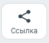
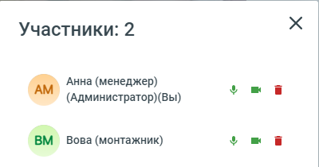
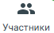

# 7.8. Как добавить или удалить сотрудников и гостей видеоконференции

> Трассировка: PDF §7.8 · сквозные стр. 77-79 · источники: ч.1 `kb/sources/mtalker/UserGuide_Windows_mTalker_ch1_Working.11.06.26.pdf` с.77-79.

Как добавить участников в видеоконференцию Для того чтобы пригласить участника в текущий видео звонок, вам нужно создать ссылку на этот видео звонок и передать ее тому, кого вы приглашаете, например, через чат MTalker. Примечание. Добавить участника в видеоконференцию может любой участник участника в видеоконференцию, а не только администратор. Чтобы создать ссылку на текущую видеоконференцию, в окне проведения видеоконференцию следует:

> **Описание иллюстрации MTALKER-WORK-§7.8-1** · к разделу §7.8 «Как добавить или удалить сотрудников и гостей видеоконференции» · стр. 77 · фрагмент интерфейса (кнопка, переключатель, поле или подпись), 80×71 px.
> Относится к тексту руководства: «…через чат MTalker. Примечание. Добавить участника в видеоконференцию может любой участник участника в видеоконференцию, а не только администратор. Чтобы создать ссылку на текущую видеоконференцию, в окне проведения видеоконференцию следует:»
> Следующий за иллюстрацией текст: «1. нажать на кнопку “Ссылка” . Будет скопирована ссылка на проводимый видео звонок; 2. отправьте скопированную ссылку нужному вам сотруднику или гостю. Для этого воспользуйтесь функцией “Чат” MTalker …»
> Текст на изображении (OCR, требует сверки): Ссылка

1. нажать на кнопку “Ссылка” . Будет скопирована ссылка на проводимый видео звонок; 2. отправьте скопированную ссылку нужному вам сотруднику или гостю. Для этого воспользуйтесь функцией “Чат” MTalker или отправьте по электронной почте или иным способом. Mango Talker для сред ОС Windows и Mac. Руководство пользователя | Версия от 11.06.2026 Получив ссылку, сотрудник или гость сможет присоединиться к вашему звонку. Он сможет видеть и слышать всех участников мероприятия, транслировать видео экрана своего ПК / окна программы, открытой на ПК . Таким образом, вы можете пригласить в видео звонок всех нужных вам участников. Как удалить участника из видеоконференции или выключить его камеру или микрофон Важно. Удаление участника или выключение его камеры или микрофона доступно только администратору видеоконференции. Чтобы удалить участника из видеоконференции или выключить его камеру или микрофон, в окне проведения видеоконференции следует:

> **Описание иллюстрации MTALKER-WORK-§7.8-2** · к разделу §7.8 «Как добавить или удалить сотрудников и гостей видеоконференции» · стр. 78 · фрагмент интерфейса (кнопка, переключатель, поле или подпись), 94×80 px.
> Относится к тексту руководства: «…ажно. Удаление участника или выключение его камеры или микрофона доступно только администратору видеоконференции. Чтобы удалить участника из видеоконференции или выключить его камеру или микрофон, в окне проведения видеоконференции следует:»
> Следующий за иллюстрацией текст: «1. нажмите кнопку “Участники” . Будет открыто окно “Участники”;»
> Текст на изображении (OCR, требует сверки): ee; Участники

1. нажмите кнопку “Участники” . Будет открыто окно “Участники”;

> **Описание иллюстрации MTALKER-WORK-§7.8-3** · к разделу §7.8 «Как добавить или удалить сотрудников и гостей видеоконференции» · стр. 78 · снимок экрана / схема, 400×210 px.
> Относится к тексту руководства: «1. нажмите кнопку “Участники” . Будет открыто окно “Участники”;»
> Следующий за иллюстрацией текст: «2. в окне “Участники” перечислены все участники видеоконференции и иконки управления. Нажмите на иконку, чтобы выполнить нужное вам действие:»
> Текст на изображении (OCR, требует сверки): Участники: 2; Анна (менеджер); vm; (Администратор)(Вы); BM Вова (монтажник)

2. в окне “Участники” перечислены все участники видеоконференции и иконки управления. Нажмите на иконку, чтобы выполнить нужное вам действие:

> **Описание иллюстрации MTALKER-WORK-§7.8-4** · к разделу §7.8 «Как добавить или удалить сотрудников и гостей видеоконференции» · стр. 78 · пиктограмма (значок элемента интерфейса), 19×24 px.
> Относится к тексту руководства: «2. в окне “Участники” перечислены все участники видеоконференции и иконки управления. Нажмите на иконку, чтобы выполнить нужное вам действие:»
> Следующий за иллюстрацией текст: «– нажмите на “Микрофон”, чтобы выключить микрофон участника;»
> Текста на изображении нет; назначение значка — см. текст, к которому он относится.

– нажмите на “Микрофон”, чтобы выключить микрофон участника;

> **Описание иллюстрации MTALKER-WORK-§7.8-5** · к разделу §7.8 «Как добавить или удалить сотрудников и гостей видеоконференции» · стр. 78 · пиктограмма (значок элемента интерфейса), 22×24 px.
> Относится к тексту руководства: «– нажмите на “Микрофон”, чтобы выключить микрофон участника;»
> Следующий за иллюстрацией текст: «– нажмите на “Камера”, чтобы выключить камеру участника;»
> Текста на изображении нет; назначение значка — см. текст, к которому он относится.

– нажмите на “Камера”, чтобы выключить камеру участника;

> **Описание иллюстрации MTALKER-WORK-§7.8-6** · к разделу §7.8 «Как добавить или удалить сотрудников и гостей видеоконференции» · стр. 78 · пиктограмма (значок элемента интерфейса), 23×25 px.
> Относится к тексту руководства: «– нажмите на “Камера”, чтобы выключить камеру участника;»
> Следующий за иллюстрацией текст: «– нажмите на “Корзина”, чтобы удалить участника. Как пригласить участника звонком во время видеоконференции Во время видеоконференции вы можете пригласить участника с помощью звонка. Чтобы выполнить з…»
> Текста на изображении нет; назначение значка — см. текст, к которому он относится.

– нажмите на “Корзина”, чтобы удалить участника. Как пригласить участника звонком во время видеоконференции Во время видеоконференции вы можете пригласить участника с помощью звонка. Чтобы выполнить звонок участнику:

> **Описание иллюстрации MTALKER-WORK-§7.8-7** · к разделу §7.8 «Как добавить или удалить сотрудников и гостей видеоконференции» · стр. 78 · фрагмент интерфейса (кнопка, переключатель, поле или подпись), 68×42 px.
> Относится к тексту руководства: «– нажмите на “Корзина”, чтобы удалить участника. Как пригласить участника звонком во время видеоконференции Во время видеоконференции вы можете пригласить участника с помощью звонка. Чтобы выполнить звонок участнику:»
> Следующий за иллюстрацией текст: «1. в окне видеоконференции нажмите кнопку “Участники” ; 2. нажмите кнопку “Пригласить на встречу” 3. выберите нужного сотрудника из списка; 4. нажмите кнопку «Пригласить». Выбранному участнику будет о…»

1. в окне видеоконференции нажмите кнопку “Участники” ; 2. нажмите кнопку “Пригласить на встречу” 3. выберите нужного сотрудника из списка; 4. нажмите кнопку «Пригласить». Выбранному участнику будет отправлен входящий звонок видеоконференции. После принятия вызова участник автоматически присоединится к текущей видеоконференции. Mango Talker для сред ОС Windows и Mac. Руководство пользователя | Версия от 11.06.2026
