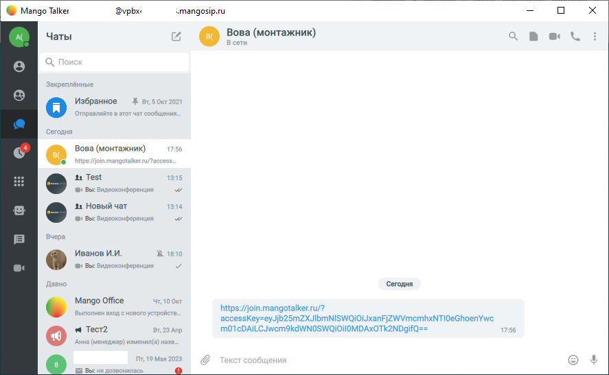
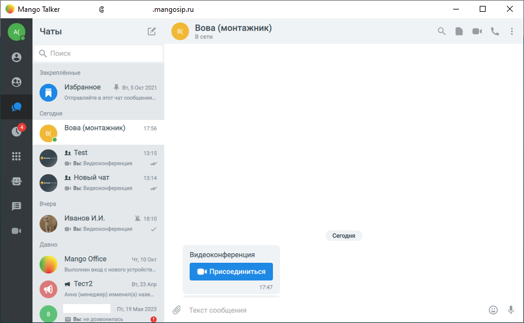
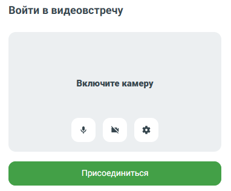

# 7.9. Как присоединиться по ссылке к видеоконференции

> Трассировка: PDF §7.9 · сквозные стр. 79-81 · источники: ч.1 `kb/sources/mtalker/UserGuide_Windows_mTalker_ch1_Working.11.06.26.pdf` с.79-81.

Важная информация Когда вас приглашают на видеоконференцию, вам отправляют ссылку на нее через чат MTalker или иным способом, например через email. При этом, в чате MTalker ссылка на видеоконференцию может выглядеть: • как обычная http-ссылка (если сообщение отправлено вручную):

> **Описание иллюстрации MTALKER-WORK-§7.9-1** · к разделу §7.9 «Как присоединиться по ссылке к видеоконференции» · стр. 79 · снимок экрана / схема, 887×547 px.
> Относится к тексту руководства: «…на видеоконференцию, вам отправляют ссылку на нее через чат MTalker или иным способом, например через email. При этом, в чате MTalker ссылка на видеоконференцию может выглядеть: • как обычная http-ссылка (если сообщение отправлено вручную):»
> Следующий за иллюстрацией текст: «• или как автоматически созданное сообщение “Видеоконференция” с кнопкой “Присоединиться”:»
> Текст на изображении (OCR, требует сверки): e@ Mango Talker; ®vpbx-; imangosip.ru; Чаты; © Вова (монтажник); Закреплённые; 5 Окт; Избранное; Ж Br,; 21; Отправляйте в этот чат; общения.; Сегодня; Вова (монтажник); 7:5; 15; ®‹ Вы: Видеоконференция; 2: Новый чат; 14; Вчера; Иванов И.И.; Хх; 18:10; Давно; Mango Office; Чт, 10 Окт; https://join.mangotalker.ru/?; Выпо.; нен вход с нового устройств.; accessKey=eyJjb25mZXJIbmNISWQiOiJxanFJZWVmemhxNT/lOeGhoenYwe; 4 Тест2; Вт, 23 Апр; m01cDAiLCJwem9kdWNOSWQiOiIOMDAxOTk2NDgifQ==; Анна (менеджер) изменил(а; назв.; 19 Мая; Ба Вы: не дозвони,

• или как автоматически созданное сообщение “Видеоконференция” с кнопкой “Присоединиться”:

> **Описание иллюстрации MTALKER-WORK-§7.9-2** · к разделу §7.9 «Как присоединиться по ссылке к видеоконференции» · стр. 79 · снимок экрана / схема, 887×547 px.
> Относится к тексту руководства: «• или как автоматически созданное сообщение “Видеоконференция” с кнопкой “Присоединиться”:»
> Следующий за иллюстрацией текст: «Mango Talker для сред ОС Windows и Mac. Руководство пользователя | Версия от 11.06.2026 Примечание. Ссылка на видеоконференцию работает одинаково для обоих вариантов отображения ссылки в чате MTalker.…»
> Текст на изображении (OCR, требует сверки): e@ Mango Talker; «Mangosip.ru; Чаты; г © Вова (монтажник); Закреплённые; Избранное; Ж вт, 5 Окт; Отправляйте в этот чат с; бщения.; Сегодня; Вова (монтажник); 15; ®‹ Вы: Видеоконференция; 2: Новый чат; 13:14; Вчера; Иванов И.И.; Хх; 18:10; Давно; Mango Office; Чт, 10 Окт; Видеоконференция; Выполнен вход с ново:; ройств.; et Тест2; Вт, 23 Апр; Анна (менеджер) изменил(а; назв.; Пт, 19 Ма:; los; Ga Вы: не дозвонила

Mango Talker для сред ОС Windows и Mac. Руководство пользователя | Версия от 11.06.2026 Примечание. Ссылка на видеоконференцию работает одинаково для обоих вариантов отображения ссылки в чате MTalker. Чтобы присоединиться к видеоконференции по ссылке, следует: 1. нажать на ссылку на видеоконференцию или кнопку “Присоединиться”; 2. будет открыто окно “Присоединиться”, в котором перед подключением к видеоконференции вы можете:

> **Описание иллюстрации MTALKER-WORK-§7.9-3** · к разделу §7.9 «Как присоединиться по ссылке к видеоконференции» · стр. 80 · пиктограмма (значок элемента интерфейса), 51×48 px.
> Относится к тексту руководства: «…ате MTalker. Чтобы присоединиться к видеоконференции по ссылке, следует: 1. нажать на ссылку на видеоконференцию или кнопку “Присоединиться”; 2. будет открыто окно “Присоединиться”, в котором перед подключением к видеоконференции вы можете:»
> Следующий за иллюстрацией текст: «• включить или выключить микрофон ;»
> Текста на изображении нет; назначение значка — см. текст, к которому он относится.

• включить или выключить микрофон ;

> **Описание иллюстрации MTALKER-WORK-§7.9-4** · к разделу §7.9 «Как присоединиться по ссылке к видеоконференции» · стр. 80 · пиктограмма (значок элемента интерфейса), 48×48 px.
> Относится к тексту руководства: «• включить или выключить микрофон ;»
> Следующий за иллюстрацией текст: «• включить или выключить камеру ; • установить настройки вашего участия в видеоконференции (например, размытие фона)»
> Текста на изображении нет; назначение значка — см. текст, к которому он относится.

• включить или выключить камеру ; • установить настройки вашего участия в видеоконференции (например, размытие фона)

> **Описание иллюстрации MTALKER-WORK-§7.9-5** · к разделу §7.9 «Как присоединиться по ссылке к видеоконференции» · стр. 80 · пиктограмма (значок элемента интерфейса), 46×47 px.
> Относится к тексту руководства: «• включить или выключить камеру ; • установить настройки вашего участия в видеоконференции (например, размытие фона)»
> Следующий за иллюстрацией текст: «. 3. нажать кнопку “Присоединиться”.»
> Текста на изображении нет; назначение значка — см. текст, к которому он относится.

. 3. нажать кнопку “Присоединиться”.

> **Описание иллюстрации MTALKER-WORK-§7.9-6** · к разделу §7.9 «Как присоединиться по ссылке к видеоконференции» · стр. 80 · снимок экрана / схема, 382×316 px.
> Относится к тексту руководства: «. 3. нажать кнопку “Присоединиться”.»
> Следующий за иллюстрацией текст: «Mango Talker для сред ОС Windows и Mac. Руководство пользователя | Версия от 11.06.2026»
> Текст на изображении (OCR, требует сверки): Войти в видеовстречу; Включите камеру; by

Mango Talker для сред ОС Windows и Mac. Руководство пользователя | Версия от 11.06.2026
