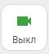

# 7.12. Как настроить собственные камеру и микрофон

> Трассировка: PDF §7.12 · сквозные стр. 82-83 · источники: ч.1 `kb/sources/mtalker/UserGuide_Windows_mTalker_ch1_Working.11.06.26.pdf` с.82-83.

Как включить или выключить Для того чтобы выключить вашу камеру / микрофон во время разговора, в окне проведения видеозвонка / на панели управления видеозвонком нажмите кнопку:

> **Описание иллюстрации MTALKER-WORK-§7.12-1** · к разделу §7.12 «Как настроить собственные камеру и микрофон» · стр. 82 · фрагмент интерфейса (кнопка, переключатель, поле или подпись), 63×69 px.
> Относится к тексту руководства: «Как включить или выключить Для того чтобы выключить вашу камеру / микрофон во время разговора, в окне проведения видеозвонка / на панели управления видеозвонком нажмите кнопку:»
> Следующий за иллюстрацией текст: «• . Будет выключена ваша камера и ваши собеседники вас не увидят;»

• . Будет выключена ваша камера и ваши собеседники вас не увидят;

> **Описание иллюстрации MTALKER-WORK-§7.12-2** · к разделу §7.12 «Как настроить собственные камеру и микрофон» · стр. 82 · фрагмент интерфейса (кнопка, переключатель, поле или подпись), 64×67 px.
> Относится к тексту руководства: «• . Будет выключена ваша камера и ваши собеседники вас не увидят;»
> Следующий за иллюстрацией текст: «• . Будет выключен ваш микрофон и ваши собеседники вас не услышат. Как выбрать камеру или микрофон и проверить их работу В этом разделе описано, как во время видеоконференции выбрать камеру или микроф…»

• . Будет выключен ваш микрофон и ваши собеседники вас не услышат. Как выбрать камеру или микрофон и проверить их работу В этом разделе описано, как во время видеоконференции выбрать камеру или микрофон, или динамик, а также проверить их работу. Вот как это сделать:

> **Описание иллюстрации MTALKER-WORK-§7.12-3** · к разделу §7.12 «Как настроить собственные камеру и микрофон» · стр. 82 · фрагмент интерфейса (кнопка, переключатель, поле или подпись), 80×65 px.
> Относится к тексту руководства: «…рофон и ваши собеседники вас не услышат. Как выбрать камеру или микрофон и проверить их работу В этом разделе описано, как во время видеоконференции выбрать камеру или микрофон, или динамик, а также проверить их работу. Вот как это сделать:»
> Следующий за иллюстрацией текст: «1. нажмите на кнопку “Настройки” в окне видеоконференции. Будет открыто окно “Настройки”;»
> Текст на изображении (OCR, требует сверки): Настройки

1. нажмите на кнопку “Настройки” в окне видеоконференции. Будет открыто окно “Настройки”;

> **Описание иллюстрации MTALKER-WORK-§7.12-4** · к разделу §7.12 «Как настроить собственные камеру и микрофон» · стр. 82 · пиктограмма (значок элемента интерфейса), 39×31 px.
> Относится к тексту руководства: «1. нажмите на кнопку “Настройки” в окне видеоконференции. Будет открыто окно “Настройки”;»
> Следующий за иллюстрацией текст: «2. чтобы выбрать камеру или проверить ее работу, нажмите на пункт “Видео” . Будет открыт раздел настроек видео, в котором вы можете: – в поле “Камера” выбрать камеру, подключенную к вашему ПК; – в пол…»
> Текста на изображении нет; назначение значка — см. текст, к которому он относится.

2. чтобы выбрать камеру или проверить ее работу, нажмите на пункт “Видео” . Будет открыт раздел настроек видео, в котором вы можете: – в поле “Камера” выбрать камеру, подключенную к вашему ПК; – в поле “Изменить фон” можете включить или выключить эффект размытия фона или подстановку фонового изображения; 3. чтобы выбрать микрофон и динами или проверить их работу, нажмите на пункт “Звук”

> **Описание иллюстрации MTALKER-WORK-§7.12-5** · к разделу §7.12 «Как настроить собственные камеру и микрофон» · стр. 82 · пиктограмма (значок элемента интерфейса), 39×39 px.
> Относится к тексту руководства: «…” выбрать камеру, подключенную к вашему ПК; – в поле “Изменить фон” можете включить или выключить эффект размытия фона или подстановку фонового изображения; 3. чтобы выбрать микрофон и динами или проверить их работу, нажмите на пункт “Звук”»
> Следующий за иллюстрацией текст: «. Будет открыт раздел настроек звука, в котором вы можете: – в поле “Микрофон” выбрать микрофон, подключенный к вашему ПК. Под полем “Микрофон” расположена шкала, показывающая уровень громкости выбран…»
> Текста на изображении нет; назначение значка — см. текст, к которому он относится.

. Будет открыт раздел настроек звука, в котором вы можете: – в поле “Микрофон” выбрать микрофон, подключенный к вашему ПК. Под полем “Микрофон” расположена шкала, показывающая уровень громкости выбранного микрофона; – в поле “Динамики” выбрать динамики, подключенные к вашему ПК. Справа от

> **Описание иллюстрации MTALKER-WORK-§7.12-6** · к разделу §7.12 «Как настроить собственные камеру и микрофон» · стр. 82 · пиктограмма (значок элемента интерфейса), 37×39 px.
> Относится к тексту руководства: «…ы можете: – в поле “Микрофон” выбрать микрофон, подключенный к вашему ПК. Под полем “Микрофон” расположена шкала, показывающая уровень громкости выбранного микрофона; – в поле “Динамики” выбрать динамики, подключенные к вашему ПК. Справа от»
> Следующий за иллюстрацией текст: «поля “Динамики” расположена кнопка для проверки работы динамиков . Нажмите на нее, чтобы услышать громкость ваших динамиков; – с помощью переключателя “Громкость” вы можете настроить громкость звучани…»
> Текста на изображении нет; назначение значка — см. текст, к которому он относится.

поля “Динамики” расположена кнопка для проверки работы динамиков . Нажмите на нее, чтобы услышать громкость ваших динамиков; – с помощью переключателя “Громкость” вы можете настроить громкость звучания динамиков. Mango Talker для сред ОС Windows и Mac. Руководство пользователя | Версия от 11.06.2026 4. нажмите кнопку “Закрыть”, чтобы закрыто окно “Настройки” и вернуться к окну проведения видеоконференции.
