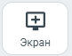
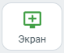

# 7.13. Включение демонстрации экрана

> Трассировка: PDF §7.13 · сквозные стр. 83 · источники: ч.1 `kb/sources/mtalker/UserGuide_Windows_mTalker_ch1_Working.11.06.26.pdf` с.83.

Как включить или выключить Во время участия в видеозвонке вы можете транслировать видео вашего экрана / программы, открытой на вашем ПК. Для того чтобы запустить демонстрацию экрана, в окне проведения видео звонка нажмите кнопку

> **Описание иллюстрации MTALKER-WORK-§7.13-1** · к разделу §7.13 «Включение демонстрации экрана» · стр. 83 · фрагмент интерфейса (кнопка, переключатель, поле или подпись), 81×63 px.
> Относится к тексту руководства: «Как включить или выключить Во время участия в видеозвонке вы можете транслировать видео вашего экрана / программы, открытой на вашем ПК. Для того чтобы запустить демонстрацию экрана, в окне проведения видео звонка нажмите кнопку»
> Следующий за иллюстрацией текст: «с изображением монитора (подсвечена серым цветом) . Будет запущена трансляция изображения на вашем мониторе. При этом, все участники, кроме вас, будут видеть в окне проведения видеоконференции, трансл…»
> Текст на изображении (OCR, требует сверки): Экран

с изображением монитора (подсвечена серым цветом) . Будет запущена трансляция изображения на вашем мониторе. При этом, все участники, кроме вас, будут видеть в окне проведения видеоконференции, трансляцию изображения на вашем мониторе. Чтобы выключить демонстрацию экрана, нажмите кнопку изображением монитора (подсвечена

> **Описание иллюстрации MTALKER-WORK-§7.13-2** · к разделу §7.13 «Включение демонстрации экрана» · стр. 83 · фрагмент интерфейса (кнопка, переключатель, поле или подпись), 79×66 px.
> Относится к тексту руководства: «…бражения на вашем мониторе. При этом, все участники, кроме вас, будут видеть в окне проведения видеоконференции, трансляцию изображения на вашем мониторе. Чтобы выключить демонстрацию экрана, нажмите кнопку изображением монитора (подсвечена»
> Следующий за иллюстрацией текст: «зеленым цветом) . Будет завершена трансляция изображения на вашем мониторе. Как настроить качество трансляции Вот как это сделать:»

зеленым цветом) . Будет завершена трансляция изображения на вашем мониторе. Как настроить качество трансляции Вот как это сделать:

> **Описание иллюстрации MTALKER-WORK-§7.13-3** · к разделу §7.13 «Включение демонстрации экрана» · стр. 83 · фрагмент интерфейса (кнопка, переключатель, поле или подпись), 80×65 px.
> Относится к тексту руководства: «зеленым цветом) . Будет завершена трансляция изображения на вашем мониторе. Как настроить качество трансляции Вот как это сделать:»
> Следующий за иллюстрацией текст: «1. нажмите на кнопку “Настройки” в окне видеоконференции. Будет открыто окно “Настройки”;»
> Текст на изображении (OCR, требует сверки): Настройки

1. нажмите на кнопку “Настройки” в окне видеоконференции. Будет открыто окно “Настройки”;

> **Описание иллюстрации MTALKER-WORK-§7.13-4** · к разделу §7.13 «Включение демонстрации экрана» · стр. 83 · пиктограмма (значок элемента интерфейса), 48×46 px.
> Относится к тексту руководства: «1. нажмите на кнопку “Настройки” в окне видеоконференции. Будет открыто окно “Настройки”;»
> Следующий за иллюстрацией текст: «2. нажмите на пункт “Демонстрация экрана” ; 3. выберите качество изображения транслируемого экрана: – Full HD (оптимальная производительность); – Максимальное (Максимальное качество изображения). 4. н…»
> Текста на изображении нет; назначение значка — см. текст, к которому он относится.

2. нажмите на пункт “Демонстрация экрана” ; 3. выберите качество изображения транслируемого экрана: – Full HD (оптимальная производительность); – Максимальное (Максимальное качество изображения). 4. нажмите кнопку “Закрыть”, чтобы закрыто окно “Настройки” и вернуться к видеоконференции.
