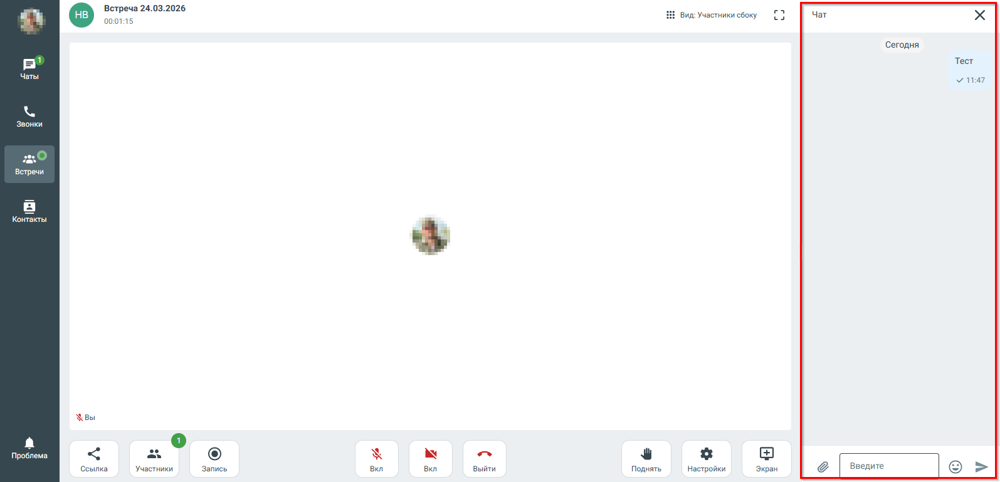
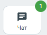

# 7.18. Чат во время видеоконференции

> Трассировка: PDF §7.18 · сквозные стр. 85-87 · источники: ч.1 `kb/sources/mtalker/UserGuide_Windows_mTalker_ch1_Working.11.06.26.pdf` с.85-87.

Во время проведения видеоконференции в MTalker доступен встроенный чат, который позволяет участникам обмениваться сообщениями в режиме реального времени. Чат доступен всем участникам видеоконференции. В окне видеоконференции перейдите в «Чат» — справа на экране будет открыто окно чата.

> **Описание иллюстрации MTALKER-WORK-§7.18-1** · к разделу §7.18 «Чат во время видеоконференции» · стр. 85 · снимок экрана / схема, 1595×769 px.
> Относится к тексту руководства: «… доступен встроенный чат, который позволяет участникам обмениваться сообщениями в режиме реального времени. Чат доступен всем участникам видеоконференции. В окне видеоконференции перейдите в «Чат» — справа на экране будет открыто окно чата.»
> Следующий за иллюстрацией текст: «В чате доступны следующие возможности: • отправка текстовых сообщений; • отправка файлов, изображений и ссылок; • ответ на сообщения; • удаление отправленных сообщений. После отправки сообщение мгнове…»
> Текст на изображении (OCR, требует сверки): Встреча 24.03.2026; 00:01:15; Вид: Участники сбоку; cs; Yar; ‘Сегодня; Тест; Maret; va?; ки; Встречи; Контакты; вы; Проблема; Хх; Ссылка; Участники; Запись; Вкл; Выйти; Поднять; "Настройки; Экран; Введите

В чате доступны следующие возможности: • отправка текстовых сообщений; • отправка файлов, изображений и ссылок; • ответ на сообщения; • удаление отправленных сообщений. После отправки сообщение мгновенно отображается у всех участников видеоконференции. Mango Talker для сред ОС Windows и Mac. Руководство пользователя | Версия от 11.06.2026 При поступлении нового сообщения на кнопке “Чат” отображается индикатор новых

> **Описание иллюстрации MTALKER-WORK-§7.18-2** · к разделу §7.18 «Чат во время видеоконференции» · стр. 86 · фрагмент интерфейса (кнопка, переключатель, поле или подпись), 98×73 px.
> Относится к тексту руководства: «…равки сообщение мгновенно отображается у всех участников видеоконференции. Mango Talker для сред ОС Windows и Mac. Руководство пользователя | Версия от 11.06.2026 При поступлении нового сообщения на кнопке “Чат” отображается индикатор новых»
> Следующий за иллюстрацией текст: «сообщений . Примечание. Чат видеоконференции является временным и не отображается в общем списке чатов MTalker. Mango Talker для сред ОС Windows и Mac. Руководство пользователя | Версия от 11.06.2026»
> Текст на изображении (OCR, требует сверки): Чат

сообщений . Примечание. Чат видеоконференции является временным и не отображается в общем списке чатов MTalker. Mango Talker для сред ОС Windows и Mac. Руководство пользователя | Версия от 11.06.2026
