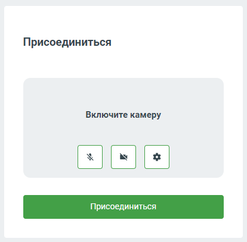
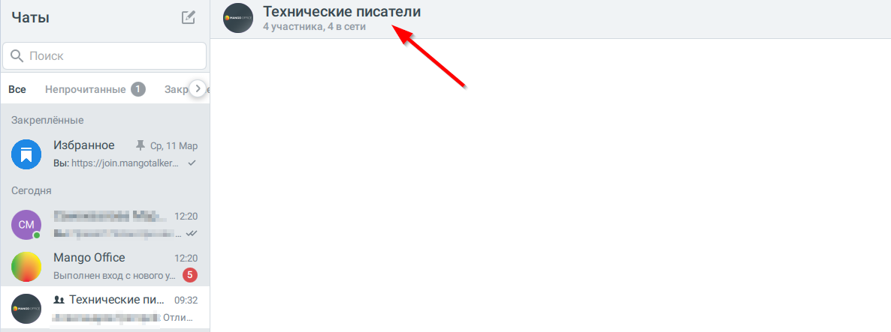
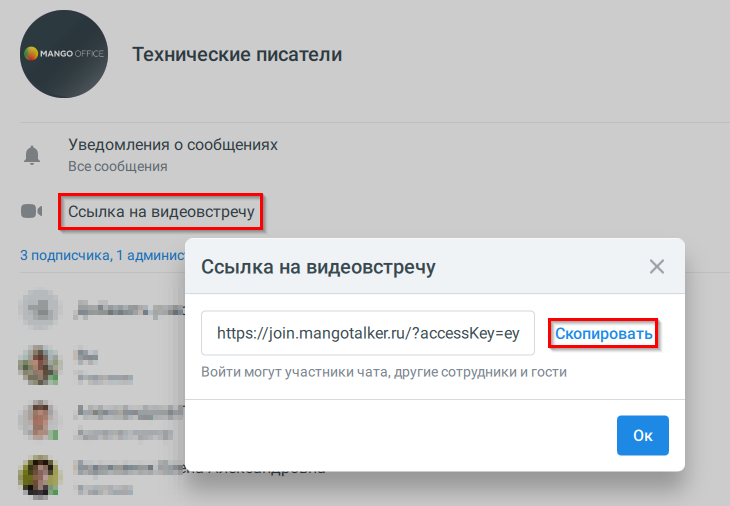

# 8.4. Работа с видеоконференцией (ВКС)

> Трассировка: PDF §8.4 · сквозные стр. 89-96 · источники: ч.1 `kb/sources/mtalker/UserGuide_Windows_mTalker_ch1_Working.11.06.26.pdf` с.89-96.

Общее Вы можете создать новую видео конференцию и пригласить в нее участников, предоставь им ссылку для присоединения. И наоборот, вы можете присоединиться по ссылке к видеоконференции, созданной другим сотрудником. При использовании видеоконференций пользователю могут отображаться подсказки и уведомления, описанные в разделе «Видеоконференции». Как создать новую видеоконференцию и предоставить ссылку для присоединения

> **Описание иллюстрации MTALKER-WORK-§8.4-1** · к разделу §8.4 «Работа с видеоконференцией (ВКС)» · стр. 89 · пиктограмма (значок элемента интерфейса), 38×42 px.
> Относится к тексту руководства: «…ии, созданной другим сотрудником. При использовании видеоконференций пользователю могут отображаться подсказки и уведомления, описанные в разделе «Видеоконференции». Как создать новую видеоконференцию и предоставить ссылку для присоединения»
> Следующий за иллюстрацией текст: «Для этого, в основном окне MTalker в разделе “Конференции” следует:»
> Текста на изображении нет; назначение значка — см. текст, к которому он относится.

Для этого, в основном окне MTalker в разделе “Конференции” следует:

> **Описание иллюстрации MTALKER-WORK-§8.4-2** · к разделу §8.4 «Работа с видеоконференцией (ВКС)» · стр. 89 · пиктограмма (значок элемента интерфейса), 46×47 px.
> Относится к тексту руководства: «Для этого, в основном окне MTalker в разделе “Конференции” следует:»
> Следующий за иллюстрацией текст: «1. нажмите на пункт “Создать ссылку на новую видеоконференцию” . Будет открыто окно “Ссылка на видеоконференцию”; 2. нажмите кнопку “Копировать”. Будет скопирована ссылка для присоединения к видеоконф…»
> Текста на изображении нет; назначение значка — см. текст, к которому он относится.

1. нажмите на пункт “Создать ссылку на новую видеоконференцию” . Будет открыто окно “Ссылка на видеоконференцию”; 2. нажмите кнопку “Копировать”. Будет скопирована ссылка для присоединения к видеоконференции; 3. передайте ссылку на видеоконференцию всем, кто должен принимать участие в видеоконференции. Не более 8 человек; 4. нажмите кнопку “Открыть” в окне “Ссылка на видеоконференцию”. Будет выполнено одно из действий: – если включена настройка “Открывать видеозвонки во внешнем браузере” в разделе “Видео” вашего MTalker, то будет открыта новая страница браузера, на которой вам будет предложено авторизоваться в MTalker или войти как гость в видеоконференцию. Выполните одно из действий: • если вы хотите войти в видеоконференцию как сотрудник, то: 1. нажмите кнопку “Авторизоваться”; 2. войдите в ваш аккаунт MTalker при помощи логина и пароля или с помощью короткого кода; 3. в поле “Включите камеру” перед тем, как присоединиться к

> **Описание иллюстрации MTALKER-WORK-§8.4-3** · к разделу §8.4 «Работа с видеоконференцией (ВКС)» · стр. 89 · пиктограмма (значок элемента интерфейса), 51×48 px.
> Относится к тексту руководства: «… вы хотите войти в видеоконференцию как сотрудник, то: 1. нажмите кнопку “Авторизоваться”; 2. войдите в ваш аккаунт MTalker при помощи логина и пароля или с помощью короткого кода; 3. в поле “Включите камеру” перед тем, как присоединиться к»
> Следующий за иллюстрацией текст: «видеоконференции, вы можете: включить микрофон;»
> Текста на изображении нет; назначение значка — см. текст, к которому он относится.

> **Описание иллюстрации MTALKER-WORK-§8.4-4** · к разделу §8.4 «Работа с видеоконференцией (ВКС)» · стр. 89 · пиктограмма (значок элемента интерфейса), 48×48 px.
> Относится к тексту руководства: «… вы хотите войти в видеоконференцию как сотрудник, то: 1. нажмите кнопку “Авторизоваться”; 2. войдите в ваш аккаунт MTalker при помощи логина и пароля или с помощью короткого кода; 3. в поле “Включите камеру” перед тем, как присоединиться к»
> Следующий за иллюстрацией текст: «видеоконференции, вы можете: включить микрофон;»
> Текста на изображении нет; назначение значка — см. текст, к которому он относится.

видеоконференции, вы можете: включить микрофон;

> **Описание иллюстрации MTALKER-WORK-§8.4-5** · к разделу §8.4 «Работа с видеоконференцией (ВКС)» · стр. 89 · пиктограмма (значок элемента интерфейса), 46×47 px.
> Относится к тексту руководства: «видеоконференции, вы можете: включить микрофон;»
> Следующий за иллюстрацией текст: «включить камеру; установить настройки вашего участия в видеоконференции (например, размытие вашего фона); 4. затем в окне “Присоединиться” нажмите кнопку “Присоединиться”. После этого, вы присоедините…»
> Текста на изображении нет; назначение значка — см. текст, к которому он относится.

включить камеру; установить настройки вашего участия в видеоконференции (например, размытие вашего фона); 4. затем в окне “Присоединиться” нажмите кнопку “Присоединиться”. После этого, вы присоединитесь к видеозвонку; • если вы хотите войти в видеоконференцию как гость (без авторизации), то: 1. нажмите кнопку “Войти как гость”; 2. укажите ваше имя в поле “Ваше имя”; Mango Talker для сред ОС Windows и Mac. Руководство пользователя | Версия от 11.06.2026 3. в поле “Включите камеру” перед тем, как присоединиться к

> **Описание иллюстрации MTALKER-WORK-§8.4-6** · к разделу §8.4 «Работа с видеоконференцией (ВКС)» · стр. 90 · пиктограмма (значок элемента интерфейса), 51×48 px.
> Относится к тексту руководства: «…вторизации), то: 1. нажмите кнопку “Войти как гость”; 2. укажите ваше имя в поле “Ваше имя”; Mango Talker для сред ОС Windows и Mac. Руководство пользователя | Версия от 11.06.2026 3. в поле “Включите камеру” перед тем, как присоединиться к»
> Следующий за иллюстрацией текст: «видеоконференции, вы можете: включить микрофон;»
> Текста на изображении нет; назначение значка — см. текст, к которому он относится.

> **Описание иллюстрации MTALKER-WORK-§8.4-7** · к разделу §8.4 «Работа с видеоконференцией (ВКС)» · стр. 90 · пиктограмма (значок элемента интерфейса), 48×48 px.
> Относится к тексту руководства: «…вторизации), то: 1. нажмите кнопку “Войти как гость”; 2. укажите ваше имя в поле “Ваше имя”; Mango Talker для сред ОС Windows и Mac. Руководство пользователя | Версия от 11.06.2026 3. в поле “Включите камеру” перед тем, как присоединиться к»
> Следующий за иллюстрацией текст: «видеоконференции, вы можете: включить микрофон;»
> Текста на изображении нет; назначение значка — см. текст, к которому он относится.

видеоконференции, вы можете: включить микрофон;

> **Описание иллюстрации MTALKER-WORK-§8.4-8** · к разделу §8.4 «Работа с видеоконференцией (ВКС)» · стр. 90 · пиктограмма (значок элемента интерфейса), 46×47 px.
> Относится к тексту руководства: «видеоконференции, вы можете: включить микрофон;»
> Следующий за иллюстрацией текст: «включить камеру; установить настройки вашего участия в видеоконференции (например, размытие вашего фона); 4. затем в окне “Присоединиться” нажмите кнопку “Присоединиться”. После этого, вы присоедините…»
> Текста на изображении нет; назначение значка — см. текст, к которому он относится.

включить камеру; установить настройки вашего участия в видеоконференции (например, размытие вашего фона); 4. затем в окне “Присоединиться” нажмите кнопку “Присоединиться”. После этого, вы присоединитесь к видеозвонку;

> **Описание иллюстрации MTALKER-WORK-§8.4-9** · к разделу §8.4 «Работа с видеоконференцией (ВКС)» · стр. 90 · снимок экрана / схема, 479×531 px.
> Относится к тексту руководства: «включить камеру; установить настройки вашего участия в видеоконференции (например, размытие вашего фона); 4. затем в окне “Присоединиться” нажмите кнопку “Присоединиться”. После этого, вы присоединитесь к видеозвонку;»
> Следующий за иллюстрацией текст: «– Если выключена настройка “Открывать видеозвонки во внешнем браузере” в разделе “Видео” вашего MTalker, то: 1. в окне MTalker будет открыто окно “Присоединиться”, в котором, перед»
> Текст на изображении (OCR, требует сверки): МАМСО; облачные; изнес-; OFFICE; коммуникации; Вход в Mango Talker; Войти как гость

– Если выключена настройка “Открывать видеозвонки во внешнем браузере” в разделе “Видео” вашего MTalker, то: 1. в окне MTalker будет открыто окно “Присоединиться”, в котором, перед

> **Описание иллюстрации MTALKER-WORK-§8.4-10** · к разделу §8.4 «Работа с видеоконференцией (ВКС)» · стр. 90 · снимок экрана / схема, 414×407 px.
> Относится к тексту руководства: «– Если выключена настройка “Открывать видеозвонки во внешнем браузере” в разделе “Видео” вашего MTalker, то: 1. в окне MTalker будет открыто окно “Присоединиться”, в котором, перед»
> Следующий за иллюстрацией текст: «тем, как присоединиться к видеоконференции, вы можете: включить»
> Текст на изображении (OCR, требует сверки): Присоединиться; Включите камеру; зы

тем, как присоединиться к видеоконференции, вы можете: включить

> **Описание иллюстрации MTALKER-WORK-§8.4-11** · к разделу §8.4 «Работа с видеоконференцией (ВКС)» · стр. 90 · пиктограмма (значок элемента интерфейса), 41×40 px.
> Относится к тексту руководства: «тем, как присоединиться к видеоконференции, вы можете: включить»
> Следующий за иллюстрацией текст: «микрофон; включить камеру; установить настройки вашего участия в видеоконференции (например, размытие вашего фона). 2. Затем в окне “Присоединиться” нажмите кнопку “Присоединиться”. После этого, вы пр…»
> Текста на изображении нет; назначение значка — см. текст, к которому он относится.

> **Описание иллюстрации MTALKER-WORK-§8.4-12** · к разделу §8.4 «Работа с видеоконференцией (ВКС)» · стр. 90 · фрагмент интерфейса (кнопка, переключатель, поле или подпись), 65×66 px.
> Относится к тексту руководства: «тем, как присоединиться к видеоконференции, вы можете: включить»
> Следующий за иллюстрацией текст: «микрофон; включить камеру; установить настройки вашего участия в видеоконференции (например, размытие вашего фона). 2. Затем в окне “Присоединиться” нажмите кнопку “Присоединиться”. После этого, вы пр…»

микрофон; включить камеру; установить настройки вашего участия в видеоконференции (например, размытие вашего фона). 2. Затем в окне “Присоединиться” нажмите кнопку “Присоединиться”. После этого, вы присоединитесь к видеозвонку.

> **Описание иллюстрации MTALKER-WORK-§8.4-13** · к разделу §8.4 «Работа с видеоконференцией (ВКС)» · стр. 90 · пиктограмма (значок элемента интерфейса), 51×48 px.
> Относится к тексту руководства: «микрофон; включить камеру; установить настройки вашего участия в видеоконференции (например, размытие вашего фона). 2. Затем в окне “Присоединиться” нажмите кнопку “Присоединиться”. После этого, вы присоединитесь к видеозвонку.»
> Следующий за иллюстрацией текст: «Как присоединиться по ссылке к ВКС Если вы получили ссылку на видеоконференцию и хотите присоединиться к видеоконференции,»
> Текста на изображении нет; назначение значка — см. текст, к которому он относится.

Как присоединиться по ссылке к ВКС Если вы получили ссылку на видеоконференцию и хотите присоединиться к видеоконференции,

> **Описание иллюстрации MTALKER-WORK-§8.4-14** · к разделу §8.4 «Работа с видеоконференцией (ВКС)» · стр. 90 · пиктограмма (значок элемента интерфейса), 48×48 px.
> Относится к тексту руководства: «Как присоединиться по ссылке к ВКС Если вы получили ссылку на видеоконференцию и хотите присоединиться к видеоконференции,»
> Следующий за иллюстрацией текст: «в основном окне MTalker, в разделе “Конференции” выполните: Mango Talker для сред ОС Windows и Mac. Руководство пользователя | Версия от 11.06.2026»
> Текста на изображении нет; назначение значка — см. текст, к которому он относится.

в основном окне MTalker, в разделе “Конференции” выполните: Mango Talker для сред ОС Windows и Mac. Руководство пользователя | Версия от 11.06.2026

> **Описание иллюстрации MTALKER-WORK-§8.4-15** · к разделу §8.4 «Работа с видеоконференцией (ВКС)» · стр. 91 · пиктограмма (значок элемента интерфейса), 46×47 px.
> Относится к тексту руководства: «в основном окне MTalker, в разделе “Конференции” выполните: Mango Talker для сред ОС Windows и Mac. Руководство пользователя | Версия от 11.06.2026»
> Следующий за иллюстрацией текст: «1. нажмите на кнопку “Присоединиться по ссылке” . Будет открыто окно “Вход в видеоконференцию”; 2. введите скопированную ссылку в поле “Ссылка”; 3. нажмите кнопку “Открыть”. Будет выполнено одно из де…»
> Текста на изображении нет; назначение значка — см. текст, к которому он относится.

1. нажмите на кнопку “Присоединиться по ссылке” . Будет открыто окно “Вход в видеоконференцию”; 2. введите скопированную ссылку в поле “Ссылка”; 3. нажмите кнопку “Открыть”. Будет выполнено одно из действий: – если включена настройка “Открывать видеозвонки во внешнем браузере” в разделе “Видео” вашего MTalker, то будет открыта новая страница браузера, на которой вам будет предложено авторизоваться в MTalker или войти как гость в видеоконференцию. Выполните одно из действий: • если вы хотите войти в видеоконференцию как сотрудник, то: 1. нажмите кнопку “Авторизоваться”; 2. войдите в ваш аккаунт MTalker при помощи логина и пароля или с помощью короткого кода; 3. в поле “Включите камеру” перед тем, как присоединиться к

> **Описание иллюстрации MTALKER-WORK-§8.4-16** · к разделу §8.4 «Работа с видеоконференцией (ВКС)» · стр. 91 · снимок экрана / схема, 479×531 px.
> Относится к тексту руководства: «… вы хотите войти в видеоконференцию как сотрудник, то: 1. нажмите кнопку “Авторизоваться”; 2. войдите в ваш аккаунт MTalker при помощи логина и пароля или с помощью короткого кода; 3. в поле “Включите камеру” перед тем, как присоединиться к»
> Следующий за иллюстрацией текст: «видеоконференции, вы можете: включить микрофон;»
> Текст на изображении (OCR, требует сверки): МАМСО; облачные; изнес-; OFFICE; коммуникации; Вход в Mango Talker; Войти как гость

> **Описание иллюстрации MTALKER-WORK-§8.4-17** · к разделу §8.4 «Работа с видеоконференцией (ВКС)» · стр. 91 · пиктограмма (значок элемента интерфейса), 51×48 px.
> Относится к тексту руководства: «… вы хотите войти в видеоконференцию как сотрудник, то: 1. нажмите кнопку “Авторизоваться”; 2. войдите в ваш аккаунт MTalker при помощи логина и пароля или с помощью короткого кода; 3. в поле “Включите камеру” перед тем, как присоединиться к»
> Следующий за иллюстрацией текст: «видеоконференции, вы можете: включить микрофон;»
> Текста на изображении нет; назначение значка — см. текст, к которому он относится.

видеоконференции, вы можете: включить микрофон;

> **Описание иллюстрации MTALKER-WORK-§8.4-18** · к разделу §8.4 «Работа с видеоконференцией (ВКС)» · стр. 91 · пиктограмма (значок элемента интерфейса), 48×48 px.
> Относится к тексту руководства: «видеоконференции, вы можете: включить микрофон;»
> Следующий за иллюстрацией текст: «включить камеру; установить настройки вашего участия в видеоконференции (например, размытие вашего фона); 4. затем в окне “Присоединиться” нажмите кнопку “Присоединиться”. После этого, вы присоедините…»
> Текста на изображении нет; назначение значка — см. текст, к которому он относится.

включить камеру; установить настройки вашего участия в видеоконференции (например, размытие вашего фона); 4. затем в окне “Присоединиться” нажмите кнопку “Присоединиться”. После этого, вы присоединитесь к видеозвонку; • если вы хотите войти в видеоконференцию как гость (без авторизации), то: 1. нажмите кнопку “Войти как гость”; 2. укажите ваше имя в поле “Ваше имя”; 3. в поле “Включите камеру” перед тем, как присоединиться к

> **Описание иллюстрации MTALKER-WORK-§8.4-19** · к разделу §8.4 «Работа с видеоконференцией (ВКС)» · стр. 91 · пиктограмма (значок элемента интерфейса), 46×47 px.
> Относится к тексту руководства: «…присоединитесь к видеозвонку; • если вы хотите войти в видеоконференцию как гость (без авторизации), то: 1. нажмите кнопку “Войти как гость”; 2. укажите ваше имя в поле “Ваше имя”; 3. в поле “Включите камеру” перед тем, как присоединиться к»
> Следующий за иллюстрацией текст: «видеоконференции, вы можете: включить микрофон;»
> Текста на изображении нет; назначение значка — см. текст, к которому он относится.

> **Описание иллюстрации MTALKER-WORK-§8.4-20** · к разделу §8.4 «Работа с видеоконференцией (ВКС)» · стр. 91 · снимок экрана / схема, 414×407 px.
> Относится к тексту руководства: «…присоединитесь к видеозвонку; • если вы хотите войти в видеоконференцию как гость (без авторизации), то: 1. нажмите кнопку “Войти как гость”; 2. укажите ваше имя в поле “Ваше имя”; 3. в поле “Включите камеру” перед тем, как присоединиться к»
> Следующий за иллюстрацией текст: «видеоконференции, вы можете: включить микрофон;»
> Текст на изображении (OCR, требует сверки): Присоединиться; Включите камеру; зы

видеоконференции, вы можете: включить микрофон;

> **Описание иллюстрации MTALKER-WORK-§8.4-21** · к разделу §8.4 «Работа с видеоконференцией (ВКС)» · стр. 91 · пиктограмма (значок элемента интерфейса), 38×42 px.
> Относится к тексту руководства: «видеоконференции, вы можете: включить микрофон;»
> Следующий за иллюстрацией текст: «включить камеру; установить настройки вашего участия в видеоконференции (например, размытие вашего фона); 4. затем в окне “Присоединиться” нажмите кнопку “Присоединиться”. После этого, вы присоедините…»
> Текста на изображении нет; назначение значка — см. текст, к которому он относится.

включить камеру; установить настройки вашего участия в видеоконференции (например, размытие вашего фона); 4. затем в окне “Присоединиться” нажмите кнопку “Присоединиться”. После этого, вы присоединитесь к видеозвонку;

> **Описание иллюстрации MTALKER-WORK-§8.4-22** · к разделу §8.4 «Работа с видеоконференцией (ВКС)» · стр. 91 · пиктограмма (значок элемента интерфейса), 46×47 px.
> Относится к тексту руководства: «включить камеру; установить настройки вашего участия в видеоконференции (например, размытие вашего фона); 4. затем в окне “Присоединиться” нажмите кнопку “Присоединиться”. После этого, вы присоединитесь к видеозвонку;»
> Следующий за иллюстрацией текст: «Mango Talker для сред ОС Windows и Mac. Руководство пользователя | Версия от 11.06.2026 – Если выключена настройка “Открывать видеозвонки во внешнем браузере” в разделе “Видео” вашего MTalker, то: 1. …»
> Текста на изображении нет; назначение значка — см. текст, к которому он относится.

Mango Talker для сред ОС Windows и Mac. Руководство пользователя | Версия от 11.06.2026 – Если выключена настройка “Открывать видеозвонки во внешнем браузере” в разделе “Видео” вашего MTalker, то: 1. в окне MTalker будет открыто окно “Присоединиться”, в котором, перед

> **Описание иллюстрации MTALKER-WORK-§8.4-23** · к разделу §8.4 «Работа с видеоконференцией (ВКС)» · стр. 92 · снимок экрана / схема, 1186×443 px.
> Относится к тексту руководства: «…dows и Mac. Руководство пользователя | Версия от 11.06.2026 – Если выключена настройка “Открывать видеозвонки во внешнем браузере” в разделе “Видео” вашего MTalker, то: 1. в окне MTalker будет открыто окно “Присоединиться”, в котором, перед»
> Следующий за иллюстрацией текст: «тем, как присоединиться к видеоконференции, вы можете: включить»
> Текст на изображении (OCR, требует сверки): Технические писатели; Чаты; участника, 4 в сети; Q Поиск; Все; Непрочитанные @; `Закреплённые; Избранное —Х ср 11 Map; Вы: https://join. mangotalker..; Сегодня; тии но жа И,; 12:20; Be ae; Mango Office; Выполнен exon с новогоу. @; зн Технические пи; 09:32; Oru.

тем, как присоединиться к видеоконференции, вы можете: включить

> **Описание иллюстрации MTALKER-WORK-§8.4-24** · к разделу §8.4 «Работа с видеоконференцией (ВКС)» · стр. 92 · снимок экрана / схема, 730×506 px.
> Относится к тексту руководства: «тем, как присоединиться к видеоконференции, вы можете: включить»
> Следующий за иллюстрацией текст: «микрофон, включить камеру, установить настройки вашего участия в видеоконференции (например, размытие вашего фона); Mango Talker для сред ОС Windows и Mac. Руководство пользователя | Версия от 11.06.2…»
> Текст на изображении (OCR, требует сверки): Технические писатели; Уведомления о сообщениях; Все сообщения; 3 подписчика, 1 админис; Ссылка на видеовстречу; Xx; Мы в; https://join.mangotalker.ru/?accessKey=ey; Fo; Войти могут участники чата, другие сотрудники и гости; fa et; ии; ив om,; ви

<!-- изображение на стр. 92: байты не извлечены (PyMuPDF недоступен) -->

микрофон, включить камеру, установить настройки вашего участия в видеоконференции (например, размытие вашего фона); Mango Talker для сред ОС Windows и Mac. Руководство пользователя | Версия от 11.06.2026 2. затем в окне “Присоединиться” нажмите кнопку “Присоединиться”. После этого, вы присоединитесь к видеозвонку.

<!-- изображение на стр. 93: байты не извлечены (PyMuPDF недоступен) -->

Как предоставить доступ к видеоконференции по ссылке Видеоконференция будет доступна только тем абонентом, у которых есть ссылка.

<!-- изображение на стр. 93: байты не извлечены (PyMuPDF недоступен) -->

Выполните следующие действия в основном окне MTalker в разделе “Конференции” :

<!-- изображение на стр. 93: байты не извлечены (PyMuPDF недоступен) -->

1) нажмите на пункт “Создать ссылку на новую видеоконференцию” . Будет открыто окно “Ссылка на видеоконференцию”, в котором будет выдана ссылка на видеоконференцию; 2) нажмите на кнопку “Копировать”. Будет скопирована ссылка на видеоконференцию; 3) передайте ссылку на видеоконференцию всем участникам, которые будут принимать участие. Передать ссылку вы можете через чат в MTalker; 4) нажмите на кнопку “Открыть” в окне “Ссылка на видеоконференцию”. Будет запущена видеоконференция. Пользователи, получившие ссылку на конференцию, смогут по ней перейти к конференции. Mango Talker для сред ОС Windows и Mac. Руководство пользователя | Версия от 11.06.2026 Постоянная ссылка на видеоконференцию Создавайте видеоконференции и приглашайте коллег по ссылке. Если встреча уже создана другим сотрудником — просто перейдите по ссылке, чтобы присоединиться. Чтобы скопировать ссылку на видеоконференцию: 1. Откройте нужный чат и нажмите на карточку чата.

<!-- изображение на стр. 94: байты не извлечены (PyMuPDF недоступен) -->

2. В карточке чата нажмите кнопку «Ссылка на “видеовстречу”. В открывшемся окне — кнопку “Скопировать”.

<!-- изображение на стр. 94: байты не извлечены (PyMuPDF недоступен) -->

Скопированную ссылку можно отправить участникам или использовать при создании события в календаре. При запуске видеоконференции из этого чата будет использоваться та же ссылка. Mango Talker для сред ОС Windows и Mac. Руководство пользователя | Версия от 11.06.2026 Особенности  Для каждого группового чата используется одна постоянная ссылка на видеоконференцию.  Ссылка на видеоконференцию доступна всем участникам чата.  Изменить или удалить ссылку может только администратор чата.  При изменении или удалении ссылки информация об этом отображается в истории чата.  При удалении ссылки подключение к видеоконференции по ней становится недоступным.  При активной видеоконференции в чате отображается статус встречи и кнопка «Присоединиться».  Активная видеоконференция отображается в истории вызовов.  Функция применяется для групповых чатов, открытых и закрытых каналов. Mango Talker для сред ОС Windows и Mac. Руководство пользователя | Версия от 11.06.2026
