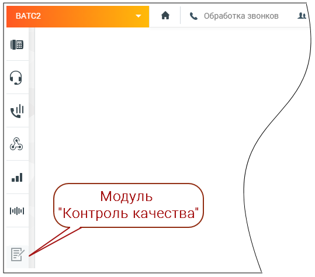
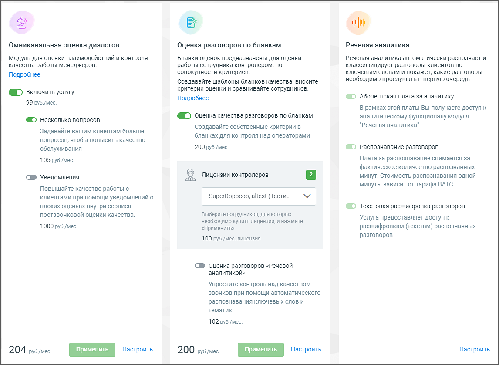

# 1.1. Как подключить модуль Контроль качества в Личном кабинете

> Трассировка: PDF §1.1 · сквозные стр. 4-5 · источники: ч.1 `kb/sources/quality-managment/QM_manual_v-1.26.18.pdf` с.4-5.

Доступ к модулю Контроль качества MANGO OFFICE осуществляется через браузер по адресу qm.mango-office.ru Для начала работы следует: • Подключить модуль "Контроль качества" в личном кабинете пользователя ВАТС; • Добавить пользователей, которые будут оценивать разговоры по бланкам оценки (контролеров); • Добавить правила оценки качества в чатах • Добавить бланки оценки разговоров • Настроить омниканальную оценку диалогов Чтобы подключить модуль войдите в Личный кабинет, выберите Виртуальную АТС, и кликните по значку модуля на левой вертикальной панели:

> **Описание иллюстрации QM-§1.1-1** · к разделу §1.1 «Как подключить модуль Контроль качества в Личном кабинете» · стр. 4 · снимок экрана / схема, 539×474 px.
> Относится к тексту руководства: «…вила оценки качества в чатах • Добавить бланки оценки разговоров • Настроить омниканальную оценку диалогов Чтобы подключить модуль войдите в Личный кабинет, выберите Виртуальную АТС, и кликните по значку модуля на левой вертикальной панели:»
> Следующий за иллюстрацией текст: «На экране отобразятся три блока модуля: ✓ Омниканальная оценка диалогов – оценка работы сотрудника клиентом. Включает в себя Постзвонковую оценку качества и Оценку качества в чатах; ✓ Оценка разговоро…»
> Текст на изображении (OCR, требует сверки): а & Обработка звонков 4; wl; al; Модуль; ШО; "Контроль качества"

На экране отобразятся три блока модуля: ✓ Омниканальная оценка диалогов – оценка работы сотрудника клиентом. Включает в себя Постзвонковую оценку качества и Оценку качества в чатах; ✓ Оценка разговоров по бланкам – оценка работы сотрудника контролером; ✓ Речевая аналитика – распознавание разговоров и поиск (вручную или автоматически) необходимой информации в разговоре.

> **Описание иллюстрации QM-§1.1-2** · к разделу §1.1 «Как подключить модуль Контроль качества в Личном кабинете» · стр. 5 · снимок экрана / схема, 1146×838 px.
> Относится к тексту руководства: «…онковую оценку качества и Оценку качества в чатах; ✓ Оценка разговоров по бланкам – оценка работы сотрудника контролером; ✓ Речевая аналитика – распознавание разговоров и поиск (вручную или автоматически) необходимой информации в разговоре.»
> Следующий за иллюстрацией текст: «Ознакомьтесь с условиями и самостоятельно подключите блоки, проставив соответствующие переключатели и кликнув по кнопкам Применить или Подключить (в зависимости от выбранного блока и состояния услуги)…»
> Текст на изображении (OCR, требует сверки): sh; Омниканальная оценка диалогов; Оценка разговоров по бланкам; Речевая аналитика; Модуль для оценки взаимодействий и контроля; Бланки оценок предназначены для оценки; Речевая аналитика автоматически распознает и; качества работы менеджеров.; работы сотрудника контролером, по; классифицирует разговоры клиентов по; совокупности критериев.; ключевым словам и покажет, какие разговоры; Подробнее; необходимо прослушать в первую очередь; Создавайте шаблоны бланков качества, вносите; критерии оценки и сравнивайте сотрудников.; © включить yonyry; © Абонентская плата за аналитику; 99 руб./мес.; В рамк…

Ознакомьтесь с условиями и самостоятельно подключите блоки, проставив соответствующие переключатели и кликнув по кнопкам Применить или Подключить (в зависимости от выбранного блока и состояния услуги). После подключения блока необходимо произвести его настройки. В дальнейшем любой из блоков может быть отключен, либо пользователем могут быть изменены условия подключения. Для этого перейдите в раздел меню «Дополнительные возможности» модуля Контроля качества.
