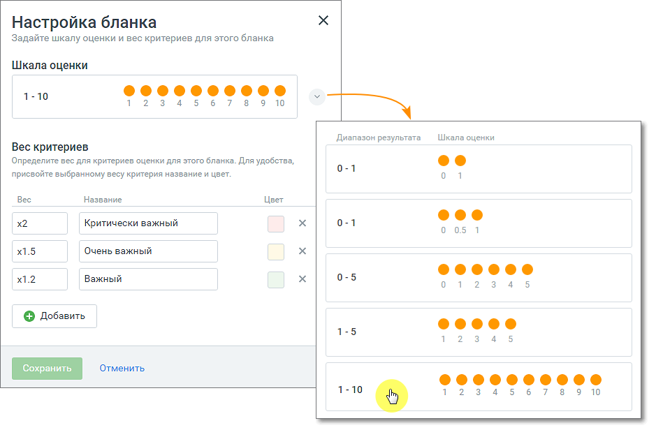

# 2.3. Настройка шкалы оценок и веса критериев

> Трассировка: PDF §2.3 · сквозные стр. 12-13 · источники: ч.1 `kb/sources/quality-managment/QM_manual_v-1.26.18.pdf` с.12-13.

Для настройки шкалы и веса критериев кликните по кнопке «Настроить бланк». В открывшемся окне выберите вкладку «Настройки бланка» со шкалой оценки из 10-ти возможных вариантов. Далее настройте коэффициенты оценок для данной шкалы. Возможно добавление до 10 коэффициентов. Каждый коэффициент содержит: Вес – в поле доступен выбор из настроенных весов критериев. Название – характеристика или иное пользовательское определение коэффициента, максимальная длина – 50 символов; Цвет – по клику в области поля открывается палитра выбора цвета; Пиктограмма удаления «х» – при удалении коэффициент удаляется у всех критериев бланка, которым он был ранее проставлен; Добавить – кнопка добавления нового веса критерия - число от 0,001 до 50 (дробные числа могут содержать до 3-х символов после запятой); Если значение коэффициента было изменено, то это значение коэффициента меняется для всех критериев бланка, которым он был проставлен.

> **Описание иллюстрации QM-§2.3-1** · к разделу §2.3 «Настройка шкалы оценок и веса критериев» · стр. 13 · снимок экрана / схема, 939×616 px.
> Относится к тексту руководства: «…нового веса критерия - число от 0,001 до 50 (дробные числа могут содержать до 3-х символов после запятой); Если значение коэффициента было изменено, то это значение коэффициента меняется для всех критериев бланка, которым он был проставлен.»
> Текст на изображении (OCR, требует сверки): Настройка бланка; Задайте шкалу оценки и вес критериев для этого бланка; Шкала оценки; 1-10; ХХХ]; 2345678910; Диапазон результата:; Вес критериев; Определите вес для критериев оценки для этого бланка. Для удобства,; ee; 0-1; присвойте выбранному весу критерия название и цвет.; Beo; Название; User; eee; x2; Критически важный; 0 051; х1.5; Очень важный; ФоФФФо; x12; Важный; 0-5; 2345; © Добавить; 1-5; eam: