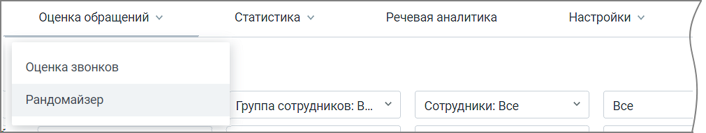

# 3. Оценка обращений

> Трассировка: PDF §3 · сквозные стр. 17 · источники: ч.1 `kb/sources/quality-managment/QM_manual_v-1.26.18.pdf` с.17.

Раздел меню Оценка обращений содержит три вкладки: • Оценка звонков • Оценка чатов • Рандомайзер

> **Описание иллюстрации QM-§3-1** · к разделу §3 «Оценка обращений» · стр. 17 · снимок экрана / схема, 1011×192 px.
> Относится к тексту руководства: «Раздел меню Оценка обращений содержит три вкладки: • Оценка звонков • Оценка чатов • Рандомайзер»
> Текст на изображении (OCR, требует сверки): Статистика v; Речевая аналитика; Оценка обращений у; Настройки v; ‘Оценка звонков; Рандомайзер; Все; Группа сотрудников: В...; ‘Сотрудники: Все