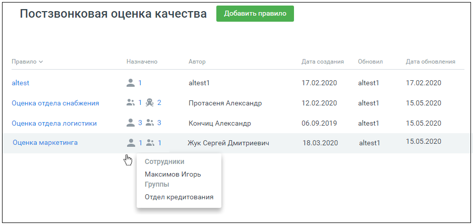
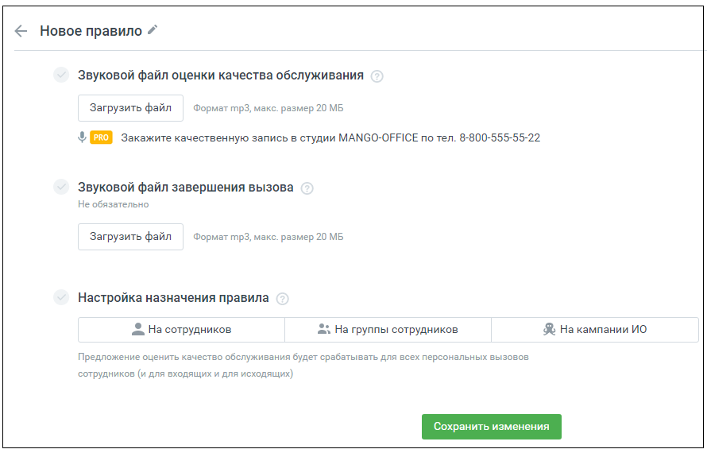
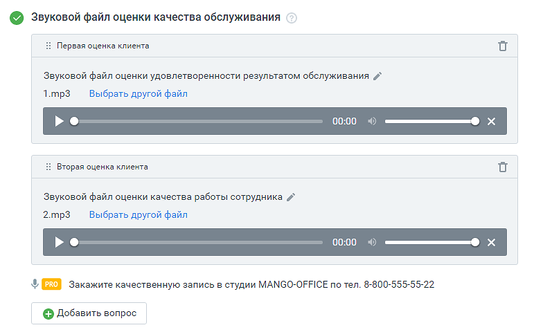
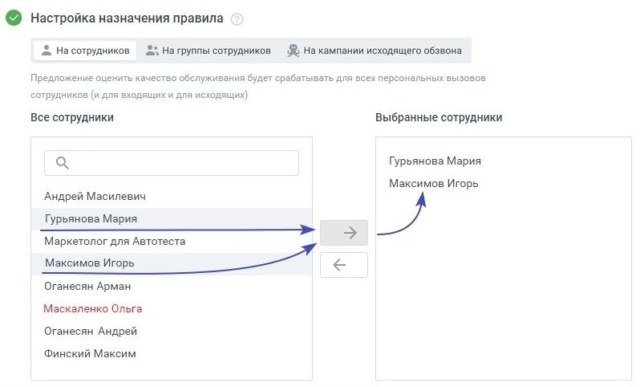
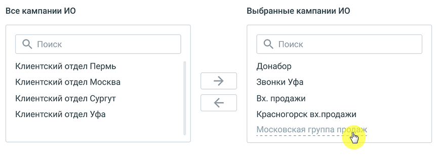

# 4.1. Настройка правил постзвонковой оценки

> Трассировка: PDF §4.1 · сквозные стр. 34-38 · источники: ч.1 `kb/sources/quality-managment/QM_manual_v-1.26.18.pdf` с.34-38.

Постзвонковая оценка качества предназначена для оценки: • персональных вызовов сотрудников (внешних входящих и исходящих); • вызовов, поступающих на группу сотрудников; • кампании исходящего обзвона с участием сотрудника (роботизированным кампаниям ИО правило оценки качества не назначается). Постзвонковая оценка качества предназначена для оценки клиентом работы сотрудника по завершении звонка. Рабочая область вкладки содержит список настроенных правил постзвонковой оценки качества:

> **Описание иллюстрации QM-§4.1-1** · к разделу §4.1 «Настройка правил постзвонковой оценки» · стр. 34 · снимок экрана / схема, 938×444 px.
> Относится к тексту руководства: «…ям ИО правило оценки качества не назначается). Постзвонковая оценка качества предназначена для оценки клиентом работы сотрудника по завершении звонка. Рабочая область вкладки содержит список настроенных правил постзвонковой оценки качества:»
> Следующий за иллюстрацией текст: «Применяются следующие обозначения:»
> Текст на изображении (OCR, требует сверки): Постзвонковая оценка качества; Правило у; Назначено; Автор; Дата создания; Обновил; Дата обновления; altest; altest1; 17.02.2020; анезй; 12.02.2020; 15.05.2020; Оценка отдела снабжения; 21 R2; Протасеня Александр.; 06.09.2019; Оценка отдела логистики; Кончиц Александр; 18.03.2020; Оценка маркетинга; Жук Сергей Дмитриевич; Сотрудники; Максимов Игорь; Группы; Отдел кредитования

Применяются следующие обозначения:

> **Описание иллюстрации QM-§4.1-2** · к разделу §4.1 «Настройка правил постзвонковой оценки» · стр. 35 · пиктограмма (значок элемента интерфейса), 37×38 px.
> Относится к тексту руководства: «Применяются следующие обозначения:»
> Следующий за иллюстрацией текст: «– правило назначено на персональные вызовы сотрудников;»
> Текста на изображении нет; назначение значка — см. текст, к которому он относится.

– правило назначено на персональные вызовы сотрудников;

> **Описание иллюстрации QM-§4.1-3** · к разделу §4.1 «Настройка правил постзвонковой оценки» · стр. 35 · пиктограмма (значок элемента интерфейса), 35×34 px.
> Относится к тексту руководства: «– правило назначено на персональные вызовы сотрудников;»
> Следующий за иллюстрацией текст: «– правило назначено на вызовы для групп сотрудников;»
> Текста на изображении нет; назначение значка — см. текст, к которому он относится.

– правило назначено на вызовы для групп сотрудников;

> **Описание иллюстрации QM-§4.1-4** · к разделу §4.1 «Настройка правил постзвонковой оценки» · стр. 35 · пиктограмма (значок элемента интерфейса), 37×45 px.
> Относится к тексту руководства: «– правило назначено на вызовы для групп сотрудников;»
> Следующий за иллюстрацией текст: «– правило назначено на вызовы, совершаемые в рамках кампании Исходящего обзвона. Правила постзвонковой оценки качества можно: • создавать • редактировать • удалять»
> Текста на изображении нет; назначение значка — см. текст, к которому он относится.

– правило назначено на вызовы, совершаемые в рамках кампании Исходящего обзвона. Правила постзвонковой оценки качества можно: • создавать • редактировать • удалять

| Примечание: Если для вызовов на группу сотрудников, персональных вызовов или кампании |
| --- |
| Исходящего обзвона настроено несколько правил, действительным является правило, |
| настроенное последним. |

Добавление правила постзвонковой оценки качества Для добавления нового правила зайдите в раздел Настройки/Постзвонковая оценка качества и нажмите кнопку Добавить правило.

> **Описание иллюстрации QM-§4.1-5** · к разделу §4.1 «Настройка правил постзвонковой оценки» · стр. 35 · снимок экрана / схема, 890×570 px.
> Относится к тексту руководства: «Добавление правила постзвонковой оценки качества Для добавления нового правила зайдите в раздел Настройки/Постзвонковая оценка качества и нажмите кнопку Добавить правило.»
> Следующий за иллюстрацией текст: «Форма настройки правила содержит следующие поля: • Название правила – по умолчанию "Имя правила". Редактируется путем нажатия на»
> Текст на изображении (OCR, требует сверки): < Новое правило /; Звуковой файл оценки качества обслуживания; Загрузить файл; Формат mp3, макс. размер 20 МБ; $ [ PRO / Закажите качественную запись в студии MANGO-OFFICE no тел. 8-800-555-55-22; Звуковой файл завершения вызова; Не обязательно; Настройка назначения правила; & На сотрудников; 3 На группы сотрудников; % На кампании ИО; Предложение оценить качество обслуживания будет срабатывать для всех персональных вызовов; сотрудников (и для входящих и для исходящих)

Форма настройки правила содержит следующие поля: • Название правила – по умолчанию "Имя правила". Редактируется путем нажатия на

> **Описание иллюстрации QM-§4.1-6** · к разделу §4.1 «Настройка правил постзвонковой оценки» · стр. 36 · пиктограмма (значок элемента интерфейса), 15×15 px.
> Относится к тексту руководства: «Форма настройки правила содержит следующие поля: • Название правила – по умолчанию "Имя правила". Редактируется путем нажатия на»
> Следующий за иллюстрацией текст: «пиктограмму . Название правила не может повторять уже существующие названия правил проекта. • Звуковой файл оценки качества обслуживания – звуковой файл с предложением клиенту оценить качество работы …»
> Текста на изображении нет; назначение значка — см. текст, к которому он относится.

пиктограмму . Название правила не может повторять уже существующие названия правил проекта. • Звуковой файл оценки качества обслуживания – звуковой файл с предложением клиенту оценить качество работы сотрудника. Загружается пользователем. Допустимый формат файла – mp3. Максимальный размер 20 МБ. Загруженный звуковой файл можно прослушать во встроенном плеере, заменить или удалить.

> **Описание иллюстрации QM-§4.1-7** · к разделу §4.1 «Настройка правил постзвонковой оценки» · стр. 36 · снимок экрана / схема, 784×480 px.
> Относится к тексту руководства: «…овой файл с предложением клиенту оценить качество работы сотрудника. Загружается пользователем. Допустимый формат файла – mp3. Максимальный размер 20 МБ. Загруженный звуковой файл можно прослушать во встроенном плеере, заменить или удалить.»
> Следующий за иллюстрацией текст: «При создании нового правила загрузка звукового файла оценки является обязательной. После ввода клиентом оценки (цифры от 1 до 5) введенное значение сохраняется как "Оценка клиента".»
> Текст на изображении (OCR, требует сверки): © Звуковой файл оценки качества обслуживания; Первая оценка клиента; Звуковой файл оценки удовлетворенности результатом обслуживания /`; 1.mp3; Выбрать другой файл; i: Вторая оценка клиента; Звуковой файл оценки качества работы сотрудника /^; 2.mp3; & [ PRO / Закажите качественную запись в студии MANGO-OFFICE по тел. 8-800-555-55-22; © Добавить вопрос

При создании нового правила загрузка звукового файла оценки является обязательной. После ввода клиентом оценки (цифры от 1 до 5) введенное значение сохраняется как "Оценка клиента".

| Примечание: При подключенной в Личном кабинете пользователя ВАТС услуге «Контроль |
| --- |
| качества (постзвонковая оценка)», допускается размещение до трех звуковых файлов с |
| вопросами клиенту, с получением оценки клиента по каждому. В таблицах и графиках |
| отражается статистика по каждой из оценок. |

• Звуковой файл завершения вызова – звуковой файл, который услышит клиент после оценки работы сотрудника. Загружается пользователем. Допустимый формат файла – mp3. Максимальный размер 20 МБ. Загруженный звуковой файл можно прослушать во встроенном плеере, заменить или удалить.

• Настройка назначения правил – сотрудник, группа сотрудников или компания Исходящего обзвона, для которых действует данное правило.

> **Описание иллюстрации QM-§4.1-8** · к разделу §4.1 «Настройка правил постзвонковой оценки» · стр. 37 · фрагмент интерфейса (кнопка, переключатель, поле или подпись), 66×37 px.
> Относится к тексту руководства: «• Настройка назначения правил – сотрудник, группа сотрудников или компания Исходящего обзвона, для которых действует данное правило.»
> Следующий за иллюстрацией текст: «Выделите сотрудников в поле "Все сотрудники" и нажмите кнопку . В поле "Выбранные сотрудники" отразится список сотрудников, которым назначено данное правило оценки. Чтобы удалить сотрудников из правил…»

Выделите сотрудников в поле "Все сотрудники" и нажмите кнопку . В поле "Выбранные сотрудники" отразится список сотрудников, которым назначено данное правило оценки. Чтобы удалить сотрудников из правила оценки, выделите их в поле "Выбранные сотрудники" , и нажмите

> **Описание иллюстрации QM-§4.1-9** · к разделу §4.1 «Настройка правил постзвонковой оценки» · стр. 37 · пиктограмма (значок элемента интерфейса), 63×37 px.
> Относится к тексту руководства: «…поле "Все сотрудники" и нажмите кнопку . В поле "Выбранные сотрудники" отразится список сотрудников, которым назначено данное правило оценки. Чтобы удалить сотрудников из правила оценки, выделите их в поле "Выбранные сотрудники" , и нажмите»
> Следующий за иллюстрацией текст: «.»
> Текста на изображении нет; назначение значка — см. текст, к которому он относится.

.

| Примечание: Если на выбранного сотрудника (группу, кампанию ИО) ранее уже было назначено |
| --- |
| правило, в поле "Все сотрудники" его имя выделено красным цветом. |

> **Описание иллюстрации QM-§4.1-10** · к разделу §4.1 «Настройка правил постзвонковой оценки» · стр. 37 · снимок экрана / схема, 798×482 px.
> Относится к тексту руководства: «| Примечание: Если на выбранного сотрудника (группу, кампанию ИО) ранее уже было назначено | | --- | | правило, в поле "Все сотрудники" его имя выделено красным цветом. |»
> Следующий за иллюстрацией текст: «Аналогичным образом правила оценки назначаются на группы сотрудников и на кампании Исходящего обзвона.»
> Текст на изображении (OCR, требует сверки): © Настройка назначения правила; & На сотрудников; 2s На группы сотрудников; & На кампании исходящего обзвона; Предложение оценить качество обслуживания будет срабатывать для всех персональных вызовов; сотрудников (и для входящих и для исходящих}; Все сотрудники; Выбранные сотрудники; Гурьянова Мария; Максимов Игорь; Андрей Масилевич; аркетолог для Автотеста; Максимов Игорь а; Оганесян Арман; Маскаленко Ольга; Оганесян Андрей; Финский Максим

Аналогичным образом правила оценки назначаются на группы сотрудников и на кампании Исходящего обзвона.

> **Описание иллюстрации QM-§4.1-11** · к разделу §4.1 «Настройка правил постзвонковой оценки» · стр. 38 · снимок экрана / схема, 861×308 px.
> Относится к тексту руководства: «Аналогичным образом правила оценки назначаются на группы сотрудников и на кампании Исходящего обзвона.»
> Следующий за иллюстрацией текст: «Если кампания Исходящего обзвона имеет статус "Обрабатывается", "Выполняется" или "Останавливается", она отображается в настройках правила оценки качества, но удалить из правила ее нельзя. Для удалени…»
> Текст на изображении (OCR, требует сверки): Все кампании ИО; Выбранные кампании ИО; О) Поиск; Клиентский отдел Пермь; Донабор; Клиентский отдел Москва; Звонки Уфа; Клиентский отдел Сургут; Вх. продажи; Клиентский отдел Уфа; Красногорск вх.продажи; О О eee eee; Московская группа a

Если кампания Исходящего обзвона имеет статус "Обрабатывается", "Выполняется" или "Останавливается", она отображается в настройках правила оценки качества, но удалить из правила ее нельзя. Для удаления такой кампании необходимо предварительно изменить ее статус. После заполнения полей формы сохраните внесенные изменения нажатием кнопки Сохранить.

| Примечание: Одно и то же правило может быть привязано одновременно к персональным |
| --- |
| вызовам сотрудников, вызовам, поступающим на группы и кампаниям исходящего обзвона. |

Просмотр и редактирование правила постзвонковой оценки качества Просмотр правила доступен из рабочей области вкладки. Для просмотра правила щелкните по его наименованию. Отредактируйте правило и сохраните внесенные изменения кнопкой Сохранить. Удаление правила постзвонковой оценки качества Для удаления созданного ранее правила откройте правило и нажмите кнопку "Удалить". Подтвердите свое согласие на удаление. Удаленное правило восстановить невозможно.
