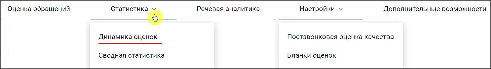
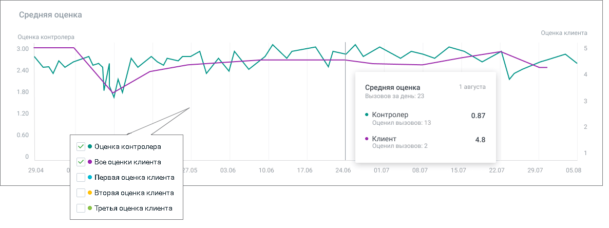
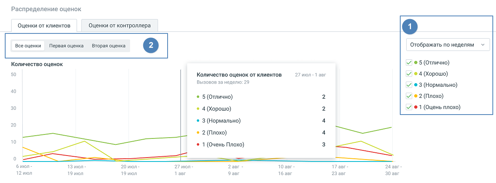
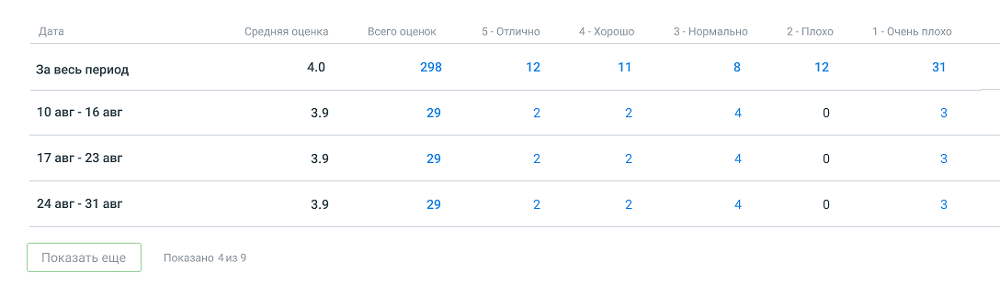
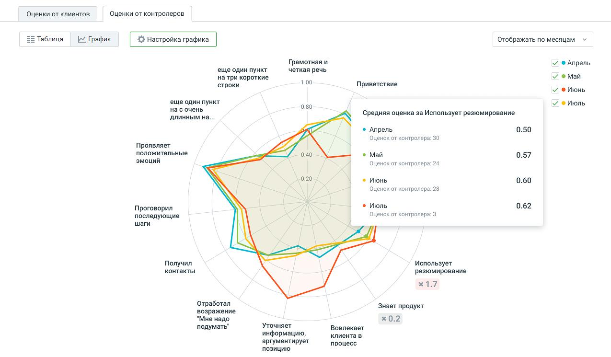
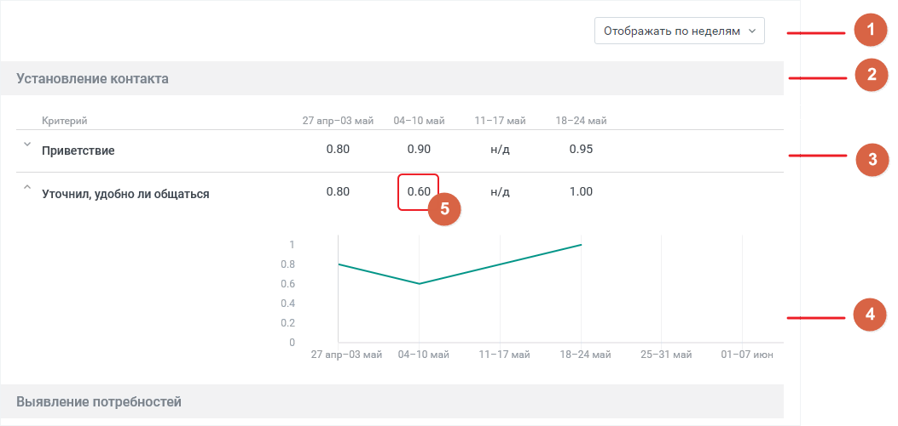

# 7.1. Динамика оценок

> Трассировка: PDF §7.1 · сквозные стр. 51-56 · источники: ч.1 `kb/sources/quality-managment/QM_manual_v-1.26.18.pdf` с.51-56.

> **Описание иллюстрации QM-§7.1-1** · к разделу §7.1 «Динамика оценок» · стр. 51 · снимок экрана / схема, 1486×212 px.
> Относится к тексту руководства: начало раздела «Динамика оценок».
> Следующий за иллюстрацией текст: «Отчет "Динамика оценок" содержит данные о качестве работы сотрудников ВАТС в соответствии с заданными параметрами фильтрации. Отчет позволяет наглядно отследить динамику изменения оценки работы сотруд…»
> Текст на изображении (OCR, требует сверки): Оценка обращений; Речевая аналитика; Настройки v; Дополнительные возможности; Статистика ь; Динамика оценок; Постзвонковая оценка качества; Сводная статистика; Бланки оценок

Отчет "Динамика оценок" содержит данные о качестве работы сотрудников ВАТС в соответствии с заданными параметрами фильтрации. Отчет позволяет наглядно отследить динамику изменения оценки работы сотрудника клиентом и контролером, по срезу день/неделя/месяц. Отчет включает в себя: 1. График «Средняя оценка» – динамика оценок разговоров сотрудника как клиентом, так и контролером: 2. График «Распределение оценок» (с табличной частью) – данные об оценках клиентов и контролеров за выбранный период. Для построения отчета воспользуйтесь следующими фильтрами: • Период – фильтрует оцененные вызовы по дате создания вызова: Текущая неделя, Текущий месяц, Произвольный (максимальное значение 1 год); • Группа – выпадающий список содержит список групп, доступных пользователю, расположенных в алфавитном порядке; • Сотрудник – выпадающий список содержит сотрудников , относящихся к группе, выбранной во вкладке "Оценка звонков". Также в списке доступен выбор варианта «Результат по всей группе». • Бланк оценки – список всех доступных бланков оценки; • Правило оценки – список всех доступных правил постзвонковой оценки качества. Для формирования отчета установите параметры фильтрации и нажмите на кнопку Показать.

| Совет: Если кнопка Показать недоступна для нажатия, проверьте – во всех ли выпадающих |
| --- |
| списках выбраны данные для формирования отчета. |

ГРАФИК «СРЕДНЯЯ ОЦЕНКА» На горизонтальной оси – динамика по времени (в формате "дд.мм" – для периода менее 210 дней, "месяц" – для периода более 210 дней); На вертикальной оси – слева от графика расположены деления оценок контролеров, справа от графика расположены деления оценок клиентов.

> **Описание иллюстрации QM-§7.1-2** · к разделу §7.1 «Динамика оценок» · стр. 52 · снимок экрана / схема, 1186×444 px.
> Относится к тексту руководства: «…инамика по времени (в формате "дд.мм" – для периода менее 210 дней, "месяц" – для периода более 210 дней); На вертикальной оси – слева от графика расположены деления оценок контролеров, справа от графика расположены деления оценок клиентов.»
> Следующий за иллюстрацией текст: «При наведении курсора на элементы графика отображается всплывающая подсказка с информацией по соответствующему дню (с учетом выбранных оценок): • выбранная дата; • количество вызовов у сотрудников за …»
> Текст на изображении (OCR, требует сверки): Средняя оценка; Оценка клиента; ка контролера; 300; 2.40; 1 августа; 1.80; вызовов за день; 1.20; ‘© Контролер; 0.87; Оценил выз; в: 13; © Клиент; 4.8; Оценил вызовов: 2; 7 @ Оценка контролера; 7 @ Boe оценки клиента; 29; 7.05; 03.06; 10.06; 17.06; 24.06; 01.07; 8.0; 15.07; 22.07; 29.07; 05.08; ® Первая оценка клиента; © Вторая оценка клиента; © Третья оценка клиента

При наведении курсора на элементы графика отображается всплывающая подсказка с информацией по соответствующему дню (с учетом выбранных оценок): • выбранная дата; • количество вызовов у сотрудников за день; • средняя оценка контролера за выбранный день; • количество разговоров, которые оценили контролеры, за выбранный день; • средняя оценка клиентов за выбранный день; • количество разговоров, которые оценили клиенты, за выбранный день. ГРАФИК «РАСПРЕДЕЛЕНИЕ ОЦЕНОК» На графике отображено распределение оценок (клиентов и контролеров) по выбранным сотрудникам.

> **Описание иллюстрации QM-§7.1-3** · к разделу §7.1 «Динамика оценок» · стр. 52 · снимок экрана / схема, 1243×460 px.
> Относится к тексту руководства: «…ь; • средняя оценка клиентов за выбранный день; • количество разговоров, которые оценили клиенты, за выбранный день. ГРАФИК «РАСПРЕДЕЛЕНИЕ ОЦЕНОК» На графике отображено распределение оценок (клиентов и контролеров) по выбранным сотрудникам.»
> Следующий за иллюстрацией текст: «Вкладка «Оценки от клиентов». График. По клику на период на графике, появляется информационное окно "Количество оценок от клиентов", с детализацией оценок сотрудников за выбранный период. Количество г…»
> Текст на изображении (OCR, требует сверки): Распределение оценок; Оценки от клиентов; Оценки от контроллера; Все оценки; Первая оценка.; Вторая оценка; Отображать по неделям; Количество оценок; Ye 5 (Отлично); Количество оценок от клиентов.; 27 июл-1 авг; Bois0g0e за неделю: 29; Ye 3 (Нормально); 40; © 5 (Отлично); 30; 5 #1 (Оцень плохо); 4 (Корошо); 3 (Нормально); 20; 2 (Плохо); 10; ene; 1 (Очень Плохо); биюл-; 1 Зиюл; 20 июл-; 27 июл; 10авг-; 17 авг-; 24 авг; 12 июл; 19 июл; Тавг; Эавг; 16 авг; 23 авг; 30 авг

Вкладка «Оценки от клиентов». График. По клику на период на графике, появляется информационное окно "Количество оценок от клиентов", с детализацией оценок сотрудников за выбранный период. Количество графиков зависит от выбранных в блоке «1» оценок. Блок «2» отображается при наличии нескольких звуковых файлов-вопросов в выбранных Правилах постзвонковой оценки. Таблица «Оценки от клиентов»

> **Описание иллюстрации QM-§7.1-4** · к разделу §7.1 «Динамика оценок» · стр. 53 · снимок экрана / схема, 1088×310 px.
> Относится к тексту руководства: «…енок сотрудников за выбранный период. Количество графиков зависит от выбранных в блоке «1» оценок. Блок «2» отображается при наличии нескольких звуковых файлов-вопросов в выбранных Правилах постзвонковой оценки. Таблица «Оценки от клиентов»»
> Следующий за иллюстрацией текст: «Таблица включает следующие данные для выбранных сотрудников: период, средняя оценка за период, детализация по оценкам за период. Кликнув на число, пользователь переходит в раздел Оценка звонков, с зап…»
> Текст на изображении (OCR, требует сверки): Дата; Средняя оценка.; всего оценок; 5- Отлично; 4- Хорошо; 3- Нормально; 2- Плохо; 1- Очень плохо; За весь период; 4.0; 298; 12; 11; 31; 10 авг- 16 авг; 39; 29; 17 авг - 23 авг; 24 авг- 31 авг; Показано 4из9

Таблица включает следующие данные для выбранных сотрудников: период, средняя оценка за период, детализация по оценкам за период. Кликнув на число, пользователь переходит в раздел Оценка звонков, с записями разговоров соответствующего периода. Клик по кнопке Скачать приводит к открытию стандартного окна экспорта данных. Экспорт производится в формат CSV, с учетом выбранных в фильтрах значений. Вкладка «Оценки контролеров». Диаграмма квалификаций. Лепестковая диаграмма квалификаций отображает оценки контролёров в разрезе выбранных периодов по каждому критерию или разделу выбранного бланка, в зависимости от периода отображения. График строится по оценкам по критериям/разделам без учета коэффициентов. Если в выпадающем списке Бланк оценки отмечено значение «Не выбран», вкладка не будет содержать никакой информации.

> **Описание иллюстрации QM-§7.1-5** · к разделу §7.1 «Динамика оценок» · стр. 54 · снимок экрана / схема, 1275×745 px.
> Относится к тексту руководства: «…ного бланка, в зависимости от периода отображения. График строится по оценкам по критериям/разделам без учета коэффициентов. Если в выпадающем списке Бланк оценки отмечено значение «Не выбран», вкладка не будет содержать никакой информации.»
> Следующий за иллюстрацией текст: «Максимальное количество одновременно отображаемых диаграмм – 5. Для настройки диаграммы следует кликнуть по кнопке Настроить график. В открывшемся окне выбрать критерии и разделы бланка оценки, сохран…»
> Текст на изображении (OCR, требует сверки): ‘Оценки от клиентов; Оценки от контролеров; Таблица; x График; Отображать по месяцам; Грамотная и; Апрель; еще один пункт; четкая речь; на три короткие; ve Май; строки; 1.00; Приветствие; июнь; 0.80; Vie Mion; на сочень; длинным на...; Средняя оценка за Использует резюмирование; ‘Апрель; 0.50; Оценок от; контро,; 30; Проявляет; положительные; 0.40; Май; 0.57; эмоций; контролера: 24; 020; 0.60; контролера: 28; Июль; 0.62; Проговорил; последующие; контролера: 3; warn; Получил; Использует; контакты; резюмирование; Отработал; Знает продукт; возражение; "Мне надо.; х 0.2; подумать”; 'Уточняет; вовл…

Максимальное количество одновременно отображаемых диаграмм – 5. Для настройки диаграммы следует кликнуть по кнопке Настроить график. В открывшемся окне выбрать критерии и разделы бланка оценки, сохранить внесенные изменения. Максимальное количество пунктов для построения диаграммы – 20. Клик по кнопке Отменить возвращает настройки к последнему сохраненному значению.

Таблица «Оценки контролеров»

> **Описание иллюстрации QM-§7.1-6** · к разделу §7.1 «Динамика оценок» · стр. 55 · снимок экрана / схема, 1053×501 px.
> Относится к тексту руководства: «Таблица «Оценки контролеров»»
> Следующий за иллюстрацией текст: «Таблица формируется по срезу день/неделя/месяц и заданным пользователем фильтрам. Таблица включает следующие данные: 1. Переключатель группировки периодов – день, неделя, месяц. • Срез "дни" недоступе…»
> Текст на изображении (OCR, требует сверки): Отображать по неделям Yo (1); Установление контакта; Критерий; 27 впр-03 мей; 04-10 май; 11-17 май; 18-24 май; Приветствие; 0.80; 0.90; н/д; 0.95; Уточнил, удобно ли общаться; 1.00; 08; 05; 04; 02; 04-10 mati; 25-31 май; 01-07 июн; Выявление потребностей

Таблица формируется по срезу день/неделя/месяц и заданным пользователем фильтрам. Таблица включает следующие данные: 1. Переключатель группировки периодов – день, неделя, месяц. • Срез "дни" недоступен, если выбранный в фильтре период более 60 дней. • Если период охватывает дни из двух календарных лет, то над первым столбцом за каждый год указан соответствующий год. 2. Заголовок раздела бланка оценки. 3. Критерий бланка оценки – критерии, по которым не проставлены оценки, не отображаются. 4. Развернутый критерий – отдельный график с динамикой оценок контролера за выбранный

> **Описание иллюстрации QM-§7.1-7** · к разделу §7.1 «Динамика оценок» · стр. 55 · пиктограмма (значок элемента интерфейса), 35×23 px.
> Относится к тексту руководства: «…д указан соответствующий год. 2. Заголовок раздела бланка оценки. 3. Критерий бланка оценки – критерии, по которым не проставлены оценки, не отображаются. 4. Развернутый критерий – отдельный график с динамикой оценок контролера за выбранный»
> Следующий за иллюстрацией текст: «период. Сворачивается/разворачивается кликом по пиктограмме и , расположенной слева от наименования критерия. 5. Среднее значение критерия – среднее арифметическое значение оценок в выбранном временно…»
> Текста на изображении нет; назначение значка — см. текст, к которому он относится.

> **Описание иллюстрации QM-§7.1-8** · к разделу §7.1 «Динамика оценок» · стр. 55 · пиктограмма (значок элемента интерфейса), 34×21 px.
> Относится к тексту руководства: «…д указан соответствующий год. 2. Заголовок раздела бланка оценки. 3. Критерий бланка оценки – критерии, по которым не проставлены оценки, не отображаются. 4. Развернутый критерий – отдельный график с динамикой оценок контролера за выбранный»
> Следующий за иллюстрацией текст: «период. Сворачивается/разворачивается кликом по пиктограмме и , расположенной слева от наименования критерия. 5. Среднее значение критерия – среднее арифметическое значение оценок в выбранном временно…»
> Текста на изображении нет; назначение значка — см. текст, к которому он относится.

период. Сворачивается/разворачивается кликом по пиктограмме и , расположенной слева от наименования критерия. 5. Среднее значение критерия – среднее арифметическое значение оценок в выбранном временном срезе, с округлением до сотых.