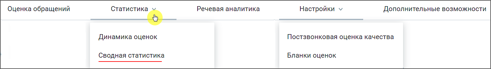
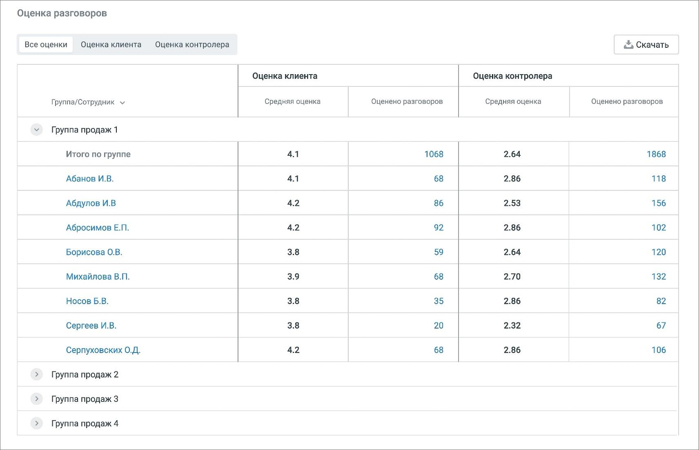
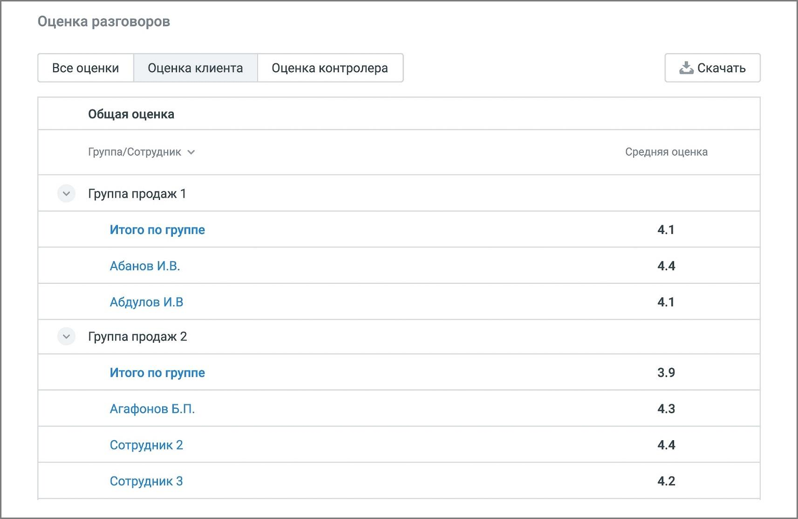
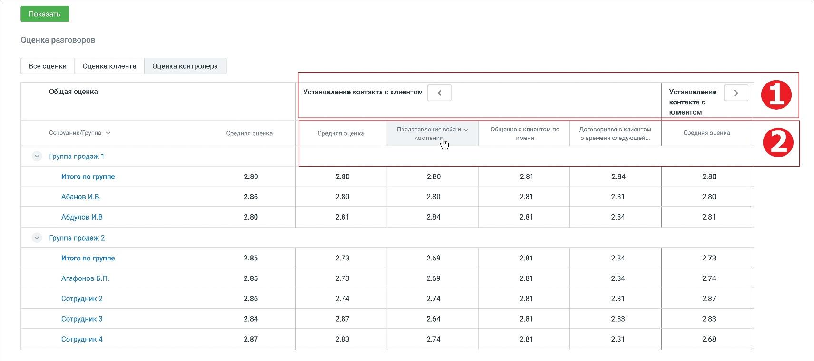

# 7.2. Сводная статистика

> Трассировка: PDF §7.2 · сквозные стр. 56-59 · источники: ч.1 `kb/sources/quality-managment/QM_manual_v-1.26.18.pdf` с.56-59.

> **Описание иллюстрации QM-§7.2-1** · к разделу §7.2 «Сводная статистика» · стр. 56 · снимок экрана / схема, 1486×212 px.
> Относится к тексту руководства: начало раздела «Сводная статистика».
> Следующий за иллюстрацией текст: «В разделе отображаются таблицы сводной статистики оценок сотрудников ВАТС клиентами и контролерами в соответствии с заданными параметрами фильтрации.»
> Текст на изображении (OCR, требует сверки): Оценка обращений; Речевая аналитика; Настройки v; Дополнительные возможности; Статистика ь; Динамика оценок; Постзвонковая оценка качества; Сводная статистика; Бланки оценок

В разделе отображаются таблицы сводной статистики оценок сотрудников ВАТС клиентами и контролерами в соответствии с заданными параметрами фильтрации.

> **Описание иллюстрации QM-§7.2-2** · к разделу §7.2 «Сводная статистика» · стр. 56 · снимок экрана / схема, 1168×352 px.
> Относится к тексту руководства: «В разделе отображаются таблицы сводной статистики оценок сотрудников ВАТС клиентами и контролерами в соответствии с заданными параметрами фильтрации.»
> Следующий за иллюстрацией текст: «Доступны три основных сводных отчета • Все оценки • Оценка клиента • Оценка контролера Вкладка ВСЕ ОЦЕНКИ»
> Текст на изображении (OCR, требует сверки): Оценка обращений; Статистика v; Речевая аналитика; Настройки v; Сводная статистика; Текущая неделя; Группа сотрудников: В...; Сотрудники: Все; Длительность вызова; Бланк оценки: Все; Правило оценки: Все; То

Доступны три основных сводных отчета • Все оценки • Оценка клиента • Оценка контролера Вкладка ВСЕ ОЦЕНКИ

> **Описание иллюстрации QM-§7.2-3** · к разделу §7.2 «Сводная статистика» · стр. 57 · снимок экрана / схема, 1712×1104 px.
> Относится к тексту руководства: «Доступны три основных сводных отчета • Все оценки • Оценка клиента • Оценка контролера Вкладка ВСЕ ОЦЕНКИ»
> Следующий за иллюстрацией текст: «Отчет содержит общие оценки сотрудников с разбиением на группы. Оценка клиента/контролера: • средняя оценка – средняя оценка клиента/контролера разговоров сотрудников; • оценено разговоров – количеств…»
> Текст на изображении (OCR, требует сверки): Оценка разговоров; Все оценки; Оценка клиента; Оценка контролера; &5 Скачать; Группа/Сотрудник м; Средняя оценка; Оценено разговоров; Группа продаж 1; Итого по группе; 4.1; 1068; 2.64; 1868; ‘Абанов И.В.; 68; 2.86; 118; Абдулов И.В; 42; 86; 2.53; 156; Абросимов Е.П.; 92; 102; Борисова О.В.; 3.8; 59; 120; Михайлова В.П.; 3.9; 2.70; 132; Носов Б.В.; 35; 82; Сергеев И.В.; 20; 2.32; 67; Серпуховских О.Д.; 4.2; 106; Группа продаж 2; Группа продаж 3; Группа продаж 4

Отчет содержит общие оценки сотрудников с разбиением на группы. Оценка клиента/контролера: • средняя оценка – средняя оценка клиента/контролера разговоров сотрудников; • оценено разговоров – количество оцененных клиентом/контролером разговоров сотрудников. Вкладка ОЦЕНКА КЛИЕНТА Таблица клиентских оценок отображается, если в фильтре выбрано только одно правило оценки.

> **Описание иллюстрации QM-§7.2-4** · к разделу §7.2 «Сводная статистика» · стр. 58 · снимок экрана / схема, 1713×1114 px.
> Относится к тексту руководства: «…та/контролера разговоров сотрудников; • оценено разговоров – количество оцененных клиентом/контролером разговоров сотрудников. Вкладка ОЦЕНКА КЛИЕНТА Таблица клиентских оценок отображается, если в фильтре выбрано только одно правило оценки.»
> Следующий за иллюстрацией текст: «Если в выбранном Правиле настроены несколько вопросов, таблица отражает детальную статистику клиенткой оценки по каждому вопросу. Текст "н/д" означает отсутствие оценки за заданный период фильтрации. …»
> Текст на изображении (OCR, требует сверки): Оценка разговоров; Все оценки; Оценка клиента; Оценка контролера; < Скачать; Общая оценка; Группа/Сотрудник v; Средняя оценка; Группа продаж 1; Итого по группе; 4.1; Абанов И.В.; 4.4; Абдулов И.В; Группа продаж 2; 3.9; 4.3; Агафонов Б.П.; Сотрудник 2; Сотрудник 3; 4.2

Если в выбранном Правиле настроены несколько вопросов, таблица отражает детальную статистику клиенткой оценки по каждому вопросу. Текст "н/д" означает отсутствие оценки за заданный период фильтрации. Вкладка ОЦЕНКА КОНТРОЛЕРА Таблица оценок контролера отображается, если в фильтре выбран только один бланк оценки

> **Описание иллюстрации QM-§7.2-5** · к разделу §7.2 «Сводная статистика» · стр. 59 · снимок экрана / схема, 1711×761 px.
> Относится к тексту руководства: «…детальную статистику клиенткой оценки по каждому вопросу. Текст "н/д" означает отсутствие оценки за заданный период фильтрации. Вкладка ОЦЕНКА КОНТРОЛЕРА Таблица оценок контролера отображается, если в фильтре выбран только один бланк оценки»
> Следующий за иллюстрацией текст: «Блок 1 – наименование раздела бланка оценки; Блок 2 – наименование критерия бланка оценки. Если для критерия в бланке оценки был установлен коэффициент (вес критерия), значение коэффициента отображает…»
> Текст на изображении (OCR, требует сверки): Оценка разговоров; Все оценки; Оценка клиента; Оценка контролера; 'Общая оценка; Установление контакта с клиентом; Установление; контакта с; клиентом,; Представление себя и ~; Общение с клиентом по; Договорился с клиентом; Сотрудник/Группа ~; Средняя оценка.; Средняя оценка; ‘имени; овремени следующей.; компани,; Группа продаж 1; Итого по группе; 2.80; 2.81; 2.84; Абанов ИВ.; 2.86; Абдулов И.В; Группа продаж 2; 2.85; 273; 2.69; 2.73; 2.74; ‘Агафонов Б.Л.; 274; 2.87; Сотрудник 2; Сотрудник 3; 2.64; 2.83; Сотрудник 4; 2.68

Блок 1 – наименование раздела бланка оценки; Блок 2 – наименование критерия бланка оценки. Если для критерия в бланке оценки был установлен коэффициент (вес критерия), значение коэффициента отображается справа от названия критерия.

> **Описание иллюстрации QM-§7.2-6** · к разделу §7.2 «Сводная статистика» · стр. 59 · пиктограмма (значок элемента интерфейса), 52×36 px.
> Относится к тексту руководства: «Блок 1 – наименование раздела бланка оценки; Блок 2 – наименование критерия бланка оценки. Если для критерия в бланке оценки был установлен коэффициент (вес критерия), значение коэффициента отображается справа от названия критерия.»
> Следующий за иллюстрацией текст: «Клик по пиктограмме сворачивает/разворачивает детализацию статистики по разделам. ЭКСПОРТ СТАТИСТИКИ По нажатию на кнопку Скачать в любом из отчетов Сводной статистики, открывается окно экспорта файла…»
> Текста на изображении нет; назначение значка — см. текст, к которому он относится.

Клик по пиктограмме сворачивает/разворачивает детализацию статистики по разделам. ЭКСПОРТ СТАТИСТИКИ По нажатию на кнопку Скачать в любом из отчетов Сводной статистики, открывается окно экспорта файла статистики в формате .csv. В окне следует выбрать сотрудников для экспорта. Также можно настроить параметры экспорта: кодировку, разделитель. Клик по кнопке Скачать отчет открывает стандартное окно проводника Windows с выбором пути сохранения файла отчета.
