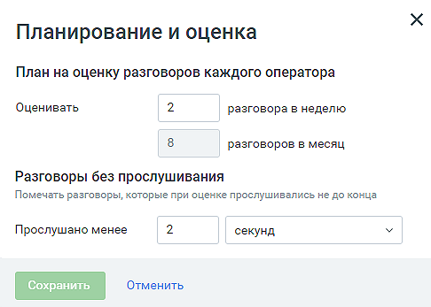
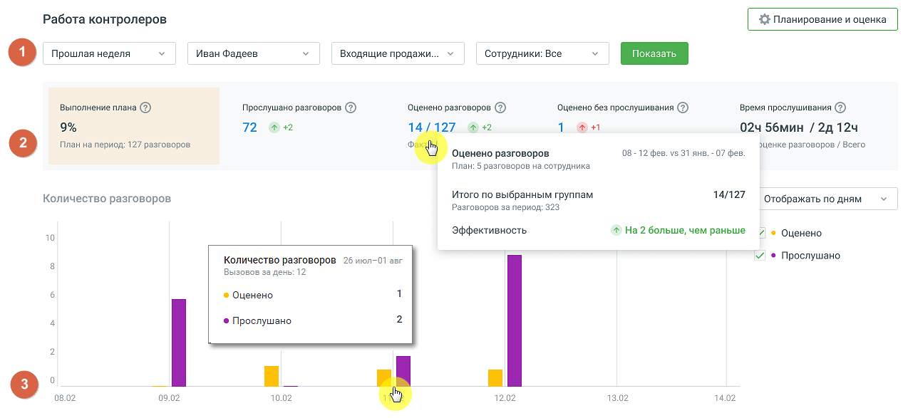
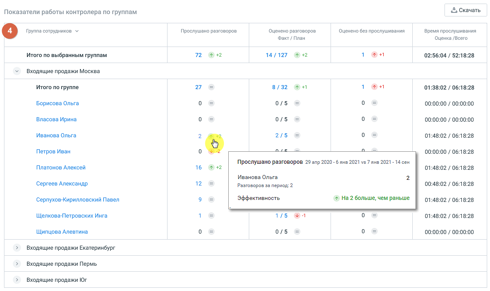

# 7.3. Работа контролеров

> Трассировка: PDF §7.3 · сквозные стр. 59-64 · источники: ч.1 `kb/sources/quality-managment/QM_manual_v-1.26.18.pdf` с.59-64.

| Важно: Отчет «Работа контролеров» доступна только тем пользователям, которые имеют статус |
| --- |
| «контролер». |

Отчет состоит четырех блоков: 1. Фильтры 2. Сводная статистика 3. График «Количество разговоров» 4. Таблица «Показатели работы контролера по группам»

Кнопка Планирование и оценка открывает окно для настройки плана и оценок работы контролеров.

> **Описание иллюстрации QM-§7.3-1** · к разделу §7.3 «Работа контролеров» · стр. 60 · снимок экрана / схема, 486×347 px.
> Относится к тексту руководства: «Кнопка Планирование и оценка открывает окно для настройки плана и оценок работы контролеров.»
> Следующий за иллюстрацией текст: «В окне следует указать: • План на оценку разговоров каждого оператора: в неделю, на месяц; • Разговоры без прослушивания – задать время, по истечении которого разговор считается прослушанным. Сохранит…»
> Текст на изображении (OCR, требует сверки): Планирование и оценка; План на оценку разговоров каждого оператора; Оценивать; разговора в неделю; разговоров в месяц; Разговоры без прослушивания; Помечать разговоры, которые при оценке прослушивались не до конца; Прослушано менее; секунд

В окне следует указать: • План на оценку разговоров каждого оператора: в неделю, на месяц; • Разговоры без прослушивания – задать время, по истечении которого разговор считается прослушанным. Сохраните внесенные изменения кликом по кнопке Сохранить.

> **Описание иллюстрации QM-§7.3-2** · к разделу §7.3 «Работа контролеров» · стр. 61 · снимок экрана / схема, 1267×587 px.
> Относится к тексту руководства: «…едует указать: • План на оценку разговоров каждого оператора: в неделю, на месяц; • Разговоры без прослушивания – задать время, по истечении которого разговор считается прослушанным. Сохраните внесенные изменения кликом по кнопке Сохранить.»
> Следующий за иллюстрацией текст: «Фильтры Для построения отчета воспользуйтесь следующими фильтрами: • Период – фильтрует оцененные вызовы по дате создания вызова: Текущая неделя, Текущий месяц, Произвольный (максимальное значение 1 г…»
> Текст на изображении (OCR, требует сверки): Работа контролеров; Mean Фадеев,; Входящие продажи.; Сотрудники: Boe; (1) Прошлая неделя; Выполнение плана @); Прослушано разговоров @); Оценено разговоров @); ООценено без прослушивания @); Время прослушивания @); 72; a2; 14; 27; aH; 024 56мин / 29124; План на период: 127 разговоров; Эценке разговоров / Всего,; Оценено разговоров; 08-12 фев. vs 31 янв. -07 фев.; План: 5 разговоров на сотрудника; Количество разговоров.; Итого по выбранным группам.; 14/127; Отображать по дням; Разговоров за период: 323; Эффективность; 4 Ha 2 больше, чем раньше; 7 © Оценено; 10; >И ® Прослушано; Количество разго…

Фильтры Для построения отчета воспользуйтесь следующими фильтрами: • Период – фильтрует оцененные вызовы по дате создания вызова: Текущая неделя, Текущий месяц, Произвольный (максимальное значение 1 год); • Выберите контролера – выпадающий список содержит список контролеров, расположенных в алфавитном порядке. Фильтрует вызовы, которые оценивал и/или прослушивал выбранный контролер. • Группа – выпадающий список содержит список групп, доступных пользователю, расположенных в алфавитном порядке; • Сотрудник – выпадающий список содержит сотрудников , относящихся к выбранной группе. Для формирования отчета установите параметры фильтрации и нажмите на кнопку Показать.

| Совет: Если кнопка Показать недоступна для нажатия, проверьте – во всех ли выпадающих |
| --- |
| списках выбраны данные для формирования отчета. |

Сводная статистика Виджет сводной статистики дает краткую информацию по прослушанным и/или оцененным звонкам с учетом выбранных фильтров.

> **Описание иллюстрации QM-§7.3-3** · к разделу §7.3 «Работа контролеров» · стр. 61 · пиктограмма (значок элемента интерфейса), 30×30 px.
> Относится к тексту руководства: «Сводная статистика Виджет сводной статистики дает краткую информацию по прослушанным и/или оцененным звонкам с учетом выбранных фильтров.»
> Следующий за иллюстрацией текст: «Также в виджете присутствуют маркеры эффективности – и . Стрелки «вверх» и «вниз» показывают рост или снижение количества прослушанных и/или оцененных разговоров за выбранный период времени. Цвет марк…»
> Текста на изображении нет; назначение значка — см. текст, к которому он относится.

> **Описание иллюстрации QM-§7.3-4** · к разделу §7.3 «Работа контролеров» · стр. 61 · пиктограмма (значок элемента интерфейса), 30×31 px.
> Относится к тексту руководства: «Сводная статистика Виджет сводной статистики дает краткую информацию по прослушанным и/или оцененным звонкам с учетом выбранных фильтров.»
> Следующий за иллюстрацией текст: «Также в виджете присутствуют маркеры эффективности – и . Стрелки «вверх» и «вниз» показывают рост или снижение количества прослушанных и/или оцененных разговоров за выбранный период времени. Цвет марк…»
> Текста на изображении нет; назначение значка — см. текст, к которому он относится.

Также в виджете присутствуют маркеры эффективности – и . Стрелки «вверх» и «вниз» показывают рост или снижение количества прослушанных и/или оцененных разговоров за выбранный период времени. Цвет маркера показывает выполнение (зеленый) или не выполнение (красный) плана, установленного в окне «Планирование и оценка».

График «Количество разговоров» Все данные графика отображаются с учетом выбранных фильтров: Выполнение плана – показывает процент выполнения плана по оценке разговоров выбранных сотрудников. Прослушано разговоров – в виджете отображается количество вызовов, которые были прослушаны контролером вне зависимости от наличия оценок по прослушанным разговорам. Оценено разговоров – количество разговоров, по которым была проставлена оценка. Оценено без прослушивания – оцененные разговоры, на прослушивание которых контролер затратил времени меньше, чем установлено в окне «Планирование и оценка». Время прослушивания – через «/» отображаются два показателя: • общая длительность прослушивания разговоров, которые были оценены; • общая длительность прослушивания всех разговоров.

| Примечание: Время прослушивания учитывает только время, затраченное выбранным |
| --- |
| контролером на прослушивание. Время по прослушиванию одного разговора одни контролером |
| суммируется |

Данные выводятся в разрезах: «по месяцам», «по неделям». Так же можно выбрать для отображения на графике оба или только один из вариантов: «оценено» или «прослушано». Клик по кнопке Скачать приводит к открытию стандартного окна экспорта данных. Экспорт производится в формат CSV, с учетом выбранных в фильтрах значений.

Таблица «Показатели работы контролера по группам»

> **Описание иллюстрации QM-§7.3-5** · к разделу §7.3 «Работа контролеров» · стр. 63 · снимок экрана / схема, 1217×725 px.
> Относится к тексту руководства: «Таблица «Показатели работы контролера по группам»»
> Следующий за иллюстрацией текст: «Данные в таблице отсортированы по группам сотрудников. При наведении на любое значение в таблице всплывает окно с уточнением значения показателей.»
> Текст на изображении (OCR, требует сверки): & Скачать,; Показатели работы контролера по группам; Прослушано разговоров; Оценено разговоров.; Оценено без прослушивания; Время прослушивания; Факт / План; Оценка /Всего; an; Итого по выбранным группам; 72; 14/127; 02:56:04 / 52:18:28; Входящие продажи Москва; Итого по группе; 27; 8/32; 01:38:02 / 06:18:28; Борисова Ольга; 0/5; 00:00:00 / 00:00:00; Власова Ирина; Иванова Ольга; 2/5; 01:48:02 / 06:18:28; Петров Иван; 00:00:00 / 06:18:28; Прослушано разговоров 29 апр 2020 -бяне 2021 из 7 axe 2021-14 ces; Платонов Алексей; 16; Сергеев Александр; 12; 00:48:02 / 06:18:28; Pasrozopos за период: 2;…

Данные в таблице отсортированы по группам сотрудников. При наведении на любое значение в таблице всплывает окно с уточнением значения показателей.

| Клик по имени сотрудника открывает окно «Оценка звонков» по данному сотруднику за последние |
| --- |
| три месяца. |

Клик по кнопке Скачать приводит к открытию стандартного окна экспорта данных. Экспорт производится в формат CSV, с учетом выбранных в фильтрах значений.