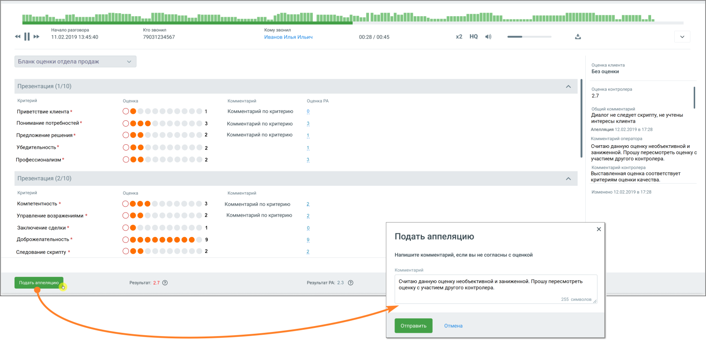

# 8.1. Как сотруднику подать апелляцию

> Трассировка: PDF §8.1 · сквозные стр. 64-65 · источники: ч.1 `kb/sources/quality-managment/QM_manual_v-1.26.18.pdf` с.64-65.

Если после получения уведомления сотрудник хочет подать апелляцию на пересмотр негативной оценки разговора, необходимо кликнуть на кнопку «Посмотреть оценку» в уведомлении.

> **Описание иллюстрации QM-§8.1-1** · к разделу §8.1 «Как сотруднику подать апелляцию» · стр. 64 · снимок экрана / схема, 328×112 px.
> Относится к тексту руководства: «Если после получения уведомления сотрудник хочет подать апелляцию на пересмотр негативной оценки разговора, необходимо кликнуть на кнопку «Посмотреть оценку» в уведомлении.»
> Следующий за иллюстрацией текст: «Открывается лист разговора, с бланком и комментариями к оценке. Для подачи апелляции следует нажать кнопку «Подать апелляцию» в нижней части экрана. В появившемся окне можно добавить комментарий по су…»
> Текст на изображении (OCR, требует сверки): © запись 25.10.2019 09:54 оценена; в 2 балла; seas /

Открывается лист разговора, с бланком и комментариями к оценке. Для подачи апелляции следует нажать кнопку «Подать апелляцию» в нижней части экрана. В появившемся окне можно добавить комментарий по существу апелляции и отправить её на рассмотрение. Диалог с контролером отображается в правой части экрана.

> **Описание иллюстрации QM-§8.1-2** · к разделу §8.1 «Как сотруднику подать апелляцию» · стр. 65 · снимок экрана / схема, 1555×765 px.
> Относится к тексту руководства: «…ля подачи апелляции следует нажать кнопку «Подать апелляцию» в нижней части экрана. В появившемся окне можно добавить комментарий по существу апелляции и отправить её на рассмотрение. Диалог с контролером отображается в правой части экрана.»
> Следующий за иллюстрацией текст: «После повторного рассмотрения сотрудник получит уведомление о результате апелляции. В случае, если оценка была изменена на оценку выше, чем указано в настройках апелляции, уведомление не отправляется.»
> Текст на изображении (OCR, требует сверки): Пао а Ieee remem О ЗО; UT; Ночало разговора; ro звонил; Кому звонил; 11.02.2019 13:45:40,; 79031234567; Иванов Илья Ильич; 00:28 / 00:45; Бланк оценки отдела продаж; оценка клиента; Bes оценки; Презентация (1/10); оценка контролера; 27; Критерий; Оценка; Комментарий; Оценка РА; Общий комментарий; Приветствие клиента *; oe; Комментарий по критерию; "Диалог we следует скрипту, не учтены; Понимание потребностей *; интересы клиента; Апелляция 12 02201951728; Предложение решения *; Комментарий по критерию.; Комментарий оператора; Убедительность*; Считаю данную оценку необъективной и; заниженной. Пр…

После повторного рассмотрения сотрудник получит уведомление о результате апелляции. В случае, если оценка была изменена на оценку выше, чем указано в настройках апелляции, уведомление не отправляется.
