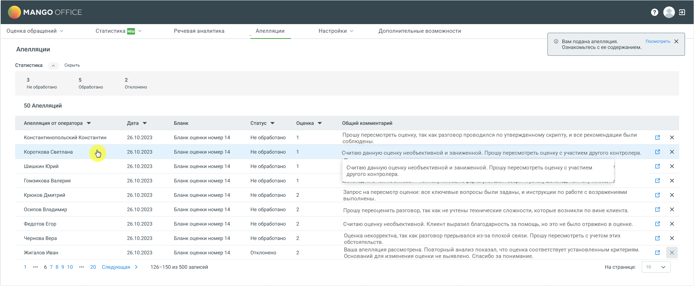

# 8.2. Как контролеру обрабатывать апелляции

> Трассировка: PDF §8.2 · сквозные стр. 65-67 · источники: ч.1 `kb/sources/quality-managment/QM_manual_v-1.26.18.pdf` с.65-67.

> **Описание иллюстрации QM-§8.2-1** · к разделу §8.2 «Как контролеру обрабатывать апелляции» · стр. 65 · снимок экрана / схема, 1923×795 px.
> Относится к тексту руководства: начало раздела «Как контролеру обрабатывать апелляции».
> Следующий за иллюстрацией текст: «Контролер обрабатывает апелляции следующим образом:»
> Текст на изображении (OCR, требует сверки): MANGO OFFIC; e@a; Оценка обращений У; Статистика {3 v; Речевая аналитика; Апелляции; Настройки v; Дополнительные возможности; @ Вам подана апелляция.; Посмотреть Х; 'Апелляции; Ознакомьтесь с ее содержанием.; Статистика; Скрыть; He обработано; Обработано; Отклонено; 50 Апелляций; Апелляция от оператора У; Дата ¥; Бланк; Статус У; Оценка У; Общий комментарий; Константинопольский Константин; 26.10.2023; Прошу пересмотреть оценку, так как разговор проводился по утвержденному скрипту, и все рекомендации были; Бланк оценки номер 14; Не обработано; ‘соблюдены.; Считаю данную оценку необъективной и з…

Контролер обрабатывает апелляции следующим образом:

1. Контролер заходит в раздел "Апелляции", где отображаются все апелляции, поданные ему на рассмотрение. 2. В этом разделе контролер видит список апелляций с деталями, такими как дата, бланк, текущая оценка и последний комментарий, оставленный в диалоге.

> **Описание иллюстрации QM-§8.2-2** · к разделу §8.2 «Как контролеру обрабатывать апелляции» · стр. 66 · пиктограмма (значок элемента интерфейса), 16×16 px.
> Относится к тексту руководства: «…аходит в раздел "Апелляции", где отображаются все апелляции, поданные ему на рассмотрение. 2. В этом разделе контролер видит список апелляций с деталями, такими как дата, бланк, текущая оценка и последний комментарий, оставленный в диалоге.»
> Следующий за иллюстрацией текст: «3. Контролер выбирает апелляцию для рассмотрения, нажав на пиктограмму в соответствующей строке. 4. Открывается окно с записью разговора, бланком и возможностью повторно оценить разговор. 5. Контролер…»
> Текста на изображении нет; назначение значка — см. текст, к которому он относится.

3. Контролер выбирает апелляцию для рассмотрения, нажав на пиктограмму в соответствующей строке. 4. Открывается окно с записью разговора, бланком и возможностью повторно оценить разговор. 5. Контролер анализирует разговор и комментарий оператора, после чего принимает решение: a. Если контролер согласен с оператором, он пересматривает оценку и вносит соответствующие изменения. b. Если контролер не согласен с апелляцией, он оставляет первоначальную оценку и отклоняет апелляцию, добавляя комментарий с обоснованием решения. 6. После обработки апелляции статус обновляется, и оператор получает уведомление о результате. В случае, если оценка была изменена на оценку выше, чем указано в настройках апелляции, уведомление не отправляется. 7. Оператору и контролеру доступен отчет по апелляциям, где они могут видеть текущий статус и результаты рассмотрения апелляций.