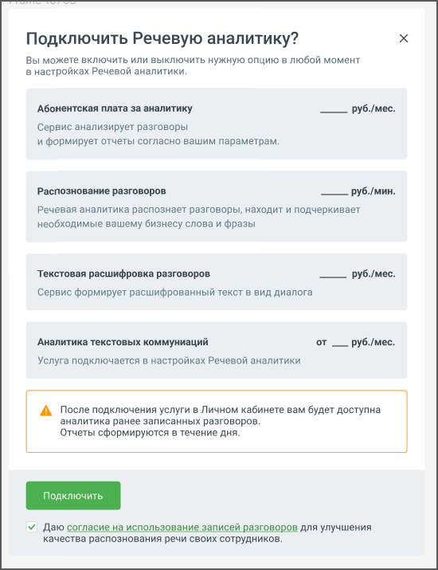

# 9.1. Подключение услуги Речевая аналитика

> Трассировка: PDF §9.1 · сквозные стр. 67-69 · источники: ч.1 `kb/sources/quality-managment/QM_manual_v-1.26.18.pdf` с.67-69.

Для подключения услуги "Речевая аналитика" в демо-режиме зайдите в Личный кабинет и найдите

> **Описание иллюстрации QM-§9.1-1** · к разделу §9.1 «Подключение услуги Речевая аналитика» · стр. 67 · пиктограмма (значок элемента интерфейса), 36×30 px.
> Относится к тексту руководства: «Для подключения услуги "Речевая аналитика" в демо-режиме зайдите в Личный кабинет и найдите»
> Следующий за иллюстрацией текст: «на боковой навигационной панели иконку . Перейдите в подраздел Речевая аналитика. Нажмите кнопку Подключить.»
> Текста на изображении нет; назначение значка — см. текст, к которому он относится.

на боковой навигационной панели иконку . Перейдите в подраздел Речевая аналитика. Нажмите кнопку Подключить.

> **Описание иллюстрации QM-§9.1-2** · к разделу §9.1 «Подключение услуги Речевая аналитика» · стр. 67 · снимок экрана / схема, 486×456 px.
> Относится к тексту руководства: «на боковой навигационной панели иконку . Перейдите в подраздел Речевая аналитика. Нажмите кнопку Подключить.»
> Следующий за иллюстрацией текст: «Речевая аналитика может быть подключена в двух режимах: демо-режим (на 7 дней), полная версия (платная). Для демо-режима суммарная длительность распознаваемых звонков ограничена 100 минутами разговора…»
> Текст на изображении (OCR, требует сверки): MANGO OFFICE; Мой продуктовый набор №1 #; & Обработка звонков; Речевая аналитика; alll

Речевая аналитика может быть подключена в двух режимах: демо-режим (на 7 дней), полная версия (платная). Для демо-режима суммарная длительность распознаваемых звонков ограничена 100 минутами разговора за сутки. Остальной функционал полностью соответствует функционалу полной версии. По истечении 7 дней демоверсия деактивируется. Повторно подключить услугу в демо-режиме невозможно. После нажатия на кнопку Подключить появляется всплывающее окно с описанием расходов на подключение услуги.

> **Описание иллюстрации QM-§9.1-3** · к разделу §9.1 «Подключение услуги Речевая аналитика» · стр. 68 · снимок экрана / схема, 550×715 px.
> Относится к тексту руководства: «…ствует функционалу полной версии. По истечении 7 дней демоверсия деактивируется. Повторно подключить услугу в демо-режиме невозможно. После нажатия на кнопку Подключить появляется всплывающее окно с описанием расходов на подключение услуги.»
> Следующий за иллюстрацией текст: «Стоимость минуты распознавания разговора зависит от версии ВАТС. Подробнее о версии продукта и тарифах здесь.»
> Текст на изображении (OCR, требует сверки): Подключить Речевую аналитику?; Вы можете включить или выключить нужную опцию в любой момент; в настройках Речевой аналитики.; Абонентская плата за аналитику; Сервис анализирует разговоры; и формирует отчеты согласно вашим параметрам.; Распознование разговоров; руб./мин.; Речевая аналитика распознает разговоры, находит и подчеркивает; необходимые вашему бизнесу слова и фразы; Текстовая расшифровка разговоров; Сервис формирует расшифрованный текст в вид диалога; Аналитика текстовых коммуниаций; Услуга подключается в настройках Речевой аналитики; А После подключения услуги в Личном кабинете вам б…

Стоимость минуты распознавания разговора зависит от версии ВАТС. Подробнее о версии продукта и тарифах здесь.

| Важно: При первом подключении услуги “Речевая аналитика” обязательно подключите |
| --- |
| распознавание разговоров. |

В дальнейшем, при необходимости, инструменты “Распознавание” и “Расшифровка”, можно отключить: • Разговоры, записанные при отключенном инструменте “Распознавание”, распознаваться не будут. В этом случае Речевая аналитика формирует отчеты только по уже записанным и распознанным разговорам. • Если инструмент «Расшифровка разговоров» отключен, тексты разговоров на плеере не отображаются. Рабочая область раздела Речевая аналитика содержит вкладки: • Отчеты • Тегирование разговоров

• Настройки • Список текстовых коммуникаций • ИИ Помощники
