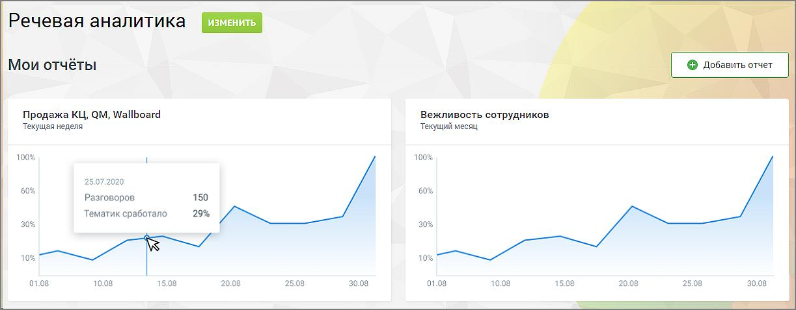

# 9.2. Вкладка ОТЧЕТЫ

> Трассировка: PDF §9.2 · сквозные стр. 69 · источники: ч.1 `kb/sources/quality-managment/QM_manual_v-1.26.18.pdf` с.69.

Вкладка Отчеты содержит детальную аналитическую информацию о распознанных вызовах в соответствии с заданными параметрами фильтрации. В подразделе Мои отчеты размещаются виджеты отчетов (не более 10-ти) с настроенными параметрами фильтрации, для быстрого перехода.

> **Описание иллюстрации QM-§9.2-1** · к разделу §9.2 «Вкладка ОТЧЕТЫ» · стр. 69 · снимок экрана / схема, 1223×478 px.
> Относится к тексту руководства: «… детальную аналитическую информацию о распознанных вызовах в соответствии с заданными параметрами фильтрации. В подразделе Мои отчеты размещаются виджеты отчетов (не более 10-ти) с настроенными параметрами фильтрации, для быстрого перехода.»
> Следующий за иллюстрацией текст: «Доступны несколько отчетов: • Расходы Речевой аналитики – отчет помогает быстро понять, сколько стоит использование сервиса за выбранный период и какие услуги вносят основной вклад в затраты. • Анализ…»
> Текст на изображении (OCR, требует сверки): Речевая аналитика; изм; Мои отчёты; Продажа КЦ, QM, Wallboard; Вежливость сотрудников; Текущая неделя; Текущий месяц; 100%; 25.07.2020; 60%; разговоров.; 150; 29%; Tematuk сработало; 30%; 10%; 01.08; 10.08; 18.08; 20.08; 2508; 3008; 15.08; 30.08

Доступны несколько отчетов: • Расходы Речевой аналитики – отчет помогает быстро понять, сколько стоит использование сервиса за выбранный период и какие услуги вносят основной вклад в затраты. • Анализ сотрудников • Анализ разговоров • Ловец инсайтов • Анализ по чек-листам Для построения любого из отчетов выберите отчетный промежуток времени, срез, показатели и фильтры. Каждый отчет содержит блок таблиц и блок визуализации.
