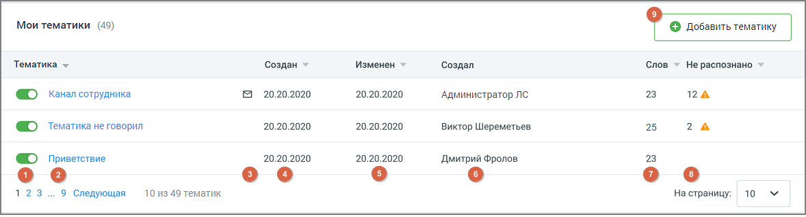
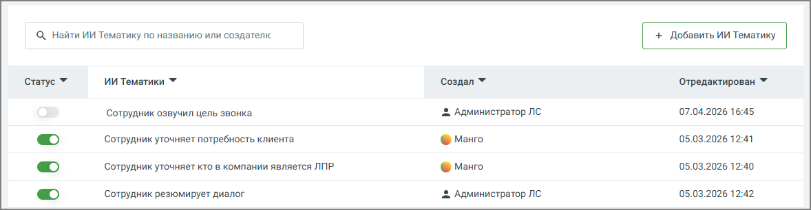
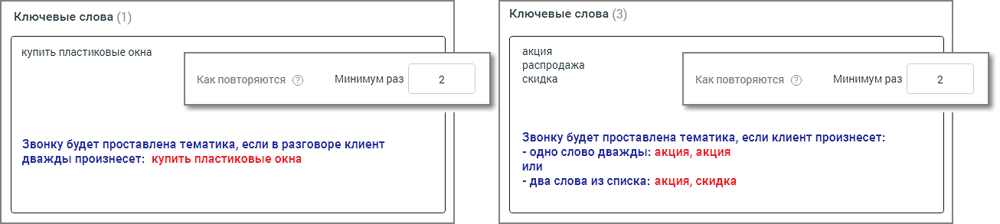

# 9.3. Вкладка ТЕГИРОВАНИЕ РАЗГОВОРОВ

> Трассировка: PDF §9.3 · сквозные стр. 69-72 · источники: ч.1 `kb/sources/quality-managment/QM_manual_v-1.26.18.pdf` с.69-72.

Рабочая область вкладки «Тегирование разговоров» содержит список всех Тематик и ИИ Тематик, созданных на продукте ВАТС. Тематика может иметь статус Активна/Неактивна. Распознанному звонку может присваиваться только активная тематика. Максимальное количество тематик в рамках одного продукта ВАТС – 200. По достижении лимита появляется окно уведомления о необходимости удалить ранее созданные неактуальные тематики.

> **Описание иллюстрации QM-§9.3-1** · к разделу §9.3 «Вкладка ТЕГИРОВАНИЕ РАЗГОВОРОВ» · стр. 70 · снимок экрана / схема, 1178×319 px.
> Относится к тексту руководства: «…анному звонку может присваиваться только активная тематика. Максимальное количество тематик в рамках одного продукта ВАТС – 200. По достижении лимита появляется окно уведомления о необходимости удалить ранее созданные неактуальные тематики.»
> Следующий за иллюстрацией текст: «Рис.1–Тематики»
> Подпись в руководстве: «Рис.1–Тематики».
> Текст на изображении (OCR, требует сверки): Мои тематики (49); Тематика ~; ‘Создан; Изменен; ‘Создал; ‘Слов.; Не распознано; Канал сотрудника; © 20.20.2020; 20.20.2020; Администратор JIC; 23; 12 А; ©) тематика не говорил; Виктор Шереметьев,; 25; 2А; © приветствие; Дмитрий Фролов; ое; оо; ео; 123; 9 Следующая; 10 из 49 тематик; На страницу:; 10

Рис.1–Тематики

> **Описание иллюстрации QM-§9.3-2** · к разделу §9.3 «Вкладка ТЕГИРОВАНИЕ РАЗГОВОРОВ» · стр. 70 · снимок экрана / схема, 1178×307 px.
> Относится к тексту руководства: «Рис.1–Тематики»
> Следующий за иллюстрацией текст: «Рис.2 –ИИ Тематики»
> Подпись в руководстве: «Рис.2 –ИИ Тематики».
> Текст на изображении (OCR, требует сверки): , Найти ИИ Тематику по названию или создателк; ИИ Тематики У; Статус У; ‘Создал ¥; Отредактирован У; Сотрудник озвучил цель звонка; 2 Администратор ЛС; 07.04.2026 16:45; Сотрудник уточняет потребность клиента; © моно; 05.03.2026 12:41; Сотрудник уточняет кто в компании является ЛПР.; 05.03.2026 12:40; Сотрудник резюмирует диалог; 05.03.2026 12:42

Рис.2 –ИИ Тематики

> **Описание иллюстрации QM-§9.3-3** · к разделу §9.3 «Вкладка ТЕГИРОВАНИЕ РАЗГОВОРОВ» · стр. 70 · пиктограмма (значок элемента интерфейса), 41×27 px.
> Относится к тексту руководства: «Рис.2 –ИИ Тематики»
> Следующий за иллюстрацией текст: «Тумблер (в демоверсии цвет включенного тумблера – желтый) для новых тематик по умолчанию включен. Система проверяет на вхождение только записи, распознанные после включения тумблера; 1. Название темат…»
> Подпись в руководстве: «Рис.2 –ИИ Тематики».
> Текста на изображении нет; назначение значка — см. текст, к которому он относится.

Тумблер (в демоверсии цвет включенного тумблера – желтый) для новых тематик по умолчанию включен. Система проверяет на вхождение только записи, распознанные после включения тумблера; 1. Название тематики; 2. Пиктограмма «e-mail» – отображается в случае настроенного уведомления на E-mail и/или СМС; 3. Когда создана тематика – дата в формате "ДД.ММ.ГГГГ"; 4. Когда изменена тематика – дата в формате "ДД.ММ.ГГГГ"; 5. Кем создана тематика – ФИО, для всех тематик, кроме предустановленных; 6. Количество слов в тематике – общее количество распознанных и нераспознанных терм в составе тематики; 7. Количество не распознанных слов – общее количество нераспознанных терм в составе тематики на момент отображения данных. Чтобы добавить новую тематику, щелкните по кнопке Добавить тематику. Открывшееся окно содержит 3 блока: • Ключевые слова • Расширенные настройки (не более 3-х условий для одной тематики) • Настройки уведомлений Задайте необходимые условия и сформулируйте поисковые запросы-термы, разделяя их запятой или переносом строки. При вводе терм допускается использование следующих символов:

• Кавычки (" " или «») – для поиска точного соответствия поисковому запросу; • Дефис (тире) – для составных слов; • Буквы (кириллица, латиница); • Цифры (кроме отдельно стоящих); • Пробел; • Восклицательный знак (!).

> **Описание иллюстрации QM-§9.3-4** · к разделу §9.3 «Вкладка ТЕГИРОВАНИЕ РАЗГОВОРОВ» · стр. 71 · снимок экрана / схема, 1306×293 px.
> Относится к тексту руководства: «• Кавычки (" " или «») – для поиска точного соответствия поисковому запросу; • Дефис (тире) – для составных слов; • Буквы (кириллица, латиница); • Цифры (кроме отдельно стоящих); • Пробел; • Восклицательный знак (!).»
> Следующий за иллюстрацией текст: «В блоке есть возможность использовать искусственный интеллект для генерации синонимов к ключевым словам. Что увеличивает диапазон ключевых слов и расширяет возможности пользователя в анализе получаемы…»
> Текст на изображении (OCR, требует сверки): Ключевые слова (3); Ключевые слова (1); купить пластиковые окна; акция; распродажа; Как повторяются @; минимум раз; скидка; звонку будет проставлена тематика, если в разговоре клиент; звонку будет проставлена тематика, если клиент произнесет:; - одно слово дважды: акция, акция; дважды произнесет: купить пластиковые окна; или; - два слова из списка: акция, скидка

В блоке есть возможность использовать искусственный интеллект для генерации синонимов к ключевым словам. Что увеличивает диапазон ключевых слов и расширяет возможности пользователя в анализе получаемых данных. Если срабатывают все заданные условия и звонку присваивается тематика, пользователь получает уведомление по электронной почте или посредством СМС-сообщения. Эти опции настраиваются в Блоке уведомлений.