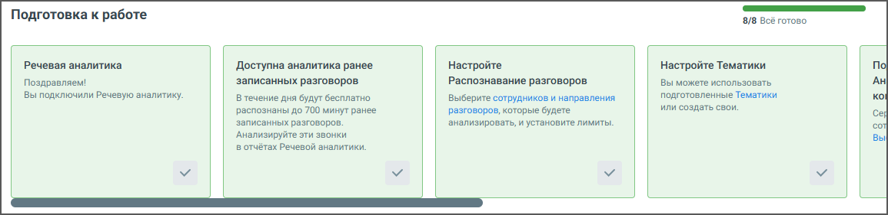

# 9.4.1. Шаги онбординга

> Трассировка: PDF §9.4.1 · сквозные стр. 73-75 · источники: ч.1 `kb/sources/quality-managment/QM_manual_v-1.26.18.pdf` с.73-75.

В верхней части вкладки Настройки модуля находится блок онбординга, содержащего все этапы настроек Речевой аналитики.

> **Описание иллюстрации QM-§9.4.1-1** · к разделу §9.4.1 «Шаги онбординга» · стр. 73 · снимок экрана / схема, 1155×281 px.
> Относится к тексту руководства: «В верхней части вкладки Настройки модуля находится блок онбординга, содержащего все этапы настроек Речевой аналитики.»
> Следующий за иллюстрацией текст: «Онбординг разработан для удобного и последовательного ознакомления с функционалом, помогая быстро настроить все ключевые параметры и начать работу с сервисом. Шкала прогресса онбординга отображает вып…»
> Текст на изображении (OCR, требует сверки): Подготовка к работе; 8/8 Всё готово,; Речевая аналитика; Доступна аналитика ранее; Настройте; Настройте Тематики; По; Вы можете использовать; Ан; Поздравляем!; ‘записанных разговоров; Распознавание разговоров; Вы подключили Речевую аналитику:; В течение дня будут бесплатно,; Выберите сотрудников и направления; подготовленные Тематики; распознаны до 700 минут ранее; разговоров, которые будете; или создать свои.; ‘записанных разговоров.; ‘анализировать, и установите лимиты.; `Анализируйте эти звонки; Bal; в отчётах Речевой аналитики.

Онбординг разработан для удобного и последовательного ознакомления с функционалом, помогая быстро настроить все ключевые параметры и начать работу с сервисом. Шкала прогресса онбординга отображает выполнение каждого шага подключения Речевой аналитики. 1. Речевая аналитика Поздравляем! Вы подключили модуль Речевая аналитика — теперь вы можете получать ценную информацию из разговоров с клиентами. Начните с простых шагов ниже, чтобы использовать возможности модуля по максимуму. 2. Доступна аналитика ранее записанных разговоров Сразу после подключения до 700 минут ваших архивных разговоров будут автоматически распознаны.

Зачем это нужно: вы сможете быстро увидеть, как работает Речевая аналитика — без ожидания новых звонков. 3. Настройте Распознавание разговоров Выберите сотрудников и направления звонков, которые хотите анализировать, и задайте лимиты. Зачем это нужно: вы контролируете, какие разговоры обрабатываются — и не расходуете минуты впустую. 4. Настройте Тематики Используйте готовые Тематики или создайте собственные — по темам, важным именно для вашего бизнеса. Клик по ссылке открывает страницу «Тематики» для редактирования или добавления новых тематик. Зачем это нужно: вы получаете отчетность по нужным вам признакам — например, «жалоба», «отказ», «продажа». 5. Подключите и настройте Аналитику текстовых коммуникаций Анализируйте переписки в чатах: выберите сотрудников и подходящий тариф. Клик по кнопке Подключить открывает всплывающее окно "Выберите тариф и сотрудников". Зачем это нужно: вы увидите, как общаются сотрудники в мессенджерах и на сайте, и сможете улучшить качество общения. 6. Настройте ИИ Тематики Выберите готовые ИИ Тематики или отправьте заявку на создание своих. Зачем это нужно: вы получаете аналитику, которая полностью соответствует бизнес-задачам.

> **Описание иллюстрации QM-§9.4.1-2** · к разделу §9.4.1 «Шаги онбординга» · стр. 74 · пиктограмма (значок элемента интерфейса), 24×14 px.
> Относится к тексту руководства: «…енджерах и на сайте, и сможете улучшить качество общения. 6. Настройте ИИ Тематики Выберите готовые ИИ Тематики или отправьте заявку на создание своих. Зачем это нужно: вы получаете аналитику, которая полностью соответствует бизнес-задачам.»
> Следующий за иллюстрацией текст: «Для сворачивания онбординга нажмите на пиктограмму .»
> Текста на изображении нет; назначение значка — см. текст, к которому он относится.

Для сворачивания онбординга нажмите на пиктограмму .