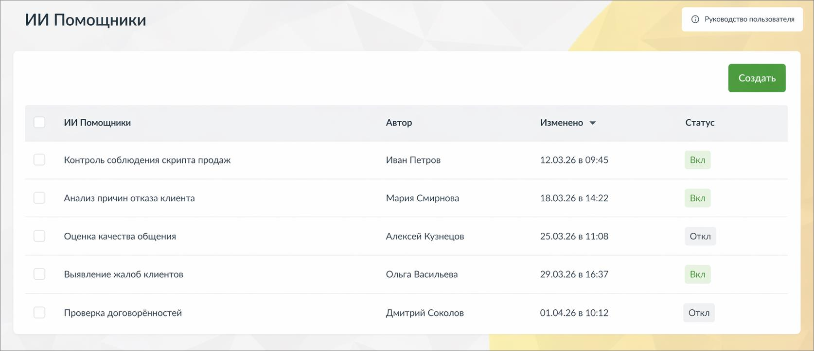

# 9.4.4.3.1. Что это такое и зачем нужно

> Трассировка: PDF §9.4.4.3.1 · сквозные стр. 83 · источники: ч.1 `kb/sources/quality-managment/QM_manual_v-1.26.18.pdf` с.83.

ИИ Помощники - это инструмент, который позволяет автоматически анализировать разговоры по заданным вами правилам и получать не только краткое содержание, но и полезные выводы и рекомендации.

> **Описание иллюстрации QM-§9.4.4.3.1-1** · к разделу §9.4.4.3.1 «Что это такое и зачем нужно» · стр. 83 · снимок экрана / схема, 1674×724 px.
> Относится к тексту руководства: «ИИ Помощники - это инструмент, который позволяет автоматически анализировать разговоры по заданным вами правилам и получать не только краткое содержание, но и полезные выводы и рекомендации.»
> Следующий за иллюстрацией текст: «В отличие от стандартных ИИ Конспектов, ИИ Помощники можно настраивать под конкретные задачи бизнеса. Вы сами определяете, что именно нужно искать и как интерпретировать разговор. С помощью ИИ Помощни…»
> Текст на изображении (OCR, требует сверки): ИИ Помощники; Автор,; Изменено У; Статус; Контроль соблюдения скрипта продаж; Иван Петров; 12.03.26 в 09:45; Вкл; 18.03.26 в 14:22; Анализ причин отказа клиента; Мария Смирнова; Оценка качества общения; Алексей Кузнецов; 25.03.26 в 11:08; Откл; Выявление жалоб клиентов; Ольга Васильева; 29.03.26 в 16:37; Проверка договорённостей; Дмитрий Соколов; 01.04.26 в 10:12

В отличие от стандартных ИИ Конспектов, ИИ Помощники можно настраивать под конкретные задачи бизнеса. Вы сами определяете, что именно нужно искать и как интерпретировать разговор. С помощью ИИ Помощников вы можете: • контролировать соблюдение скриптов • выявлять проблемы в диалогах с клиентами • получать рекомендации по улучшению работы сотрудников • анализировать разговоры с разных точек зрения одновременно Один и тот же разговор может быть обработан несколькими помощниками, и каждый из них даст свой результат.
