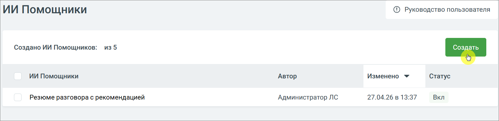

# 9.4.4.3.2. Как создать ИИ Помощника

> Трассировка: PDF §9.4.4.3.2 · сквозные стр. 83-84 · источники: ч.1 `kb/sources/quality-managment/QM_manual_v-1.26.18.pdf` с.83-84.

1. Перейдите в раздел ИИ Помощники 2. Нажмите кнопку Создать

> **Описание иллюстрации QM-§9.4.4.3.2-1** · к разделу §9.4.4.3.2 «Как создать ИИ Помощника» · стр. 83 · снимок экрана / схема, 1572×383 px.
> Относится к тексту руководства: «1. Перейдите в раздел ИИ Помощники 2. Нажмите кнопку Создать»
> Следующий за иллюстрацией текст: «3. Откроется форма создания нового ИИ Помощника»
> Текст на изображении (OCR, требует сверки): © Руководство пользователя; ИИ Помощники; Создано ИИ Помощников:; из5; Создать; Изменено ~; Автор; Статус; Резюме разговора с рекомендацией; Администратор ЛС; 27.04.26 в 13:37; Вкл

3. Откроется форма создания нового ИИ Помощника

> **Описание иллюстрации QM-§9.4.4.3.2-2** · к разделу §9.4.4.3.2 «Как создать ИИ Помощника» · стр. 84 · снимок экрана / схема, 1310×377 px.
> Относится к тексту руководства: «3. Откроется форма создания нового ИИ Помощника»
> Текст на изображении (OCR, требует сверки): Вернуться к списку; © Руководство пользователя; Создание ИИ Помощника; Название; Новый ИИ Помощник; Правила создания ИИ Помощника; Как работает ИИ Помощник Гдесмотреть результат ®; ИИ Помощник автоматически анализирует звонки и чаты по вашему промпту и показывает результаты прямо в расшифровке