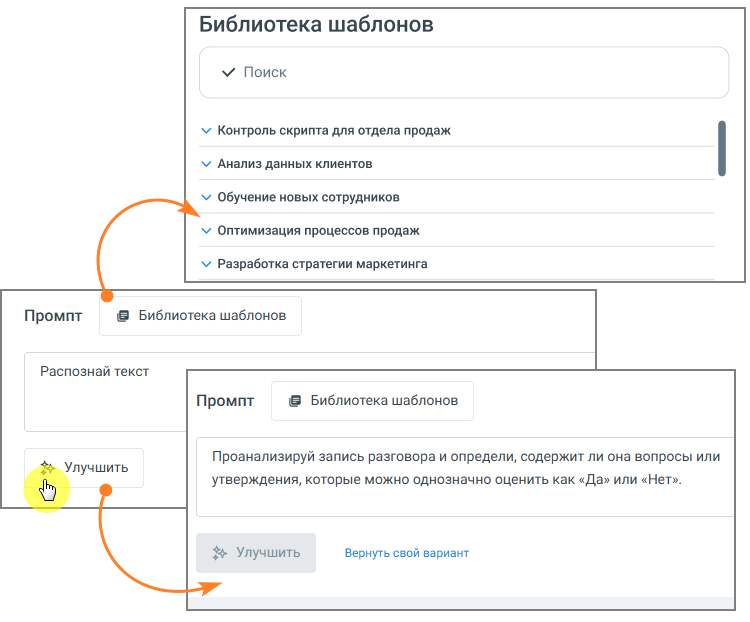
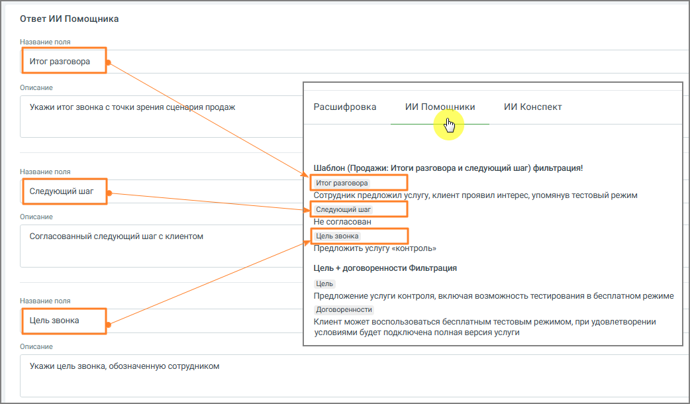
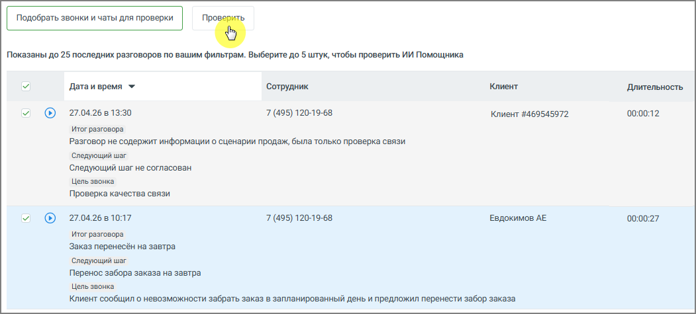

# 9.4.4.3.3. Настройка ИИ Помощника

> Трассировка: PDF §9.4.4.3.3 · сквозные стр. 84-87 · источники: ч.1 `kb/sources/quality-managment/QM_manual_v-1.26.18.pdf` с.84-87.

1. Название - введите название помощника. Рекомендуется указывать название по задаче, например: • Контроль скрипта • Анализ жалоб • Проверка качества общения 2. Промпт - определяет, какой именно результат будет получать пользователь. По сути, это описание задачи для анализа разговора. Чтобы результат был полезным: • формулируйте задачу конкретно • указывайте, что именно нужно определить или сформулировать • задавайте формат ответа (например, кратко, с примерами, с оценкой и т.д.) Один и тот же разговор может анализироваться по-разному в зависимости от промпта, поэтому рекомендуется создавать отдельные ИИ Помощники под разные задачи. • введите текст задания для анализа разговора • при необходимости нажмите Улучшить, чтобы система помогла уточнить формулировку • можно использовать Библиотеку шаблонов и выбрать нужный промт

> **Описание иллюстрации QM-§9.4.4.3.3-1** · к разделу §9.4.4.3.3 «Настройка ИИ Помощника» · стр. 85 · снимок экрана / схема, 750×622 px.
> Относится к тексту руководства: «…давать отдельные ИИ Помощники под разные задачи. • введите текст задания для анализа разговора • при необходимости нажмите Улучшить, чтобы система помогла уточнить формулировку • можно использовать Библиотеку шаблонов и выбрать нужный промт»
> Следующий за иллюстрацией текст: «Примеры промта: • «Проанализируй диалог сотрудника с клиентом. Определи цель звонка, итог разговора, был ли согласован следующий шаг (какой именно) и на какую дату/время, а также наличие отказа и его …»
> Текст на изображении (OCR, требует сверки): Библиотека шаблонов; м Поиск; м Контроль скрипта для отдела продаж; v Анализ данных клиентов; м Обучение новых сотрудников; У Оптимизация процессов продаж; Vv Разработка стратегии маркетинга; @ Библиотека шаблонов; Промпт; Распознай текст; Проанализируй запись разговора и определи, содержит ли она вопросы или; Улучшить; утверждения, которые можно однозначно оценить как «Да» или «Нет».; $ Улучшить; Вернуть свой вариант

Примеры промта: • «Проанализируй диалог сотрудника с клиентом. Определи цель звонка, итог разговора, был ли согласован следующий шаг (какой именно) и на какую дату/время, а также наличие отказа и его причины словами клиента.» • «Ты оцениваешь диалог сотрудника контактного центра и клиента. В данном диалоге сотрудник пытался продать товар или услугу. Проанализируй диалог и дай свои рекомендации - что сотрудник мог бы улучшить в работе для повышения вероятности продажи. Отвечай емко и по существу. К каждой рекомендации делай отсылку к элементу диалога где обнаружена зона роста с указанием времени. Сделай максимум 5 ключевых рекомендаций не больше чем на 300 слов.» 3. Ответ ИИ Помощника - результат работы ИИ Помощника можно настроить под нужный уровень детализации. Возможны два подхода: • единый общий вывод по разговору • структурированный ответ, разбитый на несколько частей Разделение на части удобно, если требуется анализ по нескольким аспектам - например, в плеере отдельно выделить содержание разговора, принятые решения и последующие действия.

На примере ниже показан вариант настроек структурированного ответа в блоке настроек, а также итоговое отображение ответа в плеере звонка.

> **Описание иллюстрации QM-§9.4.4.3.3-2** · к разделу §9.4.4.3.3 «Настройка ИИ Помощника» · стр. 86 · снимок экрана / схема, 1042×610 px.
> Относится к тексту руководства: «На примере ниже показан вариант настроек структурированного ответа в блоке настроек, а также итоговое отображение ответа в плеере звонка.»
> Следующий за иллюстрацией текст: «4. Звонки и чаты для анализа - здесь задаётся, какие разговоры будет анализировать помощник. Можно указать: • сотрудников или группы • номера • тип коммуникации (звонки, чаты) • направление звонков • …»
> Текст на изображении (OCR, требует сверки): `Ответ ИИ Помощника; ` Название поля; ‘Итог разговора; ‘Описание:; ИИ Nom; mK; ИИ Конспект; Укажи итог звонка с точки зрения сценария продаж; Расшифровка; `Шаблон (Продажи: Итоги разговора и следующий шаг) фильтрация!; Итог разговора; Следующий war; ру; дник предложил; угу, клиент проявил интерес, упомянув тестовый режим; He согласован; ‘Согласованный следующий шаг с клиентом; редложить услугу «контроль».; Цель + договоренности Фильтрация; Цель; Предложение услуги контроля, включая возможность тестирования в бесплатном режиме; `Договоренности; Клиент может воспользоваться бесплатным тестовым р…

4. Звонки и чаты для анализа - здесь задаётся, какие разговоры будет анализировать помощник. Можно указать: • сотрудников или группы • номера • тип коммуникации (звонки, чаты) • направление звонков • длительность разговора Это позволяет применять помощника только к нужным диалогам. 5. Проверка работы ИИ Помощника Перед использованием рекомендуется проверить работу: 1. Выберите период и фильтры 2. Нажмите Подобрать звонки и чаты для проверки 3. Выберите до 5 разговоров 4. Нажмите Проверить Вы увидите, как помощник анализирует реальные диалоги.

> **Описание иллюстрации QM-§9.4.4.3.3-3** · к разделу §9.4.4.3.3 «Настройка ИИ Помощника» · стр. 87 · снимок экрана / схема, 1051×475 px.
> Относится к тексту руководства: «…ощника Перед использованием рекомендуется проверить работу: 1. Выберите период и фильтры 2. Нажмите Подобрать звонки и чаты для проверки 3. Выберите до 5 разговоров 4. Нажмите Проверить Вы увидите, как помощник анализирует реальные диалоги.»
> Следующий за иллюстрацией текст: «Тестирование позволяет заранее проверить, как ИИ Помощник будет анализировать реальные разговоры, до его сохранения и включения в работу. Это даёт пользователю следующие преимущества: • позволяет убед…»
> Текст на изображении (OCR, требует сверки): Se; Показаны до 25 последних разговоров по вашим фильтрам. Выберите до 5 штук, чтобы проверить ИИ Помощника; "Дата и время *; ‘Сотрудник; Клиент; Длительность,; 27.04.26 8 13:30; 7 (495) 120-19-68; Клиент #469545972; 00:00:12; итог разговора; Разговор не содержит информации о сценарии продаж, была только проверка связи; ‘Следующий шаг; Следующий шаг не согласован; Цель звонка; Проверка качества связи; 27.04.26 8 10:17; Евдокимов АЕ; Заказ перенесён на завтра; Перенос забора заказа на завтра; Клиент сообщил о невозможности забрать заказ в запланированный день и предложил перенести забор заказа

Тестирование позволяет заранее проверить, как ИИ Помощник будет анализировать реальные разговоры, до его сохранения и включения в работу. Это даёт пользователю следующие преимущества: • позволяет убедиться, что помощник правильно понимает задачу • помогает выявить неточности или ошибки в формулировке промпта • даёт возможность сравнить результат на нескольких разговорах • снижает риск получения некорректных или бесполезных выводов после запуска • экономит время, исключая необходимость последующей переработки настроек В результате пользователь получает более точный и предсказуемый анализ разговоров сразу после включения помощника. Для сохранения данных нажмите кнопку Создать. После этого помощник начнёт автоматически анализировать подходящие разговоры.
