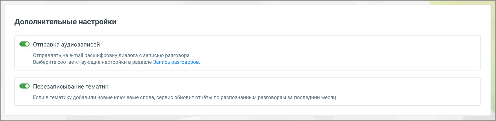

# 9.4.5. Дополнительные настройки

> Трассировка: PDF §9.4.5 · сквозные стр. 90-91 · источники: ч.1 `kb/sources/quality-managment/QM_manual_v-1.26.18.pdf` с.90-91.

Блок Дополнительные настройки позволяет пользователю управлять расширенными функциями обработки и распознавания разговоров.

> **Описание иллюстрации QM-§9.4.5-1** · к разделу §9.4.5 «Дополнительные настройки» · стр. 90 · снимок экрана / схема, 1761×432 px.
> Относится к тексту руководства: «Блок Дополнительные настройки позволяет пользователю управлять расширенными функциями обработки и распознавания разговоров.»
> Следующий за иллюстрацией текст: «В данном блоке доступны следующие опции: 1. Отправка аудиозаписей: • Если переключатель включен, клиенту, использующему сервис "Речевая аналитика" и подключившему услугу "Расшифровка разговоров", на э…»
> Текст на изображении (OCR, требует сверки): Дополнительные настройки; Ш отправка аудиозаписей; Отправлять на e-mail расшифровку диалога с записью разговора.; Выберите соответствующие настройки в разделе Запись разговоров.; @ Перезаписывание тематик; Если в тематику добавили новые ключевые слова, сервис обновит отчёты по распознанным разговорам за последний месяц.

В данном блоке доступны следующие опции: 1. Отправка аудиозаписей: • Если переключатель включен, клиенту, использующему сервис "Речевая аналитика" и подключившему услугу "Расшифровка разговоров", на электронную почту отправляются текстовая расшифровка и аудиозапись соответствующего разговора. 2. Перезаписывание тематик: • Если в тематике добавлены новые ключевые слова, сервис автоматически обновит отчёты по уже распознанным разговорам за последний месяц. Это позволяет поддерживать актуальность данных в отчетах без необходимости ручного обновления.

| Важно: Эта настройка относится ко всем добавленным тематикам и может изменить текущие |
| --- |
| данные в отчетах. |

Каждая из этих функций обеспечивает дополнительную гибкость и улучшение качества обработки разговоров, позволяя пользователю настраивать сервис в соответствии с его потребностями.
