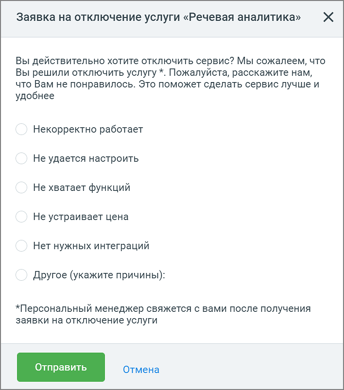

# 9.4.6. Отключение услуги

> Трассировка: PDF §9.4.6 · сквозные стр. 91-93 · источники: ч.1 `kb/sources/quality-managment/QM_manual_v-1.26.18.pdf` с.91-93.

При необходимости пользователь может отключить услугу Речевая аналитика. Для этого в разделе Настройки нажмите на ссылку Отключить.

> **Описание иллюстрации QM-§9.4.6-1** · к разделу §9.4.6 «Отключение услуги» · стр. 91 · снимок экрана / схема, 904×143 px.
> Относится к тексту руководства: «При необходимости пользователь может отключить услугу Речевая аналитика. Для этого в разделе Настройки нажмите на ссылку Отключить.»
> Следующий за иллюстрацией текст: «В появившемся окне заполните и отправьте форму обратной связи с запросом на отключение услуги. Услуга будет отключена вашим Персональным менеджером.»
> Текст на изображении (OCR, требует сверки): Речевая аналитика; Доступ к разделу: расшифровкам, формированию отчётов и услугам Речевой аналитики.; — bys smecau ©; on

В появившемся окне заполните и отправьте форму обратной связи с запросом на отключение услуги. Услуга будет отключена вашим Персональным менеджером.

> **Описание иллюстрации QM-§9.4.6-2** · к разделу §9.4.6 «Отключение услуги» · стр. 92 · снимок экрана / схема, 708×803 px.
> Относится к тексту руководства: «В появившемся окне заполните и отправьте форму обратной связи с запросом на отключение услуги. Услуга будет отключена вашим Персональным менеджером.»
> Следующий за иллюстрацией текст: «На странице Настройки будет отображаться статус заявки на отключение. После отключения услуги пользователь полностью теряет доступ к функционалу услуги.»
> Текст на изображении (OCR, требует сверки): Xx; Заявка на отключение услуги «Речевая аналитика»; Вы действительно хотите отключить сервис? Мы сожалеем, что; Вы решили отключить услугу *. Пожалуйста, расскажите нам,; что Вам не понравилось. Это поможет сделать сервис лучше и; удобнее; Некорректно работает; Не удается настроить; Не хватает функций; Не устраивает цена; Нет нужных интеграций; Другое (укажите причины):; *Персональный менеджер свяжется с вами после получения; заявки на отключение услуги; Отправить; Отмена

На странице Настройки будет отображаться статус заявки на отключение. После отключения услуги пользователь полностью теряет доступ к функционалу услуги.