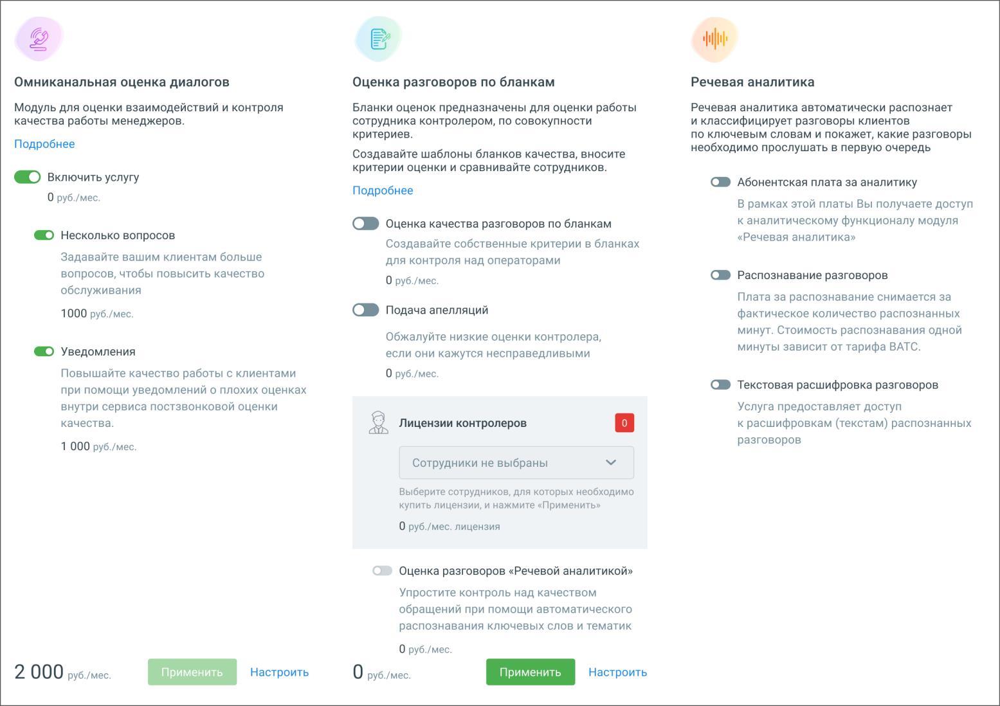

# 10. Дополнительные возможности

> Трассировка: PDF §10 · сквозные стр. 97 · источники: ч.1 `kb/sources/quality-managment/QM_manual_v-1.26.18.pdf` с.97.

В разделе «Дополнительные возможности» доступно подключение и настройка дополнительных блоков модуля Контроль качества.

> **Описание иллюстрации QM-§10-1** · к разделу §10 «Дополнительные возможности» · стр. 97 · снимок экрана / схема, 1555×1098 px.
> Относится к тексту руководства: «В разделе «Дополнительные возможности» доступно подключение и настройка дополнительных блоков модуля Контроль качества.»
> Следующий за иллюстрацией текст: «Настройка Речевой аналитики осуществляется в Личном кабинете ВАТС. Переключатель «Оценка разговоров Речевой аналитикой» доступен только при условии подключенной услуги Речевая аналитика. Если переключ…»
> Текст на изображении (OCR, требует сверки): ‘ii; Речевая аналитика; Омниканальная оценка диалогов; Оценка разговоров по бланкам; Модуль для оценки взаимодействий и контроля; Бланки оценок предназначены для оценки работы; Речевая аналитика автоматически распознает; качества работы менеджеров.; сотрудника контролером, по совокупности; и классифицирует разговоры клиентов; критериев.; по ключевым словам и покажет, какие разговоры; Подробнее; необходимо прослушать в первую очередь; Создавайте шаблоны бланков качества, вносите; критерии оценки и сравнивайте сотрудников.; © включить услугу; CB Абонентская плата за аналитику; 0 руб./мес.; В рам…

Настройка Речевой аналитики осуществляется в Личном кабинете ВАТС. Переключатель «Оценка разговоров Речевой аналитикой» доступен только при условии подключенной услуги Речевая аналитика. Если переключатель включен, то при помощи Речевой аналитики вы можете оценивать качество обслуживания с точностью, близкой к контролеру. Таким образом можно охватить 100% разговоров сотрудников и получить более точную оценку качества. Ознакомьтесь с условиями и самостоятельно подключите блоки, проставив соответствующие переключатели и кликнув по кнопкам Применить или Подключить (в зависимости от выбранного блока и состояния услуги). После подключения блока необходимо произвести его настройки.
