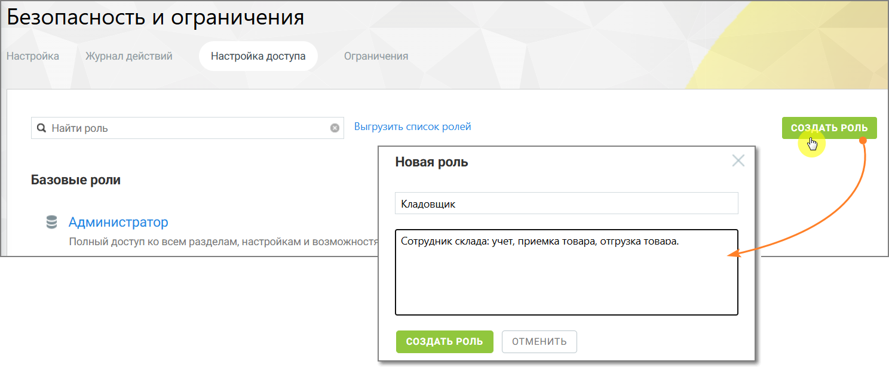

# 3.2. Создание роли

> Трассировка: PDF §3.2 · сквозные стр. 8-9 · источники: ч.1 `kb/sources/Rolevaya-model-vats/Rolevaya-model-VATS_1_26_08.pdf` с.8-9.

Создание роли позволяет определить новый набор прав доступа для пользователей системы. внимание Создавать роли могут только пользователи, обладающие правом доступа «Создать роль». Создать пользовательскую роль можно с помощью кнопки «Создать роль». Этот способ используется, если требуется создать роль с полностью уникальным набором прав. внимание Роль, созданная таким образом, изначально не имеет никаких прав доступа. После создания необходимо включить нужные права, чтобы пользователи могли выполнять свои задачи.

> **Описание иллюстрации ROLES-§3.2-1** (к §3.2 «Создание роли», стр. 8; 1488×632 px). Снимок экрана / схема.
> Относится к тексту руководства: «…данная таким образом, изначально не имеет никаких прав доступа. После создания необходимо включить нужные права, чтобы пользователи могли выполнять свои задачи.».
> Подпись в руководстве: «Рисунок 2. Как работает кнопка «Создать роль»».
> Текст на изображении (OCR, требует сверки): Безопасность и ограничения; Настройка; Журнал действий; Настройка доступа; Ограничения; Выгрузить список ролей; СОЗДАТЬ РОЛЬ; Q Найти роль; Новая роль; Базовые роли; Кладовщик; Администратор; Полный доступ ко всем разделам, настройкам и возможност:; ‘Сотрудник склада: учет, приемка товара, отгрузка товара.; ОТМЕНИТЬ

Рисунок 2. Как работает кнопка «Создать роль» Чтобы создать роль: • откройте раздел Настройки АТС → Безопасность и ограничения • нажмите кнопку Создать роль • укажите название роли • при необходимости укажите описание роли • настройте права доступа роли • нажмите Сохранить Роли и права доступа | v. 1.26.08 8

| 8 800 555 55 22, mango-office.ru |  |
| --- | --- |
|  | mango@mangotele.com |
