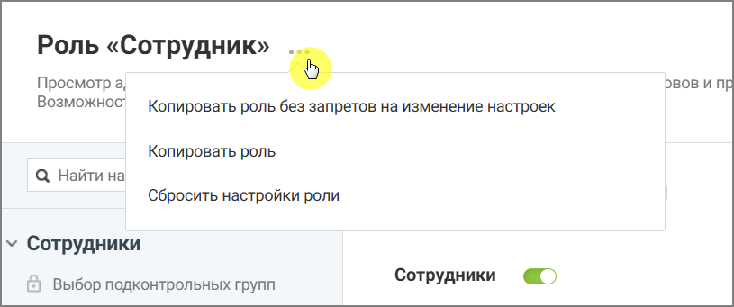

# 3.3. Создание роли путем копирования

> Трассировка: PDF §3.3 · сквозные стр. 9 · источники: ч.1 `kb/sources/Rolevaya-model-vats/Rolevaya-model-VATS_1_26_08.pdf` с.9.

копирования Новые роли можно создавать путем копирования существующих ролей.

> **Описание иллюстрации ROLES-§3.3-1** (к §3.3 «Создание роли путем копирования», стр. 9; 815×341 px). Снимок экрана / схема.
> Относится к тексту руководства: «…3.3. Создание роли путем копирования Новые роли можно создавать путем копирования существующих ролей.».
> Подпись в руководстве: «Рисунок 3. Создание новой роли на основе существующей».
> Текст на изображении (OCR, требует сверки): Роль «Сотрудник»; Просмотр а,; oO; OBOB и ПВ; Возможнос`; Копировать роль без запретов на изменение настроек; Копировать роль; Q Найти на; Сбросить настройки роли; у Сотрудники; Сотрудники; ©) Выбор подконтрольных групп

Рисунок 3. Создание новой роли на основе существующей
