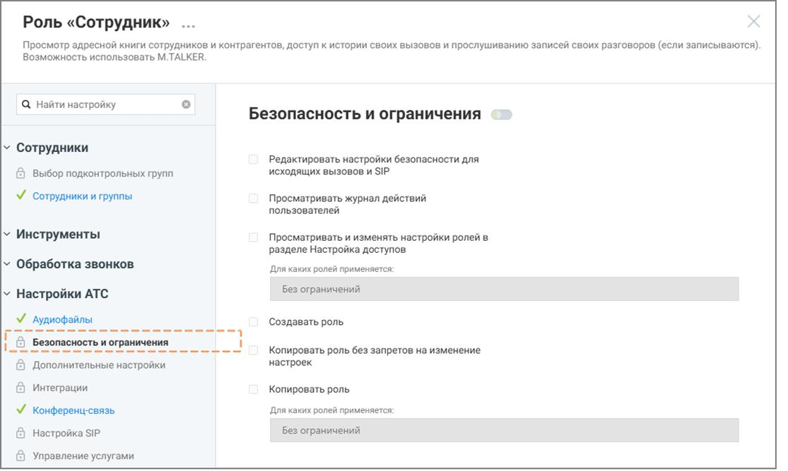
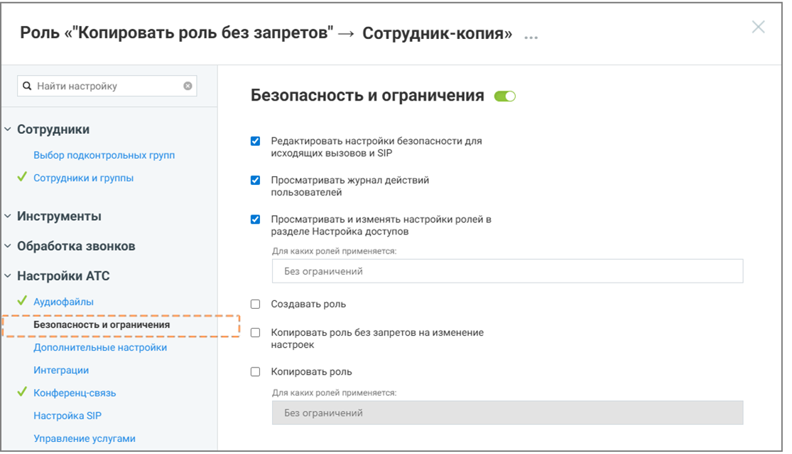

# 3.3.1. Копировать роль без запретов на изменение настроек

> Трассировка: PDF §3.3.1 · сквозные стр. 9-11 · источники: ч.1 `kb/sources/Rolevaya-model-vats/Rolevaya-model-VATS_1_26_08.pdf` с.9-11.

изменение настроек Данная строка меню доступна для нажатия если у пользователя активировано право доступа «Копировать роль без запретов на изменение настроек». внимание Важно понимать: копия роли наследует от источника только перечень доступных разделов. Если раздел был закрыт/открыт для исходной роли, после создания копии он останется аналогично закрытым/открытым, с возможностью последующего изменения доступа. Также внутри каждого унаследованного раздела копия получает возможность подключения полного набора всех возможных прав, даже если у источника они были отключены. После создания роли-копии обязательно отключите ненужные права, чтобы избежать избыточных разрешений. Чтобы создать роль на основе существующей, без запретов на изменение настроек: • откройте раздел Настройки АТС → Безопасность и ограничения • выберите системную роль, на основе которой будет создаваться пользовательская

> **Описание иллюстрации ROLES-§3.3.1-1** (к §3.3.1 «Копировать роль без запретов на изменение настроек», стр. 9; 54×37 px). Пиктограмма (значок элемента интерфейса).
> Относится к тексту руководства: «…изменение настроек: • откройте раздел Настройки АТС → Безопасность и ограничения • выберите системную роль, на основе которой будет создаваться пользовательская».
> Текста на изображении нет; назначение элемента — см. текст, к которому он относится.

• нажмите иконку контекстного меню и в выпадающем окне выберите вариант «Копировать роль без запретов на изменение настроек» • нажмите кнопку Создать роль • укажите название роли • при необходимости укажите описание роли • настройте права доступа роли Роли и права доступа | v. 1.26.08 9

| 8 800 555 55 22, mango-office.ru |  |
| --- | --- |
|  | mango@mangotele.com |

• нажмите Сохранить

> **Описание иллюстрации ROLES-§3.3.1-2** (к §3.3.1 «Копировать роль без запретов на изменение настроек», стр. 10; 1115×667 px). Снимок экрана / схема.
> Относится к тексту руководства: «…• нажмите Сохранить».
> Подпись в руководстве: «Рисунок 4. Роль-источник».
> Текст на изображении (OCR, требует сверки): Роль «Сотрудник» ...; Просмотр адресной книги сотрудников и контрагентов, доступ к истории своих вызовов и прослушиванию записей своих разговоров (если записываются); Возможность использовать M. TALKER.; Q Найти настройку; Безопасность и ограничения; У Сотрудники; Редактировать настройки безопасности для; исходящих вызовов и SIP; Выбор подконтрольных групп; У сотрудники и группы; Просматривать журнал действий; пользователей; у Инструменты; Просматривать и изменять настройки ролей в.; разделе Настройка доступов; У Обработка звонков; Ana каких ролей применяется:; Без ограничений; у Настройки ATC…

Рисунок 4. Роль-источник

> **Описание иллюстрации ROLES-§3.3.1-3** (к §3.3.1 «Копировать роль без запретов на изменение настроек», стр. 10; 1115×641 px). Снимок экрана / схема.
> Относится к тексту руководства: «…• нажмите Сохранить Рисунок 4. Роль-источник».
> Подпись в руководстве: «Рисунок 5. Роль-копия».
> Текст на изображении (OCR, требует сверки): Роль «"Копировать роль без запретов" —> Сотрудник-копия»; Q Найти настройку; Безопасность и ограничения @>; у Сотрудники; Редактировать настройки безопасности для; Выбор подконтрольных групп; исходящих вызовов и SIP; М сотрудники и группы; Просматривать журнал действий; пользователей; У Инструменты; Просматривать и изменять настройки ролей в.; разделе Настройка доступов; у Обработка звонков; Для каких ролей применяется:; у Настройки АТС; Без ограничений; У Аудиофайлы; Создавать роль; cosas; ay; 'асность и ограничения; soso; oS; et; Копировать роль без запретов на изменение; Дополнительные наст…

Рисунок 5. Роль-копия Роли и права доступа | v. 1.26.08 10

| 8 800 555 55 22, mango-office.ru |  |
| --- | --- |
|  | mango@mangotele.com |

На примере выше Рисунок 4 – роль-источник, Рисунок 5 – роль-копия. Роль-копия имеет возможности подключения разделов и подключения прав доступа внутри разделов, хотя роль- источник этой возможности не имеет.
