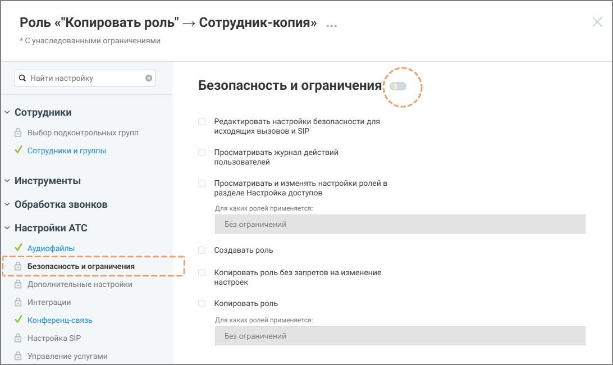

# 3.3.2. Копировать роль

> Трассировка: PDF §3.3.2 · сквозные стр. 11-12 · источники: ч.1 `kb/sources/Rolevaya-model-vats/Rolevaya-model-VATS_1_26_08.pdf` с.11-12.

Данная строка меню доступна для нажатия если у пользователя активировано право доступа «Копировать роль». Этот способ удобен, если необходимо создать роль с аналогичными разрешениями и запретами на изменение настроек. Чтобы создать роль на основе существующей: • откройте раздел Настройки АТС → Безопасность и ограничения • выберите системную роль, на основе которой будет создаваться пользовательская

> **Описание иллюстрации ROLES-§3.3.2-1** (к §3.3.2 «Копировать роль», стр. 11; 54×37 px). Пиктограмма (значок элемента интерфейса).
> Относится к тексту руководства: «…снове существующей: • откройте раздел Настройки АТС → Безопасность и ограничения • выберите системную роль, на основе которой будет создаваться пользовательская».
> Текста на изображении нет; назначение элемента — см. текст, к которому он относится.

• нажмите иконку контекстного меню и в выпадающем окне выберите вариант «Копировать роль» • нажмите кнопку Создать роль • укажите название роли • при необходимости укажите описание роли • настройте права доступа роли, которые остались доступными для изменения • нажмите Сохранить

> **Описание иллюстрации ROLES-§3.3.2-2** (к §3.3.2 «Копировать роль», стр. 11; 1092×650 px). Снимок экрана / схема.
> Относится к тексту руководства: «…• при необходимости укажите описание роли • настройте права доступа роли, которые остались доступными для изменения • нажмите Сохранить».
> Подпись в руководстве: «Рисунок 6. Роль-копия, с унаследованными запретами».
> Текст на изображении (OCR, требует сверки): Роль «"Копировать роль" — Сотрудник-копия» ...; * Сунаследованными ограничениями; Q Найти настройку; Безопасность и ограничения!; у Сотрудники; Редактировать настройки безопасности для; @ выбор подконтрольных групп; исходящих вызовов и SIP; У сотрудники и группы; Просматривать журнал действий; пользователей; у Инструменты; Просматривать и изменять настройки ролей в; разделе Настройка доступов; у Обработка звонков; Для каких ролей применяется:; у Настройки АТС; Без ограничений; У Аудиофайлы; Создавать роль; ©) Безопасность и ограничения; Копировать роль без запретов на изменение; Дополнительные…

Рисунок 6. Роль-копия, с унаследованными запретами На рисунке 6 выше роль «Сотрудник»-копия имеет те же запреты, как и роль-источник. Роли и права доступа | v. 1.26.08 11

| 8 800 555 55 22, mango-office.ru |  |
| --- | --- |
|  | mango@mangotele.com |
