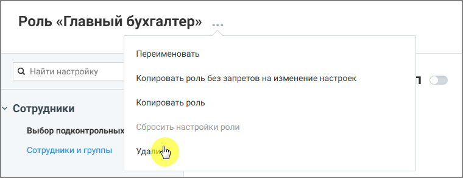

# 3.4. Удаление роли

> Трассировка: PDF §3.4 · сквозные стр. 12 · источники: ч.1 `kb/sources/Rolevaya-model-vats/Rolevaya-model-VATS_1_26_08.pdf` с.12.

Удалить можно только пользовательские роли. Системные роли удалить нельзя. Чтобы удалить роль: • откройте список ролей • выберите роль, которую необходимо удалить • выберите действие Удалить роль • подтвердите удаление

> **Описание иллюстрации ROLES-§3.4-1** (к §3.4 «Удаление роли», стр. 12; 760×292 px). Снимок экрана / схема.
> Относится к тексту руководства: «…• выберите роль, которую необходимо удалить • выберите действие Удалить роль • подтвердите удаление».
> Подпись в руководстве: «Рисунок 7. Удаление роли».
> Текст на изображении (OCR, требует сверки): Роль «Главный бухгалтер» .; Переименовать; Q Найти настройку; Копировать роль без запретов на изменение настроек; Копировать роль; \ Сотрудники; Выбор подконтрольных; Сбросить настройки роли; Сотрудники и группы

Рисунок 7. Удаление роли После удаления роль становится недоступной для назначения пользователям.
