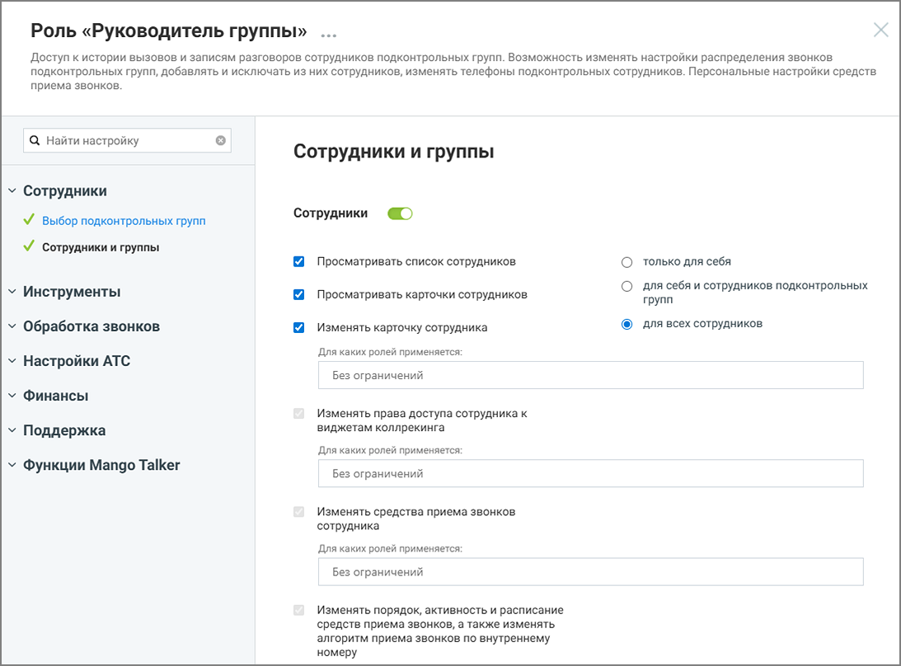

# 4. Настройка прав доступа роли

> Трассировка: PDF §4 · сквозные стр. 14-16 · источники: ч.1 `kb/sources/Rolevaya-model-vats/Rolevaya-model-VATS_1_26_08.pdf` с.14-16.

роли Права доступа роли определяют, какие действия доступны пользователям с этой ролью и к каким разделам системы они могут получить доступ. Если право включено - выполнение соответствующего действия разрешено. Если право отключено - выполнение функции недоступно. При настройке некоторых прав доступа также можно указать, над сотрудниками с какими ролями разрешено выполнение действия. Для этого выбираются роли целевых сотрудников — действие будет доступно только в том случае, если сотрудник, на которого оно направлено, обладает ролью из списка ролей параметра доступа. Если установлено значение «Без ограничений», то принадлежность роли сотрудника, над которым производится действие не проверяется. Настройка прав доступа выполняется при создании роли или при редактировании существующей роли.

> **Описание иллюстрации ROLES-§4-1** (к §4 «Настройка прав доступа роли», стр. 14; 1093×808 px). Снимок экрана / схема.
> Относится к тексту руководства: «…оли сотрудника, над которым производится действие не проверяется. Настройка прав доступа выполняется при создании роли или при редактировании существующей роли.».
> Подпись в руководстве: «Рисунок 9. Настройка прав доступа для роли».
> Текст на изображении (OCR, требует сверки): Роль «Руководитель группы» ...; Доступ к истории вызовов и записям разговоров сотрудников подконтрольных групп. Возможность изменять настройки распределения звонков.; подконтрольных групп, добавлять и исключать из них сотрудников, изменять телефоны подконтрольных сотрудников. Персональные настройки средств; приема звонков.; Q Найти настройку; Сотрудники и группы; Сотрудники; У выбор подконтрольных групп; VY сотрудники и группы.; Просматривать список сотрудников; только для себя; Инструменты; для себя и сотрудников подконтрольных; Просматривать карточки сотрудников; групп; для всех сотрудников;…

Рисунок 9. Настройка прав доступа для роли Чтобы изменить права доступа роли: • откройте раздел Настройки АТС → Безопасность и ограничения → Настройка доступа Роли и права доступа | v. 1.26.08 14

| 8 800 555 55 22, mango-office.ru |  |
| --- | --- |
|  | mango@mangotele.com |

• выберите роль, права доступа которой необходимо изменить • включите или отключите необходимые права доступа и ограничения • настройте параметры прав доступа (при необходимости) • нажмите Сохранить. внимание После сохранения изменения применяются ко всем пользователям, которым назначена эта роль. Некоторые права доступа могут зависеть от других прав. В этом случае изменение одного права может автоматически изменить состояние другого права. При редактировании прав в интерфейсе Личного кабинета ВАТС в таких случаях отображаются подсказки. Также часть прав может быть недоступна для изменения и отображаться в режиме только чтения. Такие права устанавливаются системой и не могут быть изменены вручную. Статусы прав доступа в разрезе возможностей подключения:

> **Описание иллюстрации ROLES-§4-2** (к §4 «Настройка прав доступа роли», стр. 15; 15×16 px). Пиктограмма (значок элемента интерфейса).
> Относится к тексту руководства: «…ражаться в режиме только чтения. Такие права устанавливаются системой и не могут быть изменены вручную. Статусы прав доступа в разрезе возможностей подключения:».
> Текста на изображении нет; назначение элемента — см. текст, к которому он относится.

- право доступно, но не подключено

> **Описание иллюстрации ROLES-§4-3** (к §4 «Настройка прав доступа роли», стр. 15; 15×14 px). Пиктограмма (значок элемента интерфейса).
> Относится к тексту руководства: «…кие права устанавливаются системой и не могут быть изменены вручную. Статусы прав доступа в разрезе возможностей подключения: - право доступно, но не подключено».
> Текста на изображении нет; назначение элемента — см. текст, к которому он относится.

- право доступно и подключено

> **Описание иллюстрации ROLES-§4-4** (к §4 «Настройка прав доступа роли», стр. 15; 15×15 px). Пиктограмма (значок элемента интерфейса).
> Относится к тексту руководства: «…емой и не могут быть изменены вручную. Статусы прав доступа в разрезе возможностей подключения: - право доступно, но не подключено - право доступно и подключено».
> Текста на изображении нет; назначение элемента — см. текст, к которому он относится.

- возможность подключения зависит от активности какого-либо из предыдущих прав доступа

> **Описание иллюстрации ROLES-§4-5** (к §4 «Настройка прав доступа роли», стр. 15; 14×18 px). Пиктограмма (значок элемента интерфейса).
> Относится к тексту руководства: «…лючения: - право доступно, но не подключено - право доступно и подключено - возможность подключения зависит от активности какого-либо из предыдущих прав доступа».
> Текста на изображении нет; назначение элемента — см. текст, к которому он относится.

- право недоступно для подключения

> **Описание иллюстрации ROLES-§4-6** (к §4 «Настройка прав доступа роли», стр. 15; 15×14 px). Пиктограмма (значок элемента интерфейса).
> Относится к тексту руководства: «…дключено - право доступно и подключено - возможность подключения зависит от активности какого-либо из предыдущих прав доступа - право недоступно для подключения».
> Текста на изображении нет; назначение элемента — см. текст, к которому он относится.

- право подключено и недоступно для отключения

> **Описание иллюстрации ROLES-§4-7** (к §4 «Настройка прав доступа роли», стр. 15; 25×25 px). Пиктограмма (значок элемента интерфейса).
> Относится к тексту руководства: «…ность подключения зависит от активности какого-либо из предыдущих прав доступа - право недоступно для подключения - право подключено и недоступно для отключения».
> Текста на изображении нет; назначение элемента — см. текст, к которому он относится.

Иконка рядом с названием раздела означает, что для роли включена возможность доступа хотя бы к одной функции этого раздела. Если иконка отсутствует, доступ к функциям раздела для данной роли не предоставлен.

> **Описание иллюстрации ROLES-§4-8** (к §4 «Настройка прав доступа роли», стр. 15; 748×133 px). Снимок экрана / схема.
> Относится к тексту руководства: «…для роли включена возможность доступа хотя бы к одной функции этого раздела. Если иконка отсутствует, доступ к функциям раздела для данной роли не предоставлен.».
> Подпись в руководстве: «Рисунок 10. Иконки доступа к разделам».
> Текст на изображении (OCR, требует сверки): Контрол ь качества; раздел доступен, но не подключен; МангоМобайл; раздел недоступен для подключения; у Обращения; раздел доступен и подключен

> **Описание иллюстрации ROLES-§4-9** (к §4 «Настройка прав доступа роли», стр. 15; 1097×524 px). Снимок экрана / схема.
> Относится к тексту руководства: «…для роли включена возможность доступа хотя бы к одной функции этого раздела. Если иконка отсутствует, доступ к функциям раздела для данной роли не предоставлен.».
> Подпись в руководстве: «Рисунок 10. Иконки доступа к разделам».
> Текст на изображении (OCR, требует сверки): Роль «Руководитель группы»; Доступ к истории вызовов и записям разговоров сотрудников подконтрольных групп. Возможность изменять настройки распределения звонков; подконтрольных групп, добавлять и исключать из них сотрудников, изменять телефоны подконтрольных сотрудников. Персональные настройки средств; приема звонков.; Найти настройку; Настройки дозвона и сообщений по умолчанию; Alocmyn отсутствует; у Сотрудники; У выбор подконтрольных групп; У сотрудники и группы; у Инструменты; у Обработка звонков; У голосовое меню и распределение; звонков; настройки дозвона и сообщений по; умолчанию; ee В

Рисунок 10. Иконки доступа к разделам Роли и права доступа | v. 1.26.08 15

| 8 800 555 55 22, mango-office.ru |  |
| --- | --- |
|  | mango@mangotele.com |

Переключатель состояния прав доступа раздела может иметь следующий вид:

> **Описание иллюстрации ROLES-§4-10** (к §4 «Настройка прав доступа роли», стр. 16; 38×18 px). Пиктограмма (значок элемента интерфейса).
> Относится к тексту руководства: «…Переключатель состояния прав доступа раздела может иметь следующий вид:».
> Текста на изображении нет; назначение элемента — см. текст, к которому он относится.

- все права доступа к разделу для данной роли отключены

> **Описание иллюстрации ROLES-§4-11** (к §4 «Настройка прав доступа роли», стр. 16; 37×18 px). Пиктограмма (значок элемента интерфейса).
> Относится к тексту руководства: «…Переключатель состояния прав доступа раздела может иметь следующий вид: - все права доступа к разделу для данной роли отключены».
> Текста на изображении нет; назначение элемента — см. текст, к которому он относится.

- права доступа доступны для подключения

> **Описание иллюстрации ROLES-§4-12** (к §4 «Настройка прав доступа роли», стр. 16; 37×18 px). Пиктограмма (значок элемента интерфейса).
> Относится к тексту руководства: «…атель состояния прав доступа раздела может иметь следующий вид: - все права доступа к разделу для данной роли отключены - права доступа доступны для подключения».
> Текста на изображении нет; назначение элемента — см. текст, к которому он относится.

- все права доступа отключены и недоступны для подключения

> **Описание иллюстрации ROLES-§4-13** (к §4 «Настройка прав доступа роли», стр. 16; 37×18 px). Пиктограмма (значок элемента интерфейса).
> Относится к тексту руководства: «…вид: - все права доступа к разделу для данной роли отключены - права доступа доступны для подключения - все права доступа отключены и недоступны для подключения».
> Текста на изображении нет; назначение элемента — см. текст, к которому он относится.

- все права доступа включены и недоступны для отключения
