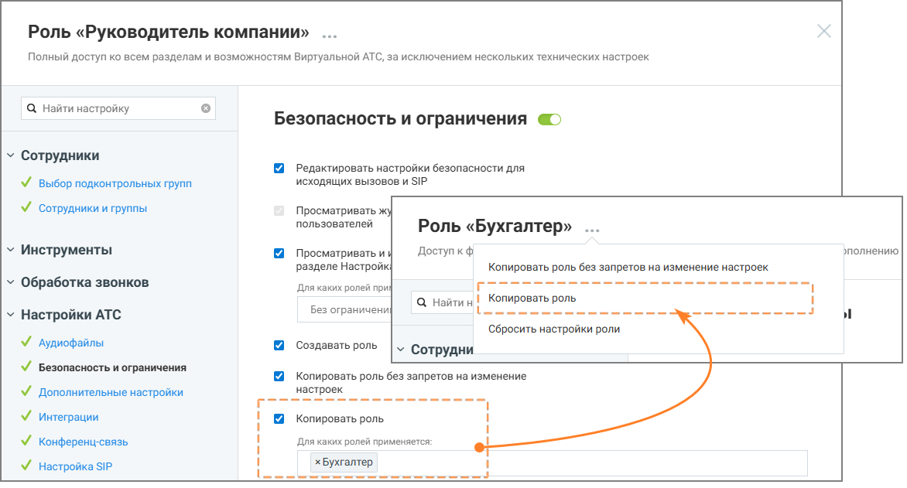

# 4.1. Гибкая настройка прав доступа с учетом ролей объекта

> Трассировка: PDF §4.1 · сквозные стр. 16-19 · источники: ч.1 `kb/sources/Rolevaya-model-vats/Rolevaya-model-VATS_1_26_08.pdf` с.16-19.

учетом ролей объекта Существует возможность тонкой настройки для ряда существующих опций. При активации некоторых разрешений можно ограничить их действие не только уровнем влияния (на себя, подчиненных или всех), но и конкретным списком ролей объекта. Под объектом подразумевается роль пользователя, над которым производится действие, ограниченное доступом. Как это работает: вы включаете настройку (например, «Изменять карточку сотрудника») и выбираете уровень влияния «Для всех сотрудников». Дополнительно вы можете указать, для сотрудников с какими ролями будет доступно это действие. При настройке вам доступны следующие варианты: • Без ограничений — настройка активна для всех сотрудников, независимо от их роли. • Выбор одной или нескольких ролей из списка — действие будет разрешено только в случае, если сотрудник, в отношении которого выполняется действие, обладает ролью из заданного списка параметров права доступа. Для сотрудников с другими ролями данное действие будет запрещено.

> **Описание иллюстрации ROLES-§4.1-1** (к §4.1 «Гибкая настройка прав доступа с учетом ролей объекта», стр. 16; 1360×575 px). Снимок экрана / схема.
> Относится к тексту руководства: «…ии которого выполняется действие, обладает ролью из заданного списка параметров права доступа. Для сотрудников с другими ролями данное действие будет запрещено.».
> Подпись в руководстве: «Рисунок 11. Роль «Руководитель компании», настройка «Изменять карточку сотрудника»».
> Текст на изображении (OCR, требует сверки): Роль «Руководитель компании» ...; Полный доступ ко всем разделам и возможностям Виртуальной АТС, за исключением нескольких технических настроек; Q Найти настройку; Сотрудники и группы; у Сотрудники; У выбор подконтрольных групп; Сотрудники; ¥ сотрудники и группы; Просматривать список сотрудников; только для себя; для себя и сотрудников подконтрольных; у Инструменты; Просматривать карточки сотрудников; групп; у Обработка звонков; Изменять карточку сотрудника; для всех сотрудников; Для каких ролей применяется; у Настройки АТС; у Финансы; хАдминистратор xByxrantep хРуководитель группы eo

Рисунок 11. Роль «Руководитель компании», настройка «Изменять карточку сотрудника» На рисунке 11 показан пример настройки прав доступа: пользователь с ролью Руководитель компании может изменять карточки только тех сотрудников, чьи роли указаны в настройках (Администратор, Бухгалтер, Руководитель группы). Изменение карточек сотрудников с иными ролями для него недоступно. Роли и права доступа | v. 1.26.08 16

| 8 800 555 55 22, mango-office.ru |  |
| --- | --- |
|  | mango@mangotele.com |

> **Описание иллюстрации ROLES-§4.1-2** (к §4.1 «Гибкая настройка прав доступа с учетом ролей объекта», стр. 17; 1172×631 px). Снимок экрана / схема.
> Относится к тексту руководства: «…х сотрудников, чьи роли указаны в настройках (Администратор, Бухгалтер, Руководитель группы). Изменение карточек сотрудников с иными ролями для него недоступно.».
> Подпись в руководстве: «Рисунок 12. Роль «Руководитель компании».».
> Текст на изображении (OCR, требует сверки): Роль «Руководитель компании»; Полный доступ ко всем разделам и возможностям Виртуальной АТС, за исключением нескольких технических настроек; Q Найти настройку; Безопасность и ограничения @›; у Сотрудники; Редактировать настройки безопасности для; исходящих вызовов и SIP; У выбор подконтрольных групп; У сотрудники и группы; Просматривать ж; пользователей; Роль «Бухгалтер» ...; Доступ кф; зполнению; у Инструменты; Просматривать и; разделе Настройк!; Копировать роль без запретов на изменение настроек.; у Обработка звонков; Для каких ролей при; а найтин! Копировать роль; Bes ограничени; ee; у Наст…

Рисунок 12. Роль «Руководитель компании». Настройка «Копировать роль» доступна для изменения Руководителем компании только для роли «Бухгалтер» На рисунке 12 показан пример настройки роли «Руководитель компании». У этой роли есть полный доступ ко всем разделам системы, а в блоке настроек «Копировать роль» задано ограничение: руководитель может копировать только роль Бухгалтер. Это означает, что сотрудник с ролью «Руководитель компании»: • сможет создать копию роли «Бухгалтер» (кнопка копирования будет активна); • не сможет скопировать никакие другие роли — при попытке это сделать система покажет уведомление об отсутствии прав. Роли и права доступа | v. 1.26.08 17

| 8 800 555 55 22, mango-office.ru |  |
| --- | --- |
|  | mango@mangotele.com |

> **Описание иллюстрации ROLES-§4.1-3** (к §4.1 «Гибкая настройка прав доступа с учетом ролей объекта», стр. 18; 1338×910 px). Снимок экрана / схема.
> Относится к тексту руководства: «…алтер» (кнопка копирования будет активна); • не сможет скопировать никакие другие роли — при попытке это сделать система покажет уведомление об отсутствии прав.».
> Подпись в руководстве: «Рисунок 13. Роль «Руководитель компании», настройки.».
> Текст на изображении (OCR, требует сверки): Роль «Руководитель компании» ...; Полный доступ ко всем разделам и возможностям Виртуальной АТС, за исключением нескольких технических настроек; @ для всех сотрудников; Изменять карточку сотрудника; Q Найти настройку; Для каких ролей применяется; хРуководитель группы |; Сотрудники; У Выбор подконтрольных групп; Изменять права доступа сотрудника к; виджетам коллрекинга; \/ сотрудники и группы; хРуководитель группы; Инструменты; Изменять средства приема звонков; Обработка звонков; сотрудника; Настройки ATC; Аудиофайлы; Безопасность и ограничения; Изменять порядок, активность и расписание; средст…

Рисунок 13. Роль «Руководитель компании», настройки. На рисунке 13 пользователь с ролью Руководитель кампании имеет доступ к редактированию карточки сотрудника пользователям только с ролью Руководитель группы. Данная настройка (задание списка ролей) позволяет ограничивать не только список прав доступа, но и уточнять роль или перечень ролей объекта, над которым планируются действия, ограниченные правом доступа. . Роли и права доступа | v. 1.26.08 18

| 8 800 555 55 22, mango-office.ru |  |
| --- | --- |
|  | mango@mangotele.com |
