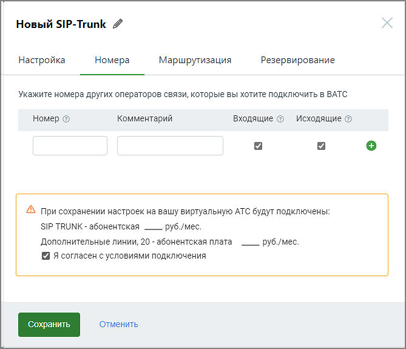

# 3.1.2. Номера

> Трассировка: PDF §3.1.2 · сквозные стр. 8-9 · источники: ч.1 `kb/sources/sip-trunk/MO_SIP_Trunk.pdf` с.8-9.

> **Описание иллюстрации SIPT-§3.1.2-1** (к §3.1.2 «Номера», стр. 8; 669×575 px). Снимок экрана / схема.
> Относится к тексту руководства: «…3.1.2. Номера».
> Текст на изображении (OCR, требует сверки): Новый SIP-Trunk 4; Настройка; Номера; Маршрутизация; Резервирование; Укажите номера других операторов связи, которые вы хотите подключить в ВАТС; Номер ©; Комментарий; Входящие @ Исходящие ©; 4S при сохранении настроек на вашу виртуальную АТС будут подключены:; SIP TRUNK - абонентская — руб./мес.; Дополнительные линии, 20 - абонентская плата; руб./мес.; Я согласен с условиями подключения

Заполните поля: Номер - если к вашей АТС подключены номера какого-то оператора связи, и вы хотите сделать их доступными через сип-транк, их необходимо указать здесь. Формат ввода номера - E.164 без пробелов, например 74951234567. Комментарий - информация произвольного характера, не более 50 символов. Поле не обязательно для заполнения; Укажите желаемые направление вызовов. В зависимости от выбора направления через SIP Trunk пользователь cможет: ● Входящие - номер будет отображен в списке номеров других операторов связи в разделе “Номера, подключенные к АТС”. Это позволит настроить для него голосовое меню IVR и правила переадресации (распределения) звонков. ● Исходящие - номер будет отображен в списке доступных для выбора исходящих линий в карточках сотрудников ВАТС. При выборе его в качестве исходящий линии и совершении сотрудником исходящего звонка, он будет направлен в сип- транк. Если номер используется (например, в схеме переадресации), при редактировании транка отключить чекбокс «звонить» невозможно.

> **Описание иллюстрации SIPT-§3.1.2-2** (к §3.1.2 «Номера», стр. 9; 17×18 px). Пиктограмма (значок элемента интерфейса).
> Относится к тексту руководства: «…а, он будет направлен в сип- транк. Если номер используется (например, в схеме переадресации), при редактировании транка отключить чекбокс «звонить» невозможно.».
> Текста на изображении нет; назначение элемента — см. текст, к которому он относится.

Чтобы удалить введенный номер, кликните по пиктограмме в строке выбранного номера. Если для данного номера настроены схемы распределения вызовов, переадресация или он используется в качестве исходящего номера абонента, номер не может быть удален.
