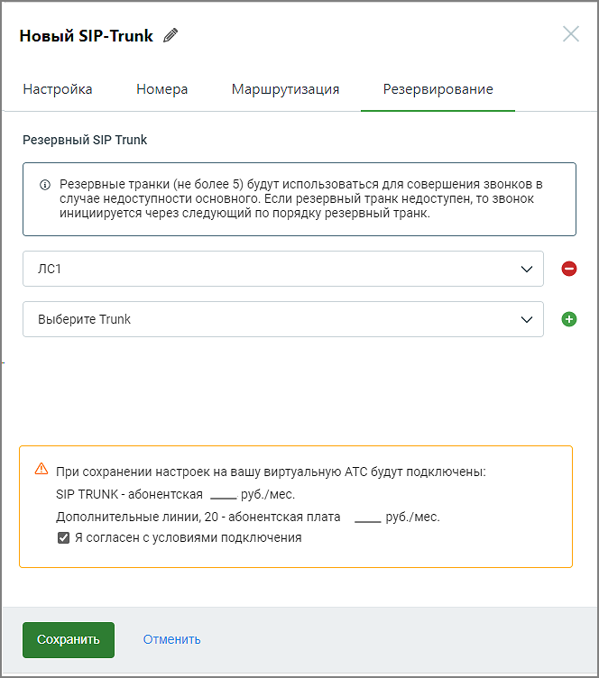

# 3.1.4. Резервирование

> Трассировка: PDF §3.1.4 · сквозные стр. 12-13 · источники: ч.1 `kb/sources/sip-trunk/MO_SIP_Trunk.pdf` с.12-13.

На вкладке Резервирование следует задать список резервных SIP Trunk (максимальное количество – 5), которые будут использоваться для совершения звонков в случае недоступности основного. Если резервный транк недоступен, то звонок инициируется через следующий по списку резервный транк.

> **Описание иллюстрации SIPT-§3.1.4-1** (к §3.1.4 «Резервирование», стр. 13; 664×752 px). Снимок экрана / схема.
> Относится к тексту руководства: «…ться для совершения звонков в случае недоступности основного. Если резервный транк недоступен, то звонок инициируется через следующий по списку резервный транк.».
> Текст на изображении (OCR, требует сверки): Новый SIP-Trunk 4; Настройка; Номера; Маршрутизация; Резервирование; Резервный SIP Trunk; © Резервные транки (не более 5) будут использоваться для совершения звонков в; случае недоступности основного. Если резервный транк недоступен, то звонок; инициируется через следующий по порядку резервный транк.; лс1; Выберите Trunk; 4S при сохранении настроек на вашу виртуальную АТС будут подключены:; SIP TRUNK - абонентская — руб./мес.; Дополнительные линии, 20 - абонентская плата; руб./мес.; Я согласен с условиями подключения
