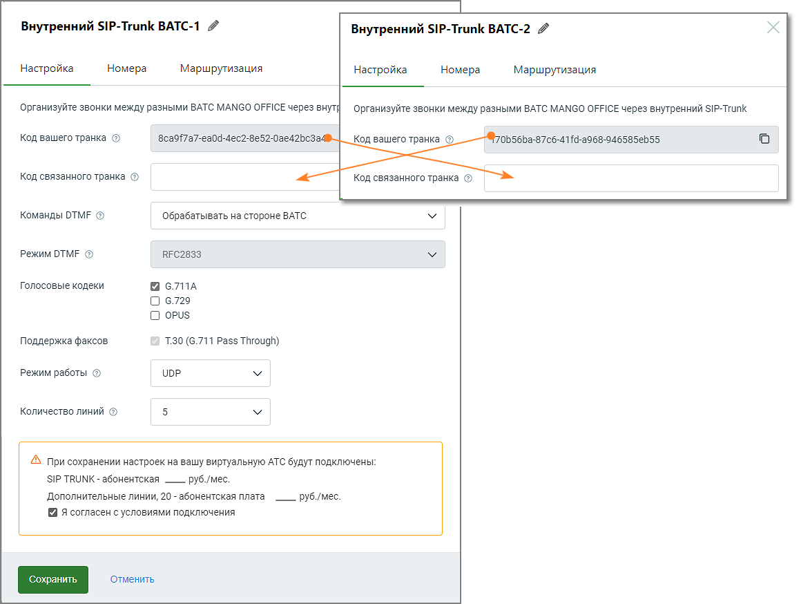

# 3.2.1. Настройка

> Трассировка: PDF §3.2.1 · сквозные стр. 13-14 · источники: ч.1 `kb/sources/sip-trunk/MO_SIP_Trunk.pdf` с.13-14.

Для настройки внутреннего SIP Trunk необходимо установить связь между двумя ВАТС, прописав соответствующие параметры, которые позволят им взаимодействовать между собой. Это обеспечит внутренние коммуникации между филиалами или частями одной и той же компании через SIP Trunk.

> **Описание иллюстрации SIPT-§3.2.1-1** (к §3.2.1 «Настройка», стр. 14; 1160×874 px). Снимок экрана / схема.
> Относится к тексту руководства: «…ы, которые позволят им взаимодействовать между собой. Это обеспечит внутренние коммуникации между филиалами или частями одной и той же компании через SIP Trunk.».
> Текст на изображении (OCR, требует сверки): Внутренний SIP-Trunk BATC-1 /; Внутренний SIP-Trunk BATC-2 4; Настройка; Номера; Маршрутизация; Организуйте звонки между разными ВАТС MANGO OFFICE через внут; Организуйте звонки между разными ВАТС MANGO OFFICE через внутренний SIP-Trunk; Код вашего транка; зсаоГ7а7-еа09-4ес2-Ве52-0ае42ьсза; (Ob56ba-87¢6-41 fd-a968-946585eb55; Код связанного транка; Команды DTMF ©; обрабатывать на стороне ВАТС; режим ОТМЕ ©; RFC2833; Голосовые кодеки; 6.7ПА; О 6.729; О opus; Поддержка факсов; 7.30 (6.711 Pass Through); Режим работы; ЦОР; Количество линий ©; AS при сохранении настроек на вашу виртуальную АТС буд…

При заполнении остальных полей формы, руководствуйтесь инструкциями, предоставленными в разделе Настройки для внешнего SIP Trunk.
