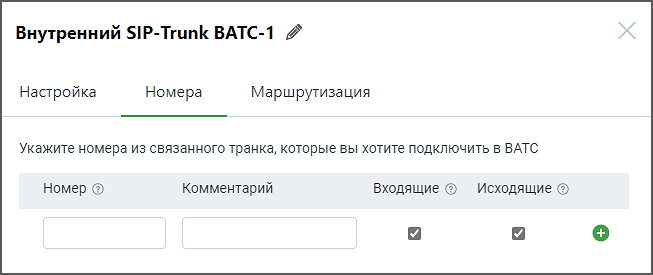

# 3.2.2. Номера

> Трассировка: PDF §3.2.2 · сквозные стр. 14-15 · источники: ч.1 `kb/sources/sip-trunk/MO_SIP_Trunk.pdf` с.14-15.

> **Описание иллюстрации SIPT-§3.2.2-1** (к §3.2.2 «Номера», стр. 14; 653×275 px). Снимок экрана / схема.
> Относится к тексту руководства: «…полей формы, руководствуйтесь инструкциями, предоставленными в разделе Настройки для внешнего SIP Trunk. 3.2.2. Номера».
> Текст на изображении (OCR, требует сверки): Внутренний SIP-Trunk ВАТС-1 4; Настройка; Номера; Маршрутизация; Укажите номера из связанного транка, которые вы хотите подключить в ВАТС; Номер ©; Комментарий; Входящие @ Исходящие ©

Заполните поля: Номер – здесь необходимо указать номера для связанного транка из ВАТС-2 Формат ввода номера - E.164 без пробелов, например 74951234567.

При заполнении остальных полей формы, руководствуйтесь инструкциями, предоставленными в разделе Номера для внешнего SIP Trunk.
